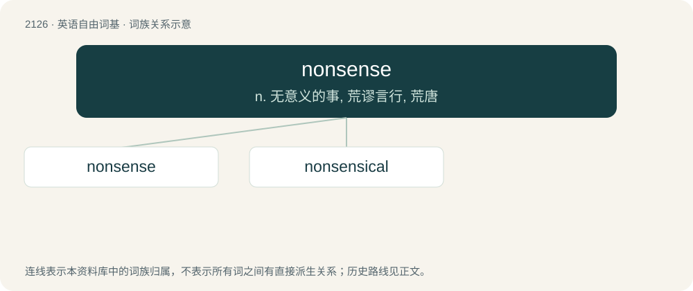

# 2233 · nonsense — n. 无意义的事, 荒谬言行, 荒唐

[总目录](../00_总目录_按常用程度.md)

**类型**：英语自由词基　｜　**来源语言**：见词源记录

## 核心含义与来源

- 核心含义：n. 无意义的事, 荒谬言行, 荒唐
- 英文含义：Letters or words, in writing or speech, that have no meaning or pattern or seem to have no meaning.
- 词形：nonsense

**来源记录 1**（名词；Letters or words, in writing or speech, that have no meaning or pattern or seem to have no meaning.）

From non- (“no, none, lack of”) + sense, from c. 1610. Compare the semantically similar West Frisian ûnsin (“nonsense”), Dutch onzin (“nonsense”), German Unsinn (“nonsense”), English unsense (“nonsense”).

## 词族图

## 单词速览（常用到不常用）

| 单词 | 音标 | 释义 |
|---|---|---|
| [nonsense](#w-1) | 英 /ˈnɒn.səns/；美 /ˈnɑn.sɛns/ | n. 无意义的事, 荒谬言行, 荒唐 |
| [nonsensical](#w-2) | /nɒnˈsensikl/ | a. 无意义的, 荒谬的 |

## 逐词详解

### 1. nonsense

**词性**：名词　｜　**音标**：英 /ˈnɒn.səns/；美 /ˈnɑn.sɛns/

**中文释义**：n. 无意义的事, 荒谬言行, 荒唐

**英文义项**：Letters or words, in writing or speech, that have no meaning or pattern or seem to have no meaning. / An untrue statement.

**构词拆分**：non- + sense；non- (“no, none, lack of”) + sense

**词源与演化**：

From non- (“no, none, lack of”) + sense, from c. 1610. Compare the semantically similar West Frisian ûnsin (“nonsense”), Dutch onzin (“nonsense”), German Unsinn (“nonsense”), English unsense (“nonsense”).

**例句**：

> After my father had a stroke, every time he tried to talk, it sounded like nonsense.

该用例对应义项：Letters or words, in writing or speech, that have no meaning or pattern or seem to have no meaning.

### 2. nonsensical

**词性**：形容词　｜　**音标**：/nɒnˈsensikl/

**中文释义**：a. 无意义的, 荒谬的

**英文义项**：Without sense; absurd.

**构词拆分**：nonsense + -ical

**词源与演化**：

From nonsense + -ical.

**例句**：

> I know this sounds nonsensical, but it is exactly what I feel.
