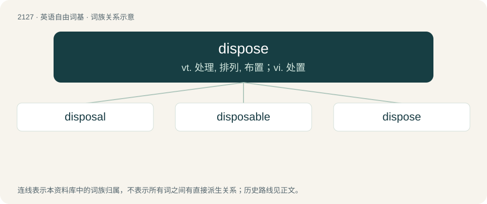

# 2235 · dispose — vt. 处理, 排列, 布置；vi. 处置

[总目录](../00_总目录_按常用程度.md)

**类型**：英语自由词基　｜　**来源语言**：见词源记录

## 核心含义与来源

- 核心含义：vt. 处理, 排列, 布置；vi. 处置
- 英文含义：To eliminate or to get rid of something.
- 词形：dispose

**来源记录 1**（动词；To eliminate or to get rid of something.）

Borrowed from French disposer.

## 词族图

## 单词速览（常用到不常用）

| 单词 | 音标 | 释义 |
|---|---|---|
| [disposal](#w-1) | 英 /dɪsˈpəʊ.zəl/；美 /dɪsˈpoʊ.zəl/ | n. 丢掉, 处理, 排列, 销毁, 布置；\[医\] 处理, 处置 |
| [disposable](#w-2) | 英 /dɪsˈpəʊzəbl̩/；美 /dɪsˈpoʊzəbl̩/ | a. 可任意处理的；\[法\] 可任意处理或处置的, 可自由使用的 |
| [dispose](#w-3) | 英 /dɪˈspəʊz/；美 /dɪsˈpoʊz/ | vt. 处理, 排列, 布置；vi. 处置 |

## 逐词详解

### 1. disposal

**词性**：名词　｜　**音标**：英 /dɪsˈpəʊ.zəl/；美 /dɪsˈpoʊ.zəl/

**中文释义**：n. 丢掉, 处理, 排列, 销毁, 布置；\[医\] 处理, 处置

**英文义项**：A disposition; an arrangement, categorization, or classification of things. / A kick or a handball of the ball during a game.

**构词拆分**：dispose + -al

**词源与演化**：

From dispose + -al.

**例句**：

> A politician must always justify the money he has at his disposal.

### 2. disposable

**词性**：形容词　｜　**音标**：英 /dɪsˈpəʊzəbl̩/；美 /dɪsˈpoʊzəbl̩/

**中文释义**：a. 可任意处理的；\[法\] 可任意处理或处置的, 可自由使用的

**英文义项**：That can be disposed of. / That is designed to be discarded rather than reused, refilled or repaired.

**构词拆分**：dispose + -able

**词源与演化**：

From dispos(e) + -able.

**例句**：

> Rather than purchase an expensive razor he bought a packet of cheap disposable ones.

该用例对应义项：That is designed to be discarded rather than reused, refilled or repaired.

### 3. dispose

**词性**：动词　｜　**音标**：英 /dɪˈspəʊz/；美 /dɪsˈpoʊz/

**中文释义**：vt. 处理, 排列, 布置；vi. 处置

**英文义项**：To eliminate or to get rid of something. / To distribute or arrange; to put in place.

**词源与演化**：

Borrowed from French disposer.

**例句**：

> I dispose of my trash in the garbage can.

该用例对应义项：To eliminate or to get rid of something.
