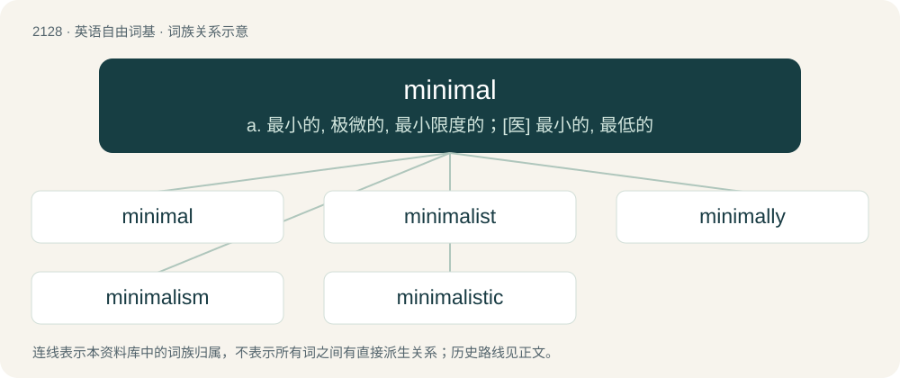

# 2236 · minimal — a. 最小的, 极微的, 最小限度的；\[医\] 最小的, 最低的

[总目录](../00_总目录_按常用程度.md)

**类型**：英语自由词基　｜　**来源语言**：见词源记录

## 核心含义与来源

- 核心含义：a. 最小的, 极微的, 最小限度的；\[医\] 最小的, 最低的
- 英文含义：The smallest possible amount, quantity, or degree.
- 词形：minimal

**来源记录 1**（形容词；The smallest possible amount, quantity, or degree.）

From minimum + -al.

## 词族图

## 单词速览（常用到不常用）

| 单词 | 音标 | 释义 |
|---|---|---|
| [minimal](#w-1) | 英 /ˈmɪn.ɪ.məl/；美 /ˈmɪn.ə.məl/ | a. 最小的, 极微的, 最小限度的；\[医\] 最小的, 最低的 |
| [minimalist](#w-2) | 英 /ˈmɪn.ɪ.məl.ɪst/；美 /ˈmɪn.ə.məl.ɪst/ | n. 极简抽象派艺术家 |
| [minimally](#w-3) |  | adv. 最低限度地；最低程度地 |
| [minimalism](#w-4) | 英 /ˈmɪnɪməlɪzəm/；美 /ˈmɪn.ə.məl.ɪz.əm/ | 最低纲领,极保守行动 |
| [minimalistic](#w-5) |  | 极简化的；简约的 |

## 逐词详解

### 1. minimal

**词性**：形容词　｜　**音标**：英 /ˈmɪn.ɪ.məl/；美 /ˈmɪn.ə.məl/

**中文释义**：a. 最小的, 极微的, 最小限度的；\[医\] 最小的, 最低的

**英文义项**：The smallest possible amount, quantity, or degree. / Among elements of some collection, such that no other element is greater (with respect to some given partial order).

**构词拆分**：minimum + -al

**词源与演化**：

From minimum + -al.

**例句**：

> With minimal effort, you won't be able to achieve all your dreams.

该用例对应义项：The smallest possible amount, quantity, or degree.

### 2. minimalist

**词性**：形容词　｜　**音标**：英 /ˈmɪn.ɪ.məl.ɪst/；美 /ˈmɪn.ə.məl.ɪst/

**中文释义**：n. 极简抽象派艺术家

**英文义项**：Believing in or seeking a minimal state; seeking to minimize or reduce to a minimum.

**构词拆分**：minimal + -ist

**词源与演化**：

From minimal + -ist.

**例句**：

> I am sure such a minimalist style of furniture would never fit well with my packrat nature.

该用例对应义项：Believing in or seeking a minimal state; seeking to minimize or reduce to a minimum.

### 3. minimally

**词性**：副词

**中文释义**：adv. 最低限度地；最低程度地

**英文义项**：In a minimal way; to the least extent.

**构词拆分**：minimal + -ly

**词源与演化**：

From minimal + -ly.

**用法示例／搭配（非完整句）**：

> minimally invasive surgery

该用例对应义项：In a minimal way; to the least extent.

### 4. minimalism

**词性**：名词　｜　**音标**：英 /ˈmɪnɪməlɪzəm/；美 /ˈmɪn.ə.məl.ɪz.əm/

**中文释义**：最低纲领,极保守行动

**英文义项**：A style of art that emphasises extreme simplicity of form. / A style of music that emphasises extreme simplicity of rhythms and melodic forms to achieve a trancelike effect.

**构词拆分**：minimal + -ism

**词源与演化**：

From minimal + -ism.

**例句**：

> He enjoys the pared-down simplicity of minimalism.

### 5. minimalistic

**词性**：形容词

**中文释义**：极简化的；简约的

**英文义项**：Exhibiting or relating to minimalism.

**构词拆分**：minimal + -istic

**词源与演化**：

From minimal + -istic.

**例句**：

> Mary's approach to beauty is minimalistic yet effective.
