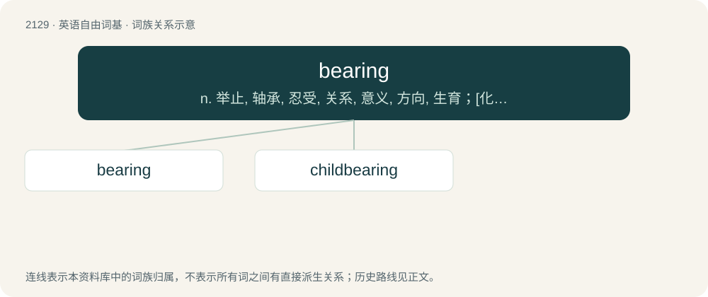

# 2238 · bearing — n. 举止, 轴承, 忍受, 关系, 意义, 方向, 生育；\[化\] 轴承

[总目录](../00_总目录_按常用程度.md)

**类型**：英语自由词基　｜　**来源语言**：见词源记录

## 核心含义与来源

- 核心含义：n. 举止, 轴承, 忍受, 关系, 意义, 方向, 生育；\[化\] 轴承
- 英文含义：That bears (some specified thing).
- 词形：bearing

**多个词源／构词路径**：同一拼写可能有不同来源；以下按词性和含义分别列出。

**来源记录 1**（形容词；That bears (some specified thing).）

From Middle English beringe, berynge, berende, berande, berand, from Old English berende (“bearing; fruitful”) (also as synonym Old English bǣrende), from Proto-Germanic \*berandz, present participle of Proto-Germanic \*beraną (“to bear; carry”), equivalent to bear + -ing.

**来源记录 2**（名词；A mechanical device that supports another part or reduces friction.）

From Middle English bering, beringe, berynge, equivalent to bear + -ing.

## 词族图

## 单词速览（常用到不常用）

| 单词 | 音标 | 释义 |
|---|---|---|
| [bearing](#w-1) | 英 /ˈbɛə̯ɹɪŋ/；美 /ˈbɛɹɪŋ/ | n. 举止, 轴承, 忍受, 关系, 意义, 方向, 生育；\[化\] 轴承 |
| [childbearing](#w-2) | /ˈtʃaildbєəriŋ/ | n. 分娩；\[医\] 分娩, 生产 |

## 逐词详解

### 1. bearing

**词性**：形容词　｜　**音标**：英 /ˈbɛə̯ɹɪŋ/；美 /ˈbɛɹɪŋ/

**中文释义**：n. 举止, 轴承, 忍受, 关系, 意义, 方向, 生育；\[化\] 轴承

**英文义项**：That bears (some specified thing). / Of a beam, column, or other device, carrying weight or load.

**构词拆分**：bear + -ing

**词源与演化**：

From Middle English beringe, berynge, berende, berande, berand, from Old English berende (“bearing; fruitful”) (also as synonym Old English bǣrende), from Proto-Germanic \*berandz, present participle of Proto-Germanic \*beraną (“to bear; carry”), equivalent to bear + -ing.

**例句**：

> That's a bearing wall.

该用例对应义项：Of a beam, column, or other device, carrying weight or load.

### 2. childbearing

**词性**：名词　｜　**音标**：/ˈtʃaildbєəriŋ/

**中文释义**：n. 分娩；\[医\] 分娩, 生产

**英文义项**：The process of giving birth; pregnancy and parturition.

**构词拆分**：By surface analysis, child + bearing

**词源与演化**：

From Middle English childberyng, childbering, chyldberynge, child berynge. By surface analysis, child + bearing.

**用法示例／搭配（非完整句）**：

> women of childbearing age

该用例对应义项：The process of giving birth; pregnancy and parturition.
