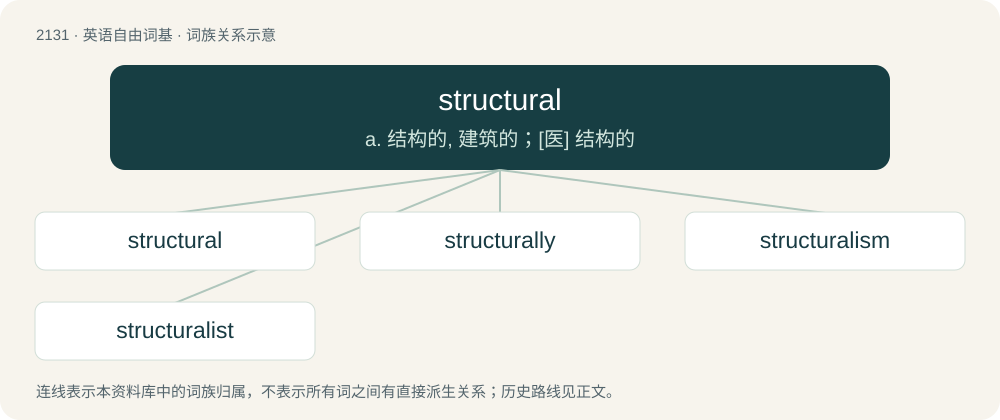

# 2239 · structural — a. 结构的, 建筑的；\[医\] 结构的

[总目录](../00_总目录_按常用程度.md)

**类型**：英语自由词基　｜　**来源语言**：见词源记录

## 核心含义与来源

- 核心含义：a. 结构的, 建筑的；\[医\] 结构的
- 英文含义：Of, relating to, or having structure.
- 词形：structural

**来源记录 1**（形容词；Of, relating to, or having structure.）

From structure + -al, 19th century.

## 词族图

## 单词速览（常用到不常用）

| 单词 | 音标 | 释义 |
|---|---|---|
| [structural](#w-1) | 美 /ˈstɹʌk(t͡)ʃəɹəl/ | a. 结构的, 建筑的；\[医\] 结构的 |
| [structurally](#w-2) |  | \[计\] 结构地 |
| [structuralism](#w-3) | /ˈstrʌktʃərəlizm/ | n. 结构主义 |
| [structuralist](#w-4) | /ˈstrʌktʃərəlist/ | n. 结构主义者, 结构语言学家 |

## 逐词详解

### 1. structural

**词性**：形容词　｜　**音标**：美 /ˈstɹʌk(t͡)ʃəɹəl/

**中文释义**：a. 结构的, 建筑的；\[医\] 结构的

**英文义项**：Of, relating to, or having structure. / Involving the mechanics of construction.

**构词拆分**：structure + -al

**词源与演化**：

From structure + -al, 19th century.

**例句**：

> The structural details of a house such as beams and joists and rafters; not ornamental elements.

该用例对应义项：affecting or involved in structure or construction

### 2. structurally

**词性**：副词

**中文释义**：\[计\] 结构地

**英文义项**：In terms of structure.

**构词拆分**：structural + -ly

**词源与演化**：

From structural + -ly.

**例句**：

> After the hurricane, the building was structurally sound but aesthetically displeasing.

该用例对应义项：In terms of structure.

### 3. structuralism

**词性**：名词　｜　**音标**：/ˈstrʌktʃərəlizm/

**中文释义**：n. 结构主义

**英文义项**：A theory of sociology that views elements of society as part of a cohesive, self-supporting structure. / A school of biological thought that deals with the law-like behaviour of the structure of organisms and how it can change, emphasising that organisms are wholes, and therefore that change in one part must necessarily take into account the inter-connected nature of the entire organism.

**构词拆分**：structural + -ism

**词源与演化**：

From structural + -ism.

**例句**：

> Structuralism has value in modern literature.

### 4. structuralist

**词性**：形容词　｜　**音标**：/ˈstrʌktʃərəlist/

**中文释义**：n. 结构主义者, 结构语言学家

**英文义项**：Of or pertaining to structuralism.

**构词拆分**：structural + -ist

**词源与演化**：

From structural + -ist.

**例句**：

> I argue that the structuralist theory suffers from a number of irredeemable flaws that render it of little or no value.
