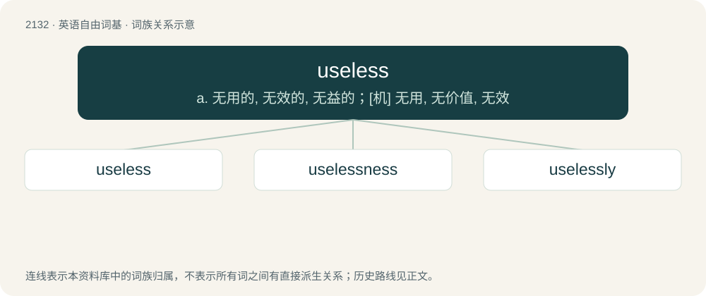

# 2240 · useless — a. 无用的, 无效的, 无益的；\[机\] 无用, 无价值, 无效

[总目录](../00_总目录_按常用程度.md)

**类型**：英语自由词基　｜　**来源语言**：见词源记录

## 核心含义与来源

- 核心含义：a. 无用的, 无效的, 无益的；\[机\] 无用, 无价值, 无效
- 英文含义：Without use or the possibility to be used.
- 词形：useless

**来源记录 1**（形容词；Without use or the possibility to be used.）

From use + -less.

## 词族图

## 单词速览（常用到不常用）

| 单词 | 音标 | 释义 |
|---|---|---|
| [useless](#w-1) | 英 /ˈjuːs.ləs/；美 /ˈjus.ləs/ | a. 无用的, 无效的, 无益的；\[机\] 无用, 无价值, 无效 |
| [uselessness](#w-2) | /ˈjuːsləsnəs/ | n. 无用 |
| [uselessly](#w-3) | /ˈjuːsləslɪ/ | adv. 无益地, 无用地 |

## 逐词详解

### 1. useless

**词性**：形容词　｜　**音标**：英 /ˈjuːs.ləs/；美 /ˈjus.ləs/

**中文释义**：a. 无用的, 无效的, 无益的；\[机\] 无用, 无价值, 无效

**英文义项**：Without use or the possibility to be used. / Unhelpful, not useful; pointless (of an action).

**构词拆分**：use + -less

**词源与演化**：

From use + -less.

**例句**：

> I think it's useless to keep this discussion going. It's like talking to a brick wall.

该用例对应义项：Unhelpful, not useful; pointless (of an action).

### 2. uselessness

**词性**：名词　｜　**音标**：/ˈjuːsləsnəs/

**中文释义**：n. 无用

**英文义项**：The state or quality of being useless.

**构词拆分**：useless + -ness

**词源与演化**：

From useless + -ness.

**例句**：

> The best doctor is the one who knows about the uselessness of the majority of medicines.

### 3. uselessly

**词性**：副词　｜　**音标**：/ˈjuːsləslɪ/

**中文释义**：adv. 无益地, 无用地

**英文义项**：In a useless manner. / To no useful purpose.

**构词拆分**：useless + -ly

**词源与演化**：

From useless + -ly.

**例句**：

> The furniture was sitting around uselessly.

该用例对应义项：in a useless manner
