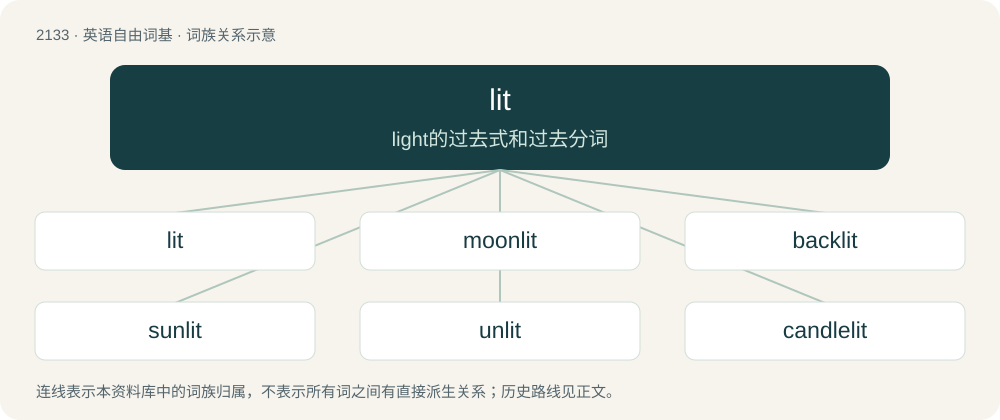

# 2241 · lit — light的过去式和过去分词

[总目录](../00_总目录_按常用程度.md)

**类型**：英语自由词基　｜　**来源语言**：见词源记录

## 核心含义与来源

- 核心含义：light的过去式和过去分词
- 英文含义：To run or light (alight).
- 词形：lit

**多个词源／构词路径**：同一拼写可能有不同来源；以下按词性和含义分别列出。

**来源记录 1**（动词；To run or light (alight).）

Alteration of earlier light, from Middle English lighte, from Old English līhtte, first and third person singular preterite of līhtan (“to light”), by analogy with bit. More at light; compare fit (“fought”). This form was proscribed during the 18th and 19th centuries, with lighted being preferred, but is now the most common past form of light.

**来源记录 2**（名词；Colour; blee; dye; stain.）

From Middle English lit, from Old Norse litr (“colour, dye, complexion, face, countenance”), from Proto-Germanic \*wlitiz, \*wlitaz (“sight, face”), from Proto-Indo-European \*wel- (“to see”). Cognate with Icelandic litur (“colour”), Old English wlite (“brightness, appearance, form, aspect, look, countenance, beauty, splendor, adornment”), Old English wlītan (“to gaze, look, observe”).

**来源记录 3**（动词；To colour; dye.）

From Middle English litten, liten, from Old Norse lita (“to colour”), from litr (“colour”). See above.

## 词族图

## 单词速览（常用到不常用）

| 单词 | 音标 | 释义 |
|---|---|---|
| [lit](#w-1) | /ˈlɪt/ | light的过去式和过去分词 |
| [moonlit](#w-2) | /ˈmuːnˌlɪt/ | a. 月光照耀的 |
| [backlit](#w-3) | 美 /ˈbækˌlɪt/ | n. 后面打光；背光式 |
| [sunlit](#w-4) | 英 /ˈsʌnlɪt/；美 /ˈsʌnˌlɪt/ | a. 阳光照射的 |
| [unlit](#w-5) | /ˈʌnˈlit/ | a. 未点燃的, 无灯光的 |
| [candlelit](#w-6) | /ˈkæn.dl̩ˌlɪt/ | a. （房间、饭桌）点蜡烛的, 用烛光照明的 |

## 逐词详解

### 1. lit

**词性**：形容词　｜　**音标**：/ˈlɪt/

**中文释义**：light的过去式和过去分词

**英文义项**：Illuminated. / Drunk, intoxicated; under the influence of drugs or alcohol.

**词源与演化**：

Alteration of earlier light, from Middle English lighte, from Old English līhtte, first and third person singular preterite of līhtan (“to light”), by analogy with bit. More at light; compare fit (“fought”). This form was proscribed during the 18th and 19th centuries, with lighted being preferred, but is now the most common past form of light.

**例句**：

> He walked down the lit corridor.

该用例对应义项：Illuminated.

### 2. moonlit

**词性**：形容词　｜　**音标**：/ˈmuːnˌlɪt/

**中文释义**：a. 月光照耀的

**英文义项**：Lit by moonlight.

**构词拆分**：moon + lit

**词源与演化**：

From moon + lit. Compare Saterland Frisian mouneljoacht (“moonlit”), West Frisian moanneljocht (“moonlit”), Dutch maanverlicht (“moonlit”), Danish månelys (“moonlit”), Swedish månljus (“moonlit”).

**例句**：

> Mary loves gazing at the moonlit clouds floating across the night sky.

### 3. backlit

**词性**：形容词　｜　**音标**：美 /ˈbækˌlɪt/

**中文释义**：n. 后面打光；背光式

**英文义项**：Lit or illuminated from behind.

**构词拆分**：back + lit

**词源与演化**：

From back + lit.

**例句**：

> Tom is backlit in this picture. That's why you can't make out his face.

### 4. sunlit

**词性**：形容词　｜　**音标**：英 /ˈsʌnlɪt/；美 /ˈsʌnˌlɪt/

**中文释义**：a. 阳光照射的

**英文义项**：Illuminated by sunlight.

**构词拆分**：sun + lit

**词源与演化**：

From sun + lit.

**例句**：

> The sunlit slopes of the canyon.

该用例对应义项：lighted by sunlight

### 5. unlit

**词性**：形容词　｜　**音标**：/ˈʌnˈlit/

**中文释义**：a. 未点燃的, 无灯光的

**英文义项**：Not lit

**构词拆分**：un- + lit

**词源与演化**：

From un- + lit.

**例句**：

> Held an unlit cigarette.

该用例对应义项：not set afire or burning

### 6. candlelit

**词性**：形容词　｜　**音标**：/ˈkæn.dl̩ˌlɪt/

**中文释义**：a. （房间、饭桌）点蜡烛的, 用烛光照明的

**英文义项**：Lit by a candle or candles.

**构词拆分**：candle + lit

**词源与演化**：

From candle + lit.

**例句**：

> Tom and Mary had a candlelit dinner together on Valentine's Day.
