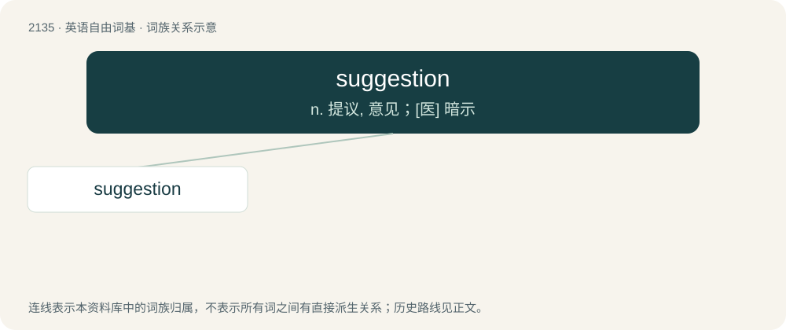

# 2242 · suggestion — n. 提议, 意见；\[医\] 暗示

[总目录](../00_总目录_按常用程度.md)

**类型**：英语自由词基　｜　**来源语言**：见词源记录

## 核心含义与来源

- 核心含义：n. 提议, 意见；\[医\] 暗示
- 英文含义：Something suggested (with subsequent adposition being for)
- 词形：suggestion

**来源记录 1**（名词；Something suggested (with subsequent adposition being for)）

From Middle English suggestion, from Anglo-Norman suggestioun, sugestiun, from Latin suggestiō, from suggerō (“suggest”, verb), from Latin sub- (“from below, up”) + gerō (“to bring”). Equivalent to suggest + -ion. Related to English up-, cast.

## 词族图

## 单词速览（常用到不常用）

| 单词 | 音标 | 释义 |
|---|---|---|
| [suggestion](#w-1) | 英 /səˈd͡ʒɛst.ʃən/；美 /sə(ɡ)ˈd͡ʒɛs.t͡ʃən/ | n. 提议, 意见；\[医\] 暗示 |

## 逐词详解

### 1. suggestion

**词性**：名词　｜　**音标**：英 /səˈd͡ʒɛst.ʃən/；美 /sə(ɡ)ˈd͡ʒɛs.t͡ʃən/

**中文释义**：n. 提议, 意见；\[医\] 暗示

**英文义项**：Something suggested (with subsequent adposition being for) / The act of suggesting.

**构词拆分**：suggest + -ion

**词源与演化**：

From Middle English suggestion, from Anglo-Norman suggestioun, sugestiun, from Latin suggestiō, from suggerō (“suggest”, verb), from Latin sub- (“from below, up”) + gerō (“to bring”). Equivalent to suggest + -ion. Related to English up-, cast.

**例句**：

> I have a small suggestion for fixing this: try lifting the left side up a bit.

该用例对应义项：Something suggested (with subsequent adposition being for)
