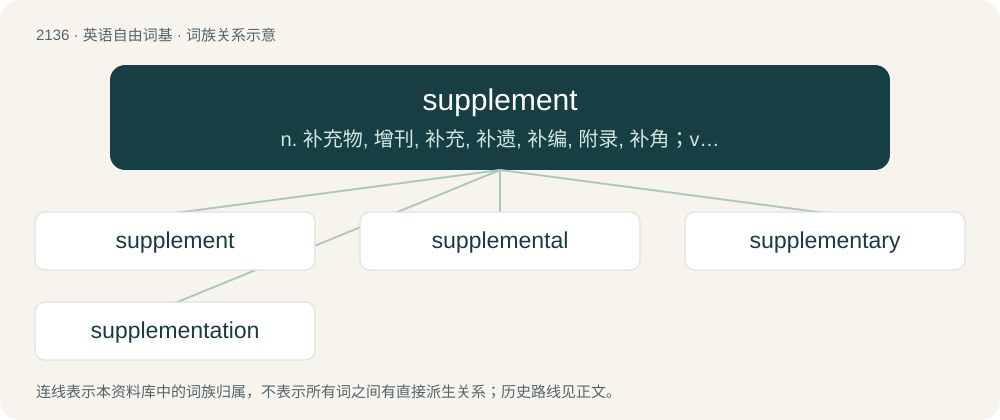

# 2243 · supplement — n. 补充物, 增刊, 补充, 补遗, 补编, 附录, 补角；vt. 补充, 增补

[总目录](../00_总目录_按常用程度.md)

**类型**：英语自由词基　｜　**来源语言**：见词源记录

## 核心含义与来源

- 核心含义：n. 补充物, 增刊, 补充, 补遗, 补编, 附录, 补角；vt. 补充, 增补
- 英文含义：Something added; especially, such an addition added to make up for a deficiency.
- 词形：supplement

**来源记录 1**（名词；Something added; especially, such an addition added to make up for a deficiency.）

From Latin supplementum (“that which is added to supply a shortage”), from supplere (“to provide something”).

## 词族图

## 单词速览（常用到不常用）

| 单词 | 音标 | 释义 |
|---|---|---|
| [supplement](#w-1) | 英 /ˈsʌp.lɪ.mənt/；美 /ˈsʌp.lə.mənt/ | n. 补充物, 增刊, 补充, 补遗, 补编, 附录, 补角；vt. 补充, 增补 |
| [supplemental](#w-2) | 英 /ˌsʌplɪˈmɛntəl/；美 /ˌsʌpləˈmɛntəl/ | a. 补足的, 追加的；\[医\] 补充的, 补足的 |
| [supplementary](#w-3) | /.sʌpliˈmentəri/ | a. 补足的, 补充的, 追加的；\[经\] 追加的, 补充的, 增补的 |
| [supplementation](#w-4) | /,sʌplimenˈteiʃən/ | n. 增补, 补足, 补充 |

## 逐词详解

### 1. supplement

**词性**：名词　｜　**音标**：英 /ˈsʌp.lɪ.mənt/；美 /ˈsʌp.lə.mənt/

**中文释义**：n. 补充物, 增刊, 补充, 补遗, 补编, 附录, 补角；vt. 补充, 增补

**英文义项**：Something added; especially, such an addition added to make up for a deficiency. / An extension to a document or publication that adds information, corrects errors, or brings up to date.

**词源与演化**：

From Latin supplementum (“that which is added to supply a shortage”), from supplere (“to provide something”).

**例句**：

> Vitamins, minerals, and essential fatty acids must come from either the diet or supplements.

该用例对应义项：A vitamin, herbal extract, or chemical compound ingested to meet dietary deficiencies or enhance muscular development; the dosage form that conveys or embodies it (e.g., tablet, capsule, pill, powder, beverage).

### 2. supplemental

**词性**：形容词　｜　**音标**：英 /ˌsʌplɪˈmɛntəl/；美 /ˌsʌpləˈmɛntəl/

**中文释义**：a. 补足的, 追加的；\[医\] 补充的, 补足的

**英文义项**：Acting to supplement. / Appending.

**构词拆分**：From supplement + -al.

**词源与演化**：

From supplement + -al.

**例句**：

> Good personal investments may provide supplemental income in retirement.

### 3. supplementary

**词性**：形容词　｜　**音标**：/.sʌpliˈmentəri/

**中文释义**：a. 补足的, 补充的, 追加的；\[经\] 追加的, 补充的, 增补的

**英文义项**：Additional; added to supply what is wanted.

**构词拆分**：supplement + -ary

**词源与演化**：

From supplement + -ary; compare French supplémentaire.

**例句**：

> Supplementary information includes adverbs and things that function as adverbs.

### 4. supplementation

**词性**：名词　｜　**音标**：/,sʌplimenˈteiʃən/

**中文释义**：n. 增补, 补足, 补充

**英文义项**：The act of supplementing / Something added as a supplement

**构词拆分**：supplement + -ation

**词源与演化**：

From supplement + -ation.
