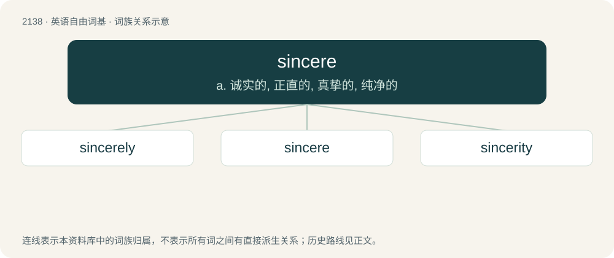

# 2246 · sincere — a. 诚实的, 正直的, 真挚的, 纯净的

[总目录](../00_总目录_按常用程度.md)

**类型**：英语自由词基　｜　**来源语言**：见词源记录

## 核心含义与来源

- 核心含义：a. 诚实的, 正直的, 真挚的, 纯净的
- 英文含义：Genuine, honest, and free from pretense or deceit; heartfelt.
- 词形：sincere

**来源记录 1**（形容词；Genuine, honest, and free from pretense or deceit; heartfelt.）

From Middle French sincere, from Latin sincerus (“genuine”), from Proto-Indo-European \*sem- (“together”) (whence English sam) + \*ḱer- (“grow”) (whence Latin Ceres, the goddess of harvest, etymon of cereal). Not from sine (“without”) + cera (“wax”), which is a folk etymology; see Wikipedia page.

## 词族图

## 单词速览（常用到不常用）

| 单词 | 音标 | 释义 |
|---|---|---|
| [sincerely](#w-1) | 英 /sɪnˈsɪəli/；美 /sɪnˈsɪɹli/ | adv. 真诚地 |
| [sincere](#w-2) | 英 /sɪnˈsɪə(ɹ)/；美 /sɪnˈsɪɹ/ | a. 诚实的, 正直的, 真挚的, 纯净的 |
| [sincerity](#w-3) | /sɪnˈsɛɹəti/ | n. 诚实, 真实, 诚心诚意 |

## 逐词详解

### 1. sincerely

**词性**：副词　｜　**音标**：英 /sɪnˈsɪəli/；美 /sɪnˈsɪɹli/

**中文释义**：adv. 真诚地

**英文义项**：In a sincere or earnest manner; honestly. / A conventional formula for ending a letter, used when the salutation addresses the person for whom the letter is intended by his or her name.

**构词拆分**：sincere + -ly

**词源与演化**：

From sincere + -ly, from Latin sincērus (“pure, clean, sound”).

**例句**：

> I sincerely hope they make it home safely.

该用例对应义项：In a sincere or earnest manner; honestly.

### 2. sincere

**词性**：形容词　｜　**音标**：英 /sɪnˈsɪə(ɹ)/；美 /sɪnˈsɪɹ/

**中文释义**：a. 诚实的, 正直的, 真挚的, 纯净的

**英文义项**：Genuine, honest, and free from pretense or deceit; heartfelt. / Meant truly or earnestly.

**词源与演化**：

From Middle French sincere, from Latin sincerus (“genuine”), from Proto-Indo-European \*sem- (“together”) (whence English sam) + \*ḱer- (“grow”) (whence Latin Ceres, the goddess of harvest, etymon of cereal). Not from sine (“without”) + cera (“wax”), which is a folk etymology; see Wikipedia page.

**例句**：

> I believe he is sincere in his offer to help.

该用例对应义项：Genuine, honest, and free from pretense or deceit; heartfelt.

### 3. sincerity

**词性**：名词　｜　**音标**：/sɪnˈsɛɹəti/

**中文释义**：n. 诚实, 真实, 诚心诚意

**英文义项**：The quality or state of being sincere.

**构词拆分**：sincere + -ity

**词源与演化**：

From Middle English sinceritie, from Old French sincerité and Medieval Latin sincēritās; both from Latin sincēritās, from sincērus + -tās. Equivalent to sincere + -ity.

**例句**：

> His sincerity inspired belief.

该用例对应义项：the quality of being open and truthful; not deceitful or hypocritical
