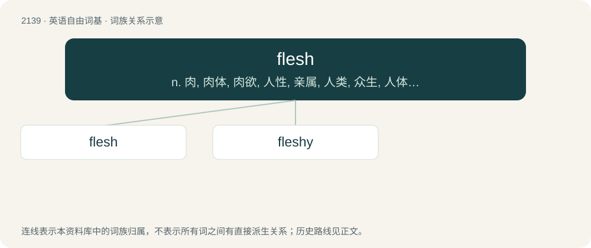

# 2247 · flesh — n. 肉, 肉体, 肉欲, 人性, 亲属, 人类, 众生, 人体；vt. 以肉喂, 激起...的杀戳情绪, 使肥, 赋以血肉；vi. 长胖

[总目录](../00_总目录_按常用程度.md)

**类型**：英语自由词基　｜　**来源语言**：见词源记录

## 核心含义与来源

- 核心含义：n. 肉, 肉体, 肉欲, 人性, 亲属, 人类, 众生, 人体；vt. 以肉喂, 激起...的杀戳情绪, 使肥, 赋以血肉；vi. 长胖
- 英文含义：The soft tissue of the body, especially muscle and fat.
- 词形：flesh

**来源记录 1**（名词；The soft tissue of the body, especially muscle and fat.）

From Middle English flesh, flesch, flæsch, from Old English flǣsċ, from Proto-West Germanic \*flaiski, from Proto-Germanic \*flaiski, from Proto-Indo-European \*pleh₁ḱ- (“to tear, peel off”). Cognates Cognate with Yola vleash, vlesh (“flesh”), North Frisian flaasch, flaosk, Fleesk, fleäsk, floask, flääsk, flååsch (“flesh, meat”), Saterland Frisian Flaask (“flesh, meat”), West Frisian fleis (“flesh, meat”), Cimbrian blòas, vlaisch, vlòas (“flesh, meat”), Dutch vlees, vleesch (“flesh, meat”), German Fleisch (“flesh, meat”), German Low German and Luxembourgish Fleesch (“flesh, meat”), Vilamovian fłaś (“meat; muscle”), Yiddish פֿלייש (fleysh, “flesh, meat”), Danish flæsk (“pork; bacon”), Faroese, Icelandic, and Norwegian Nynorsk flesk (“pork; bacon”), Swedish fläsk (“pork”).

## 词族图

## 单词速览（常用到不常用）

| 单词 | 音标 | 释义 |
|---|---|---|
| [flesh](#w-1) | /flɛʃ/ | n. 肉, 肉体, 肉欲, 人性, 亲属, 人类, 众生, 人体；vt. 以肉喂, 激起...的杀戳情绪, 使肥, 赋以血肉；vi. 长胖 |
| [fleshy](#w-2) | /ˈflɛʃi/ | a. 肉的, 肉体的 |

## 逐词详解

### 1. flesh

**词性**：名词　｜　**音标**：/flɛʃ/

**中文释义**：n. 肉, 肉体, 肉欲, 人性, 亲属, 人类, 众生, 人体；vt. 以肉喂, 激起...的杀戳情绪, 使肥, 赋以血肉；vi. 长胖

**英文义项**：The soft tissue of the body, especially muscle and fat. / The skin of a human or animal.

**词源与演化**：

From Middle English flesh, flesch, flæsch, from Old English flǣsċ, from Proto-West Germanic \*flaiski, from Proto-Germanic \*flaiski, from Proto-Indo-European \*pleh₁ḱ- (“to tear, peel off”). Cognates Cognate with Yola vleash, vlesh (“flesh”), North Frisian flaasch, flaosk, Fleesk, fleäsk, floask, flääsk, flååsch (“flesh, meat”), Saterland Frisian Flaask (“flesh, meat”), West Frisian fleis (“flesh, meat”), Cimbrian blòas, vlaisch, vlòas (“flesh, meat”), Dutch vlees, vleesch (“flesh, meat”), German Fleisch (“flesh, meat”), German Low German and Luxembourgish Fleesch (“flesh, meat”), Vilamovian fłaś (“meat; muscle”), Yiddish פֿלייש (fleysh, “flesh, meat”), Danish flæsk (“pork; bacon”), Faroese, Icelandic, and Norwegian Nynorsk flesk (“pork; bacon”), Swedish fläsk (“pork”).

**例句**：

> The spirit is willing but the flesh is weak.

该用例对应义项：alternative names for the body of a human being

### 2. fleshy

**词性**：形容词　｜　**音标**：/ˈflɛʃi/

**中文释义**：a. 肉的, 肉体的

**英文义项**：Of, related to, or resembling flesh. / Having considerable flesh; plump.

**构词拆分**：flesh + -y

**词源与演化**：

From Middle English fleisshy, fleischy, fleschi, equivalent to flesh + -y. Piecewise doublet of fleischig.

**用法示例／搭配（非完整句）**：

> a fleshy wine

该用例对应义项：Rich and smooth, with significant body or texture.
