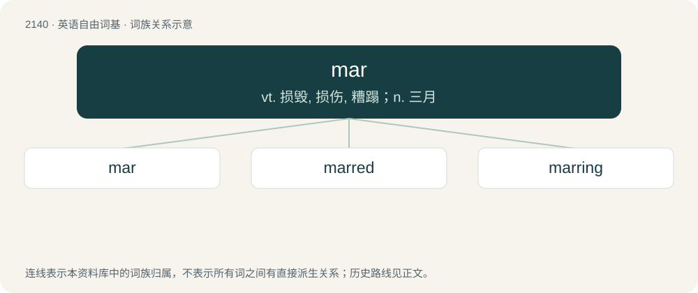

# 2248 · mar — vt. 损毁, 损伤, 糟蹋；n. 三月

[总目录](../00_总目录_按常用程度.md)

**类型**：英语自由词基　｜　**来源语言**：见词源记录

## 核心含义与来源

- 核心含义：vt. 损毁, 损伤, 糟蹋；n. 三月
- 英文含义：To spoil; to ruin; to scathe; to damage.
- 词形：mar

**来源记录 1**（动词；To spoil; to ruin; to scathe; to damage.）

Inherited from Middle English merren, from Old English mierran (“to mar, disturb, confuse; scatter, squander, waste; upset, hinder, obstruct; err”), from Proto-Germanic \*marzijaną (“to disturb, hinder”), from Proto-Indo-European \*mers- (“to annoy, disturb, neglect, forget, ignore”). Cognate with Scots mer, mar (“to obstruct, impede, spoil, ruin”), Dutch marren (“to push along, delay, hinder”), dialectal German merren (“to entangle”), Icelandic merja (“to bruise, crush”), Gothic 𐌼𐌰𐍂𐌶𐌾𐌰𐌽 (marzjan, “to annoy, bother, disturb, offend”), Lithuanian miršti (“to forget, lose, become oblivious, die”), Armenian մոռանալ (moṙanal, “to forget, fail”), Sanskrit मृष् (mṛṣ, “forget, neglect”).

## 词族图

## 单词速览（常用到不常用）

| 单词 | 音标 | 释义 |
|---|---|---|
| [mar](#w-1) | 英 /mɑː(ɹ)/；美 /mɑɹ/ | vt. 损毁, 损伤, 糟蹋；n. 三月 |
| [marred](#w-2) | /mɑːd/ | v. 毁坏, 损坏, 玷污( mar的过去式和过去分词 ) |
| [marring](#w-3) | /ˈmɑːrɪŋ/ | v. 毁坏, 损坏, 玷污( mar的现在分词 ) |

## 逐词详解

### 1. mar

**词性**：动词　｜　**音标**：英 /mɑː(ɹ)/；美 /mɑɹ/

**中文释义**：vt. 损毁, 损伤, 糟蹋；n. 三月

**英文义项**：To spoil; to ruin; to scathe; to damage.

**词源与演化**：

Inherited from Middle English merren, from Old English mierran (“to mar, disturb, confuse; scatter, squander, waste; upset, hinder, obstruct; err”), from Proto-Germanic \*marzijaną (“to disturb, hinder”), from Proto-Indo-European \*mers- (“to annoy, disturb, neglect, forget, ignore”). Cognate with Scots mer, mar (“to obstruct, impede, spoil, ruin”), Dutch marren (“to push along, delay, hinder”), dialectal German merren (“to entangle”), Icelandic merja (“to bruise, crush”), Gothic 𐌼𐌰𐍂𐌶𐌾𐌰𐌽 (marzjan, “to annoy, bother, disturb, offend”), Lithuanian miršti (“to forget, lose, become oblivious, die”), Armenian մոռանալ (moṙanal, “to forget, fail”), Sanskrit मृष् (mṛṣ, “forget, neglect”).

**例句**：

> María burst into tears upon hearing about the death of her brother.

### 2. marred

**词性**：形容词　｜　**音标**：/mɑːd/

**中文释义**：v. 毁坏, 损坏, 玷污( mar的过去式和过去分词 )

**英文义项**：Spoiled; harmed or damaged. / Spoilt, cosseted, overly indulged, soft.

**构词拆分**：mar + -ed

**词源与演化**：

From Middle English marred, merred (“troubled, distressed, vexed, bewildered”), from Old English \*mierred, ġemyrred (“disturbed, troubled”), past participle of Old English mierran, ġemyrran (“to hinder, obstruct, force, trouble, err”), equivalent to mar + -ed.

**例句**：

> The threat of terrorism has marred the lead up to the Winter Olympics.

### 3. marring

**词性**：名词　｜　**音标**：/ˈmɑːrɪŋ/

**中文释义**：v. 毁坏, 损坏, 玷污( mar的现在分词 )

**英文义项**：Something that mars or spoils; a blemish.

**构词拆分**：From mar + -ing.

**词源与演化**：

From mar + -ing.

**例句**：

> In order to thaw frozen meat without marring its flavor, it is best practice to do so slowly and at a low temperature.
