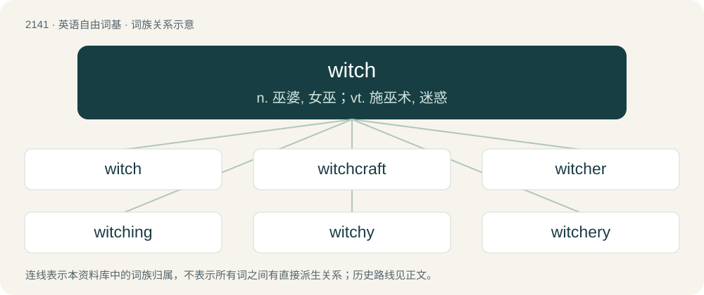

# 2250 · witch — n. 巫婆, 女巫；vt. 施巫术, 迷惑

[总目录](../00_总目录_按常用程度.md)

**类型**：英语自由词基　｜　**来源语言**：见词源记录

## 核心含义与来源

- 核心含义：n. 巫婆, 女巫；vt. 施巫术, 迷惑
- 英文含义：To bewitch.
- 词形：witch

**多个词源／构词路径**：同一拼写可能有不同来源；以下按词性和含义分别列出。

**来源记录 1**（动词；To bewitch.）

From Middle English wicchen, from Old English wiċċian, from Proto-Germanic \*wikkōną, from Proto-Indo-European \*wik-néh₂-, derivation of \*weyk-. In the senses arising in Middle English and later probably aphetic from bewitch.

**来源记录 2**（名词；A cone of paper which is placed in a vessel of lard or other fat and used as a taper.）

Compare wick.

**来源记录 3**（名词；A bitch.）

Chosen for its euphemistic rhyme.

## 词族图

## 单词速览（常用到不常用）

| 单词 | 音标 | 释义 |
|---|---|---|
| [witch](#w-1) | /wɪt͡ʃ/ | n. 巫婆, 女巫；vt. 施巫术, 迷惑 |
| [witchcraft](#w-2) | 英 /ˈwɪt͡ʃkɹɑːft/；美 /ˈwɪt͡ʃkɹæft/ | n. 巫术, 魔法, 魔力 |
| [witcher](#w-3) | 美 /ˈwɪt͡ʃɚ/ | \[人名\] 威彻 |
| [witching](#w-4) | /ˈwɪt͡ʃɪŋ/ | a. 有魔力的, 迷人的 |
| [witchy](#w-5) | /ˈwɪt͡ʃi/ | a. 像巫师的；与巫师有关的 |
| [witchery](#w-6) | /ˈwitʃəri/ | n. 巫术, 魅力 |
| [bewitch](#w-7) | /bəˈwɪt͡ʃ/ | vt. 施魔法于, 蛊惑, 使着迷 |

## 逐词详解

### 1. witch

**词性**：动词　｜　**音标**：/wɪt͡ʃ/

**中文释义**：n. 巫婆, 女巫；vt. 施巫术, 迷惑

**英文义项**：To bewitch.

**词源与演化**：

From Middle English wicchen, from Old English wiċċian, from Proto-Germanic \*wikkōną, from Proto-Indo-European \*wik-néh₂-, derivation of \*weyk-. In the senses arising in Middle English and later probably aphetic from bewitch.

**例句**：

> The nurse was a witch, though the king did not know it.

### 2. witchcraft

**词性**：名词　｜　**音标**：英 /ˈwɪt͡ʃkɹɑːft/；美 /ˈwɪt͡ʃkɹæft/

**中文释义**：n. 巫术, 魔法, 魔力

**英文义项**：The practice of witches; magic, sorcery, or the use of supernatural powers to influence or predict events. / Black magic; the use of witchcraft for evil means.

**构词拆分**：witch + -craft

**词源与演化**：

From Middle English wicchecraft, wicchecreft, from Old English wiċċecræft, equivalent to witch + -craft.

**例句**：

> The Bible warns against the use of witchcraft and sorcery.

该用例对应义项：Black magic; the use of witchcraft for evil means.

### 3. witcher

**词性**：名词　｜　**音标**：美 /ˈwɪt͡ʃɚ/

**中文释义**：\[人名\] 威彻

**英文义项**：A dowser.

**构词拆分**：witch + -er

**词源与演化**：

From witch + -er, from the popular belief that dowsing was a supernatural act.

### 4. witching

**词性**：形容词　｜　**音标**：/ˈwɪt͡ʃɪŋ/

**中文释义**：a. 有魔力的, 迷人的

**英文义项**：Of or pertaining to witchcraft or sorcery, or to witches or sorcerers. / Of a person: having the power to bewitch someone or something.

**构词拆分**：witch + -ing

**词源与演化**：

From Middle English wicching, wicchand, equivalent to witch + -ing.

**例句**：

> I walked through the deserted streets around the witching hour.

### 5. witchy

**词性**：形容词　｜　**音标**：/ˈwɪt͡ʃi/

**中文释义**：a. 像巫师的；与巫师有关的

**英文义项**：Of, pertaining to, or characteristic of witches; witchlike.

**构词拆分**：witch + -y

**词源与演化**：

From witch + -y.

**例句**：

> The children are scared to go near the witchy old woman's house at night.

该用例对应义项：Of, pertaining to, or characteristic of witches; witchlike.

### 6. witchery

**词性**：名词　｜　**音标**：/ˈwitʃəri/

**中文释义**：n. 巫术, 魅力

**英文义项**：Witchcraft. / An act of witchcraft.

**构词拆分**：witch + -ery

**词源与演化**：

From witch + -ery.

### 7. bewitch

**词性**：动词　｜　**音标**：/bəˈwɪt͡ʃ/

**中文释义**：vt. 施魔法于, 蛊惑, 使着迷

**英文义项**：To cast a spell upon. / To fascinate or charm.

**构词拆分**：be- + witch

**词源与演化**：

From Middle English bewicchen, bewycchen, biwicchen, equivalent to be- + witch.

**例句**：

> I was bewitched by the sight of the girl dancing in the forest.

该用例对应义项：To fascinate or charm.
