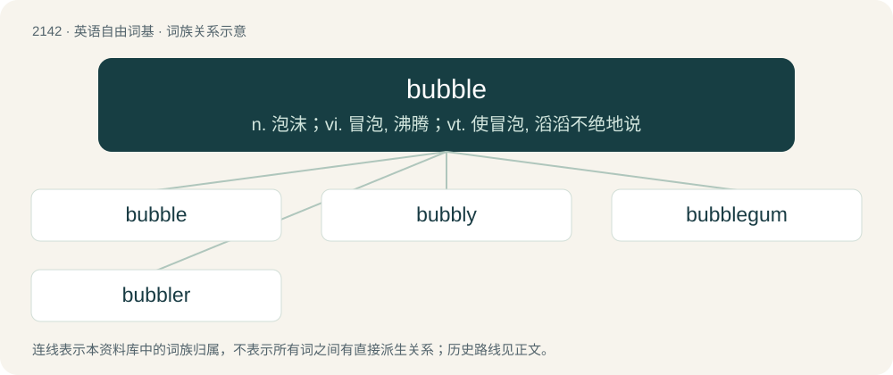

# 2251 · bubble — n. 泡沫；vi. 冒泡, 沸腾；vt. 使冒泡, 滔滔不绝地说

[总目录](../00_总目录_按常用程度.md)

**类型**：英语自由词基　｜　**来源语言**：见词源记录

## 核心含义与来源

- 核心含义：n. 泡沫；vi. 冒泡, 沸腾；vt. 使冒泡, 滔滔不绝地说
- 英文含义：A spherically contained volume of air or other gas in a liquid, commonly a soapy liquid.
- 词形：bubble

**来源记录 1**（名词；A spherically contained volume of air or other gas in a liquid, commonly a soapy liquid.）

Partly imitative, also influenced by burble. Compare Middle Dutch bobbe (“bubble”) &gt; Dutch bubbel (“bubble”), Low German bubbel (“bubble”), Danish boble (“bubble”), Swedish bubbla (“bubble”). The word was first used in its economic sense in association with the collapse of the South Sea Company in 1720, based on the metaphor of an inflated soap bubble bursting.

## 词族图

## 单词速览（常用到不常用）

| 单词 | 音标 | 释义 |
|---|---|---|
| [bubble](#w-1) | 英 /ˈbʌbəl/ | n. 泡沫；vi. 冒泡, 沸腾；vt. 使冒泡, 滔滔不绝地说 |
| [bubbly](#w-2) | /ˈbʌbli/ | a. 多泡的, 起泡的；n. 香槟酒 |
| [bubblegum](#w-3) | /ˈbʌbəlɡʌm/ | &lt;美俚&gt;泡泡糖摇滚舞曲 |
| [bubbler](#w-4) | 英 /ˈbʌb.lə/；美 /ˈbʌb.lɚ/ | n. 饮用喷泉；\[化\] 扩散器; 打泡器; 起泡器; 鼓泡器 |

## 逐词详解

### 1. bubble

**词性**：名词　｜　**音标**：英 /ˈbʌbəl/

**中文释义**：n. 泡沫；vi. 冒泡, 沸腾；vt. 使冒泡, 滔滔不绝地说

**英文义项**：A spherically contained volume of air or other gas in a liquid, commonly a soapy liquid. / A small spherical cavity in a solid material.

**词源与演化**：

Partly imitative, also influenced by burble. Compare Middle Dutch bobbe (“bubble”) &gt; Dutch bubbel (“bubble”), Low German bubbel (“bubble”), Danish boble (“bubble”), Swedish bubbla (“bubble”). The word was first used in its economic sense in association with the collapse of the South Sea Company in 1720, based on the metaphor of an inflated soap bubble bursting.

**例句**：

> Many players tend to play timidly (not play many hands) around the bubble, to keep their chips and last longer in the game.

该用例对应义项：In a poker tournament, the point before which eliminated players receive no prize money and after which they do; the situation where all remaining players are guaranteed prize money (in this case, the players are said to have made the bubble); the situation where all remaining players will be guaranteed prize money after some small number of players are eliminated (in this case, the players are said to be on the bubble).

### 2. bubbly

**词性**：形容词　｜　**音标**：/ˈbʌbli/

**中文释义**：a. 多泡的, 起泡的；n. 香槟酒

**英文义项**：Full of bubbles. / Cheerful, lively.

**构词拆分**：bubble + -y

**词源与演化**：

From bubble + -y.

**例句**：

> The architecture of the conservatory was bubbly.

该用例对应义项：Having the characteristics of bubbles.

### 3. bubblegum

**词性**：名词　｜　**音标**：/ˈbʌbəlɡʌm/

**中文释义**：&lt;美俚&gt;泡泡糖摇滚舞曲

**英文义项**：A sweet, stretchable chewing gum designed for blowing bubbles. / A type of pop music marked by sweetness, pep and charm (rather than depth or complexity).

**构词拆分**：bubble + gum

**词源与演化**：

From bubble + gum.

**例句**：

> Tom found some bubblegum and bought it for his son.

### 4. bubbler

**词性**：名词　｜　**音标**：英 /ˈbʌb.lə/；美 /ˈbʌb.lɚ/

**中文释义**：n. 饮用喷泉；\[化\] 扩散器; 打泡器; 起泡器; 鼓泡器

**英文义项**：Something that emits bubbles. / An airstone for an aquarium.

**构词拆分**：bubble + -er

**词源与演化**：

From bubble + -er.
