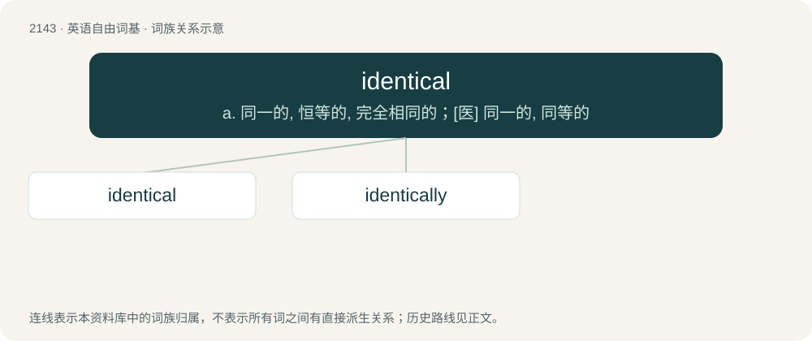

# 2252 · identical — a. 同一的, 恒等的, 完全相同的；\[医\] 同一的, 同等的

[总目录](../00_总目录_按常用程度.md)

**类型**：英语自由词基　｜　**来源语言**：见词源记录

## 核心含义与来源

- 核心含义：a. 同一的, 恒等的, 完全相同的；\[医\] 同一的, 同等的
- 英文含义：Bearing full likeness by having precisely the same set of characteristics; indistinguishable.
- 词形：identical

**来源记录 1**（形容词；Bearing full likeness by having precisely the same set of characteristics; indistinguishable.）

From identic + -al.

## 词族图

## 单词速览（常用到不常用）

| 单词 | 音标 | 释义 |
|---|---|---|
| [identical](#w-1) | /ɪˈdɛntɪkl̩/ | a. 同一的, 恒等的, 完全相同的；\[医\] 同一的, 同等的 |
| [identically](#w-2) | /aɪˈdɛntɪkəli/ | adv. 同一, 同样；\[计\] 永恒地 |

## 逐词详解

### 1. identical

**词性**：形容词　｜　**音标**：/ɪˈdɛntɪkl̩/

**中文释义**：a. 同一的, 恒等的, 完全相同的；\[医\] 同一的, 同等的

**英文义项**：Bearing full likeness by having precisely the same set of characteristics; indistinguishable. / Not different or other; not another or others; not different as regards self; selfsame; numerically identical.

**构词拆分**：From identic + -al.

**词源与演化**：

From identic + -al.

**例句**：

> My car is identical with the one my mom has just bought.

该用例对应义项：Bearing full likeness by having precisely the same set of characteristics; indistinguishable.

### 2. identically

**词性**：副词　｜　**音标**：/aɪˈdɛntɪkəli/

**中文释义**：adv. 同一, 同样；\[计\] 永恒地

**英文义项**：In an identical manner. / In terms of an identity.

**构词拆分**：identical + -ly

**词源与演化**：

From identical + -ly.

**例句**：

> It was hard to tell the twins apart: they even spoke identically.

该用例对应义项：In an identical manner.
