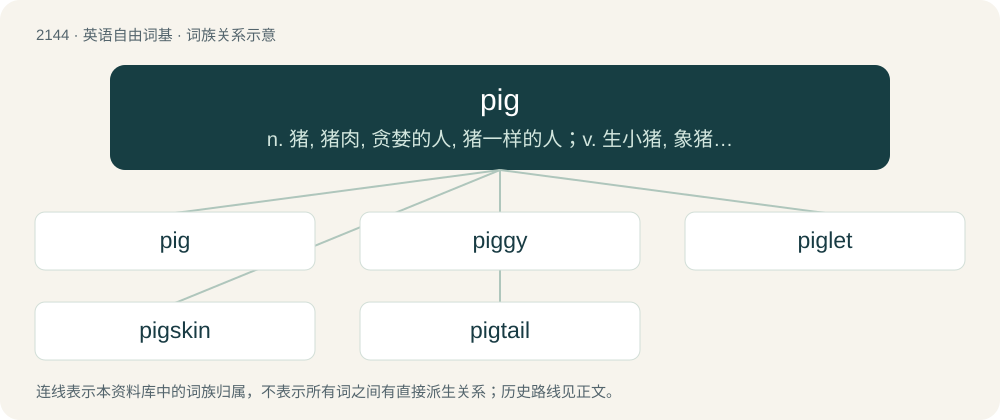

# 2253 · pig — n. 猪, 猪肉, 贪婪的人, 猪一样的人；v. 生小猪, 象猪般地生活

[总目录](../00_总目录_按常用程度.md)

**类型**：英语自由词基　｜　**来源语言**：见词源记录

## 核心含义与来源

- 核心含义：n. 猪, 猪肉, 贪婪的人, 猪一样的人；v. 生小猪, 象猪般地生活
- 英文含义：Any of several mammalian species of the family Suidae, having cloven hooves, bristles and a snout adapted for digging; especially the domesticated animal Sus domesticus.
- 词形：pig

**多个词源／构词路径**：同一拼写可能有不同来源；以下按词性和含义分别列出。

**来源记录 1**（名词；Any of several mammalian species of the family Suidae, having cloven hooves, bristles and a snout adapted for digging; especially the domesticated animal Sus domesticus.）

From Middle English pigge (“pig, piglet”) (originally a term for a young pig, with adult pigs being swyn (“swine”)), from Old English \*picga, \*pycga (attested in picgbrēad (“mast, pig-fodder”)), perhaps a diminutive of Proto-West Germanic \*puk, \*pūk (“pig”), which also gave rise to Middle Low German pûke, puyke (“pig, piglet”). Pokorny suggests this root might be somehow related to \*bū-, \*bew- (“to blow; swell”), which could account for the alternation between "pig" and "big". Compare Middle Dutch pogge, puggen, pigge, pegsken (&gt; dialectal Dutch pogge (“piglet”)), Middle Low German pugge (&gt; Westphalian German Low German Pogge, Pugge, Püggsken (“pig, piglet”)). A connection to early modern Dutch bigge (modern Dutch big (“piglet”)), West Frisian bigge (“piglet”), German Low German Bigge, Bigg (“piglet”), and Saterland Frisian Bikkie (“piggy”) is sometimes proposed, "but the phonology is difficult". Some sources say the words are "almost certainly not" related, others consider a relation "probable, but not certain". The slang sense of "police officer" is attested since at least 1785.

**来源记录 2**（名词；An earthenware pot or jar）

Possibly a transferred use of pig, because the vessel was thought to resemble the animal.

## 词族图

## 单词速览（常用到不常用）

| 单词 | 音标 | 释义 |
|---|---|---|
| [pig](#w-1) | /ˈpɪɡ/ | n. 猪, 猪肉, 贪婪的人, 猪一样的人；v. 生小猪, 象猪般地生活 |
| [piggy](#w-2) | /ˈpɪɡi/ | n. 小猪；a. 贪心的, 似猪的, 邋遢的 |
| [piglet](#w-3) | /ˈpɪɡ.lət/ | n. 小猪, 猪仔 |
| [pigskin](#w-4) | /ˈpɪɡˌskɪn/ | n. 猪皮, 猪皮革, 马鞍 |
| [pigtail](#w-5) | 英 /ˈpɪɡ.teɪl/ | n. 猪尾, 发辫, 辫形导线；\[化\] 盘管 |

## 逐词详解

### 1. pig

**词性**：名词　｜　**音标**：/ˈpɪɡ/

**中文释义**：n. 猪, 猪肉, 贪婪的人, 猪一样的人；v. 生小猪, 象猪般地生活

**英文义项**：Any of several mammalian species of the family Suidae, having cloven hooves, bristles and a snout adapted for digging; especially the domesticated animal Sus domesticus. / A young swine, a piglet (contrasted with a hog, an adult swine).

**词源与演化**：

From Middle English pigge (“pig, piglet”) (originally a term for a young pig, with adult pigs being swyn (“swine”)), from Old English \*picga, \*pycga (attested in picgbrēad (“mast, pig-fodder”)), perhaps a diminutive of Proto-West Germanic \*puk, \*pūk (“pig”), which also gave rise to Middle Low German pûke, puyke (“pig, piglet”). Pokorny suggests this root might be somehow related to \*bū-, \*bew- (“to blow; swell”), which could account for the alternation between "pig" and "big". Compare Middle Dutch pogge, puggen, pigge, pegsken (&gt; dialectal Dutch pogge (“piglet”)), Middle Low German pugge (&gt; Westphalian German Low German Pogge, Pugge, Püggsken (“pig, piglet”)). A connection to early modern Dutch bigge (modern Dutch big (“piglet”)), West Frisian bigge (“piglet”), German Low German Bigge, Bigg (“piglet”), and Saterland Frisian Bikkie (“piggy”) is sometimes proposed, "but the phonology is difficult". Some sources say the words are "almost certainly not" related, others consider a relation "probable, but not certain". The slang sense of "police officer" is attested since at least 1785.

**例句**：

> Hrm... this one's a real pig: I've been banging my head against the wall over it for hours!

该用例对应义项：A difficult problem.

### 2. piggy

**词性**：名词　｜　**音标**：/ˈpɪɡi/

**中文释义**：n. 小猪；a. 贪心的, 似猪的, 邋遢的

**英文义项**：A pig (the animal). / A guinea pig.

**构词拆分**：pig + -y (diminutive suffix)

**词源与演化**：

From pig + -y (diminutive suffix).

**例句**：

> Can't you finish your dinner? You've been a piggy, haven't you?

该用例对应义项：A pig (greedy person).

### 3. piglet

**词性**：名词　｜　**音标**：/ˈpɪɡ.lət/

**中文释义**：n. 小猪, 猪仔

**英文义项**：A young swine, one not yet mature.

**构词拆分**：pig + -let (diminutive suffix)

**词源与演化**：

From pig + -let (diminutive suffix). Attested from 1855. Displaced Old English fearh.

**例句**：

> Truffles is a pink piglet with purple hooves and green eyes.

### 4. pigskin

**词性**：名词　｜　**音标**：/ˈpɪɡˌskɪn/

**中文释义**：n. 猪皮, 猪皮革, 马鞍

**英文义项**：The skin of a pig. / Leather made from the skin of a pig.

**构词拆分**：pig + skin

**词源与演化**：

Compound of pig + skin. The American football is a direct descendant of the ball used in the game of rugby. The rugby ball originally was made of a pig’s bladder with a leather cover; the earliest versions of the leather exterior sometimes were made of pigskin.

### 5. pigtail

**词性**：名词　｜　**音标**：英 /ˈpɪɡ.teɪl/

**中文释义**：n. 猪尾, 发辫, 辫形导线；\[化\] 盘管

**英文义项**：The tail of a pig. / Tobacco twisted into a string or roll.

**构词拆分**：pig + tail

**词源与演化**：

From pig + tail.

**例句**：

> The junction box allows you to store the camera's pigtail inside of it.
