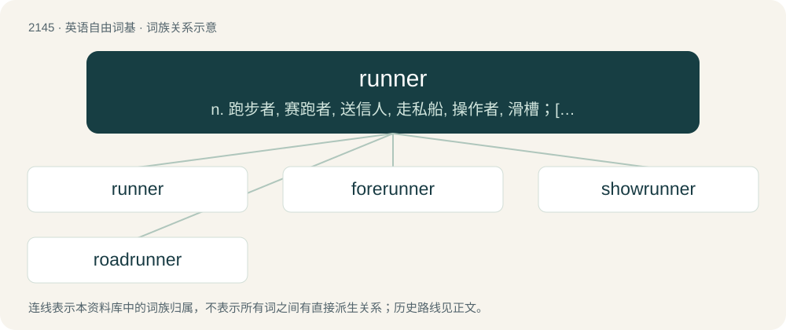

# 2254 · runner — n. 跑步者, 赛跑者, 送信人, 走私船, 操作者, 滑槽；\[化\] 碾碎机; 压碎机

[总目录](../00_总目录_按常用程度.md)

**类型**：英语自由词基　｜　**来源语言**：见词源记录

## 核心含义与来源

- 核心含义：n. 跑步者, 赛跑者, 送信人, 走私船, 操作者, 滑槽；\[化\] 碾碎机; 压碎机
- 英文含义：A person who moves, on foot, at a fast pace, especially an athlete.
- 词形：runner

**来源记录 1**（名词；A person who moves, on foot, at a fast pace, especially an athlete.）

From Middle English rennere, rynner, urnare, equivalent to run + -er. Cognate with Old Norse rennari (“runner; messenger”). Displaced earlier Middle English runel (“runner”), from Old English rynel (“runner”; also “messenger, courier”). ((botany) a long stolon sent by a plant): Compare typologically Russian побе́г (pobég) (akin to бежа́ть (bežátʹ)).

## 词族图

## 单词速览（常用到不常用）

| 单词 | 音标 | 释义 |
|---|---|---|
| [runner](#w-1) | 英 /ˈɹʌnə/；美 /ˈɹʌnɚ/ | n. 跑步者, 赛跑者, 送信人, 走私船, 操作者, 滑槽；\[化\] 碾碎机; 压碎机 |
| [forerunner](#w-2) | 美 /ˈfɔɹˌɹʌnɚ/ | n. 先驱, 前兆 |
| [showrunner](#w-3) | 美 /ˈʃoʊˌɹʌnɚ/ | \[网络\] 剧集运作人；执行制片人；剧集总监 |
| [roadrunner](#w-4) | 英 /ˈɹəʊdˌɹʌnə/；美 /ˈɹoʊdˌɹʌnɚ/ | n. \[鸟\](中美、北美产)走鹃 |

## 逐词详解

### 1. runner

**词性**：名词　｜　**音标**：英 /ˈɹʌnə/；美 /ˈɹʌnɚ/

**中文释义**：n. 跑步者, 赛跑者, 送信人, 走私船, 操作者, 滑槽；\[化\] 碾碎机; 压碎机

**英文义项**：A person who moves, on foot, at a fast pace, especially an athlete. / Any entrant, person or animal (especially a horse), for a race or any competition; a candidate for an election.

**构词拆分**：run + -er

**词源与演化**：

From Middle English rennere, rynner, urnare, equivalent to run + -er. Cognate with Old Norse rennari (“runner; messenger”). Displaced earlier Middle English runel (“runner”), from Old English rynel (“runner”; also “messenger, courier”). ((botany) a long stolon sent by a plant): Compare typologically Russian побе́г (pobég) (akin to бежа́ть (bežátʹ)).

**例句**：

> After the cycle completes, the runner travels back quickly to be in place for the next cycle.

该用例对应义项：A part of an apparatus that moves quickly.

### 2. forerunner

**词性**：名词　｜　**音标**：美 /ˈfɔɹˌɹʌnɚ/

**中文释义**：n. 先驱, 前兆

**英文义项**：A runner at the front or ahead. / By extension, a non-competitor who leads out the competitors on to the circuit, or who runs/rides the course prior to competitor trials, usually testing or checking the way.

**构词拆分**：fore- + runner；forerun + -er

**词源与演化**：

From Middle English forrenner, foreriner. Calque of Latin praecursor (“one who runs before, a forerunner”). Equivalent to fore- + runner and/or forerun + -er.

**例句**：

> Bakelite is a forerunner of today's plastics.

该用例对应义项：A forebear, an ancestor, a predecessor.

### 3. showrunner

**词性**：名词　｜　**音标**：美 /ˈʃoʊˌɹʌnɚ/

**中文释义**：\[网络\] 剧集运作人；执行制片人；剧集总监

**英文义项**：The person in overall charge of the production of a television series.

**构词拆分**：show + runner

**词源与演化**：

From show + runner.

### 4. roadrunner

**词性**：名词　｜　**音标**：英 /ˈɹəʊdˌɹʌnə/；美 /ˈɹoʊdˌɹʌnɚ/

**中文释义**：n. \[鸟\](中美、北美产)走鹃

**英文义项**：Either of two species of fast-running bird in the genus Geococcyx of the cuckoo family native to North and Central America, the lesser roadrunner (Geococcyx velox) and, especially, the greater roadrunner (Geococcyx californianus).

**构词拆分**：road + runner

**词源与演化**：

From road + runner, probably a calque of Spanish correcaminos (“roadrunner”), from correr (“to run”) + caminos (“roads”).

**例句**：

> The roadrunner is a bird also known as the "Chaparral Cock" in Texas.
