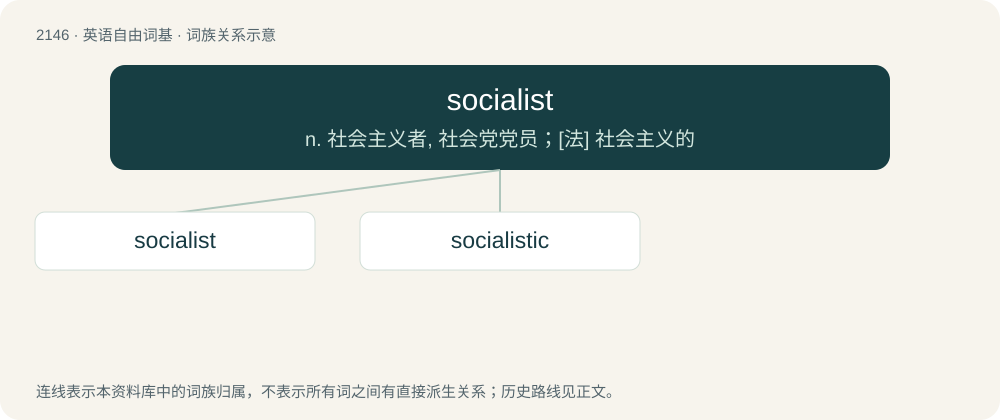

# 2255 · socialist — n. 社会主义者, 社会党党员；\[法\] 社会主义的

[总目录](../00_总目录_按常用程度.md)

**类型**：英语自由词基　｜　**来源语言**：见词源记录

## 核心含义与来源

- 核心含义：n. 社会主义者, 社会党党员；\[法\] 社会主义的
- 英文含义：Of, relating to, supporting, or advocating socialism.
- 词形：socialist

**来源记录 1**（形容词；Of, relating to, supporting, or advocating socialism.）

From social + -ist.

## 词族图

## 单词速览（常用到不常用）

| 单词 | 音标 | 释义 |
|---|---|---|
| [socialist](#w-1) | 英 /ˈsəʊʃəlɪst/；美 /ˈsoʊ.ʃə.lɪst/ | n. 社会主义者, 社会党党员；\[法\] 社会主义的 |
| [socialistic](#w-2) | /.səuʃəˈlistik/ | a. 社会主义的 |

## 逐词详解

### 1. socialist

**词性**：形容词　｜　**音标**：英 /ˈsəʊʃəlɪst/；美 /ˈsoʊ.ʃə.lɪst/

**中文释义**：n. 社会主义者, 社会党党员；\[法\] 社会主义的

**英文义项**：Of, relating to, supporting, or advocating socialism.

**构词拆分**：social + -ist

**词源与演化**：

From social + -ist.

**例句**：

> The Nazis were as socialist as the Holy Roman Empire was Roman.

### 2. socialistic

**词性**：形容词　｜　**音标**：/.səuʃəˈlistik/

**中文释义**：a. 社会主义的

**英文义项**：Of or relating to socialism. / Having socialist tendencies.

**构词拆分**：socialist + -ic

**词源与演化**：

From socialist + -ic.
