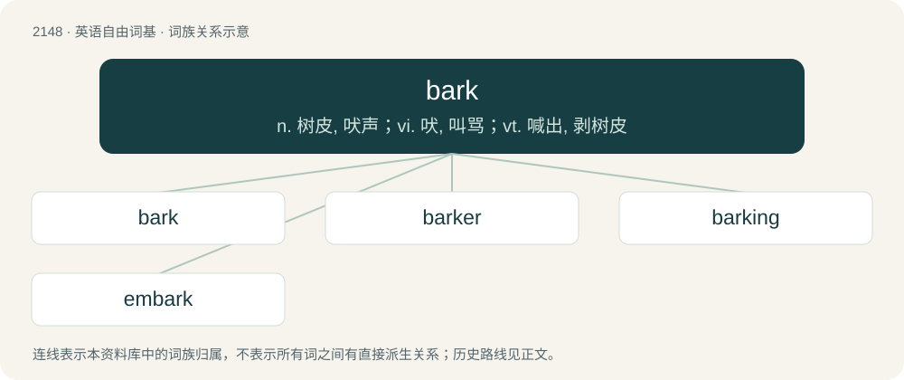

# 2257 · bark — n. 树皮, 吠声；vi. 吠, 叫骂；vt. 喊出, 剥树皮

[总目录](../00_总目录_按常用程度.md)

**类型**：英语自由词基　｜　**来源语言**：见词源记录

## 核心含义与来源

- 核心含义：n. 树皮, 吠声；vi. 吠, 叫骂；vt. 喊出, 剥树皮
- 英文含义：To make a short, loud, explosive noise with the vocal organs (said of animals, especially dogs).
- 词形：bark

**多个词源／构词路径**：同一拼写可能有不同来源；以下按词性和含义分别列出。

**来源记录 1**（动词；To make a short, loud, explosive noise with the vocal organs (said of animals, especially dogs).）

From Middle English barken, berken, borken, from Old English beorcan (“to bark”), from the Proto-West Germanic \*berkan (“to bark”), from Proto-Indo-European \*bʰerg- (“to make a noise, growl, bark”), from \*bʰer- (“to drone, hum, buzz”). Cognate with Icelandic berkja (“to bark, bluster”), Icelandic barki (“throat, windpipe”), dialectal Lithuanian burgė́ti (“to growl, grumble, grouch, quarrel”), Serbo-Croatian brbljati (“to murmur”). For the noun, compare Old English beorc, bearce (“barking”).

**来源记录 2**（名词；The exterior covering of the trunk and branches of a tree or of various other woody plants.）

From Middle English bark, from Old English barc (“bark”), from Old Norse bǫrkr (“tree bark”), from Proto-Germanic \*barkuz, probably related to \*birkijǭ (“birch”), from Proto-Indo-European \*bʰerHǵós (compare Latin frāxinus (“ash”), Lithuanian béržas (“birch”)), from Proto-Indo-European \*bʰerHǵ- (“to gleam; white”) (compare English bright); akin to Danish bark, Icelandic börkur, Low German borke and Albanian berk (“bast”).

**来源记录 3**（名词；A sailing vessel or boat of any kind.）

From Middle English barke (“boat”), from Middle French barque, from Late Latin barca, a regular syncope of Vulgar Latin \*barica, from Classical Latin bāris, from Ancient Greek βᾶρις (bâris, “Egyptian boat”), from Coptic ⲃⲁⲁⲣⲉ (baare, “small boat”), from Demotic Egyptian br, from Egyptian bꜣjrb-bA-A-y:r\*Z1-P1 (“transport ship”). Doublet of barge, barque and baris.

## 词族图

## 单词速览（常用到不常用）

| 单词 | 音标 | 释义 |
|---|---|---|
| [bark](#w-1) | 英 /bɑːk/；美 /bɑɹk/ | n. 树皮, 吠声；vi. 吠, 叫骂；vt. 喊出, 剥树皮 |
| [barker](#w-2) | /ˈbɑː(ɹ)kɚ/ | n. 招徕顾客的人, 剥树皮者；\[机\] 去皮机, 剥皮机 |
| [barking](#w-3) | 英 /ˈbɑːkɪŋ/；美 /ˈbɑɹkɪŋ/ | \[机\] 去皮, 剥皮 |
| [embark](#w-4) | 英 /ɪmˈbɑːk/；美 /ɪmˈbɑɹk/ | 【英文】To cover or enclose with bark. |

## 逐词详解

### 1. bark

**词性**：动词　｜　**音标**：英 /bɑːk/；美 /bɑɹk/

**中文释义**：n. 树皮, 吠声；vi. 吠, 叫骂；vt. 喊出, 剥树皮

**英文义项**：To make a short, loud, explosive noise with the vocal organs (said of animals, especially dogs). / To make a clamor; to make importunate outcries.

**词源与演化**：

From Middle English barken, berken, borken, from Old English beorcan (“to bark”), from the Proto-West Germanic \*berkan (“to bark”), from Proto-Indo-European \*bʰerg- (“to make a noise, growl, bark”), from \*bʰer- (“to drone, hum, buzz”). Cognate with Icelandic berkja (“to bark, bluster”), Icelandic barki (“throat, windpipe”), dialectal Lithuanian burgė́ti (“to growl, grumble, grouch, quarrel”), Serbo-Croatian brbljati (“to murmur”). For the noun, compare Old English beorc, bearce (“barking”).

**例句**：

> The seal barked as the zookeeper threw fish into its enclosure.

该用例对应义项：To make a short, loud, explosive noise with the vocal organs (said of animals, especially dogs).

### 2. barker

**词性**：名词　｜　**音标**：/ˈbɑː(ɹ)kɚ/

**中文释义**：n. 招徕顾客的人, 剥树皮者；\[机\] 去皮机, 剥皮机

**英文义项**：Someone or something who barks. / A person employed to solicit customers by calling out to passersby, e.g. at a carnival.

**构词拆分**：bark (“dog noise”) + -er

**词源与演化**：

From Middle English berkere; equivalent to bark (“dog noise”) + -er.

**例句**：

> The barker looks action-packed, but actually playing the game is rather dull.

该用例对应义项：A video game mode where the action is demonstrated to entice someone to play the game.

### 3. barking

**词性**：名词　｜　**音标**：英 /ˈbɑːkɪŋ/；美 /ˈbɑɹkɪŋ/

**中文释义**：\[机\] 去皮, 剥皮

**英文义项**：The action of the verb to bark.

**构词拆分**：bark + -ing

**词源与演化**：

From Middle English berkyng, berking, berkynge, equivalent to bark + -ing.

**例句**：

> Listen, I think that you are barking up the wrong tree here.

### 4. embark

**词性**：动词　｜　**音标**：英 /ɪmˈbɑːk/；美 /ɪmˈbɑɹk/

**英文义项**：To cover or enclose with bark.

**构词拆分**：em- + bark

**词源与演化**：

From em- + bark.
