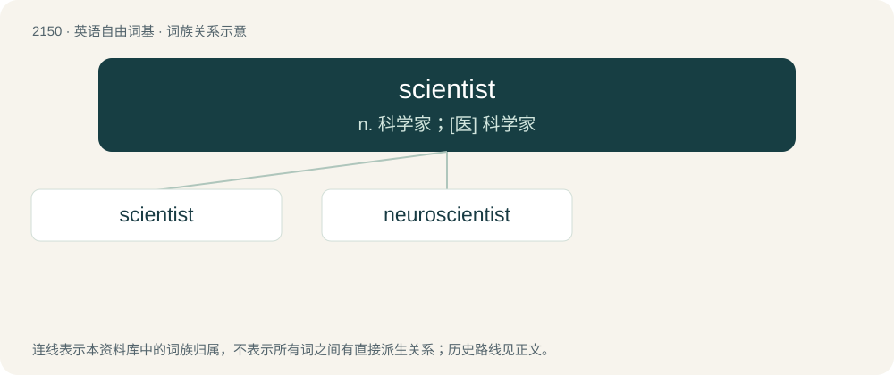

# 2258 · scientist — n. 科学家；\[医\] 科学家

[总目录](../00_总目录_按常用程度.md)

**类型**：英语自由词基　｜　**来源语言**：见词源记录

## 核心含义与来源

- 核心含义：n. 科学家；\[医\] 科学家
- 英文含义：One whose activities make use of the scientific method to answer questions regarding the measurable universe. A scientist may be involved in original research, or make use of the results of the research of others.
- 词形：scientist

**来源记录 1**（名词；One whose activities make use of the scientific method to answer questions regarding the measurable universe. A scientist may be involved in original research, or make use of the results of the research of others.）

Coined by English philosopher and historian of science William Whewell in March 1834 in an anonymous review of Mary Somerville's book On the Connexion of the Physical Sciences in the Quarterly Review as a suggested replacement for, and later seriously introduced by him in 1840 (see the quotation) as a more precise substitute for, the terms natural philosopher and man of science. Modeled after artist, from the Latin stem scientia (“knowledge”) + -ist.

## 词族图

## 单词速览（常用到不常用）

| 单词 | 音标 | 释义 |
|---|---|---|
| [scientist](#w-1) | 英 /ˈsaɪəntɪst/；美 /ˈsaɪəntəst/ | n. 科学家；\[医\] 科学家 |
| [neuroscientist](#w-2) | /ˈnjʊərəʊsaɪəntɪst/ | \[医\]神经科学家：神经科学各分支的专家 |

## 逐词详解

### 1. scientist

**词性**：名词　｜　**音标**：英 /ˈsaɪəntɪst/；美 /ˈsaɪəntəst/

**中文释义**：n. 科学家；\[医\] 科学家

**英文义项**：One whose activities make use of the scientific method to answer questions regarding the measurable universe. A scientist may be involved in original research, or make use of the results of the research of others.

**词源与演化**：

Coined by English philosopher and historian of science William Whewell in March 1834 in an anonymous review of Mary Somerville's book On the Connexion of the Physical Sciences in the Quarterly Review as a suggested replacement for, and later seriously introduced by him in 1840 (see the quotation) as a more precise substitute for, the terms natural philosopher and man of science. Modeled after artist, from the Latin stem scientia (“knowledge”) + -ist.

**例句**：

> The scientist searched for the bones of the dinosaurs in the valley.

### 2. neuroscientist

**词性**：名词　｜　**音标**：/ˈnjʊərəʊsaɪəntɪst/

**中文释义**：\[医\]神经科学家：神经科学各分支的专家

**英文义项**：A scientist whose speciality is neuroscience.

**构词拆分**：neuro- + scientist

**词源与演化**：

From neuro- + scientist.

**例句**：

> Neuroscientist António Damásio defines consciousness as "the sensation of what is happening".
