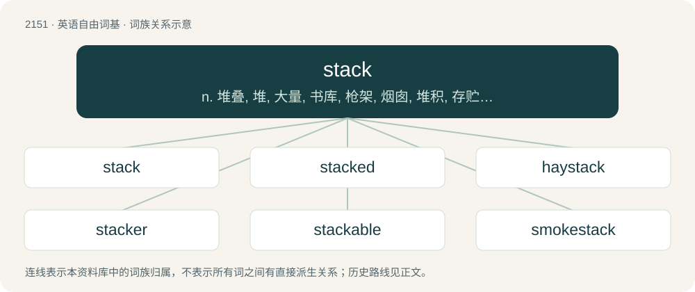

# 2259 · stack — n. 堆叠, 堆, 大量, 书库, 枪架, 烟囱, 堆积, 存贮栈；vt. 堆积, 堆满, 暗中对...做手脚；vi. 堆起

[总目录](../00_总目录_按常用程度.md)

**类型**：英语自由词基　｜　**来源语言**：见词源记录

## 核心含义与来源

- 核心含义：n. 堆叠, 堆, 大量, 书库, 枪架, 烟囱, 堆积, 存贮栈；vt. 堆积, 堆满, 暗中对...做手脚；vi. 堆起
- 英文含义：A large pile of hay, grain, straw, or the like, larger at the bottom than the top, sometimes covered with thatch.
- 词形：stack

**来源记录 1**（名词；A large pile of hay, grain, straw, or the like, larger at the bottom than the top, sometimes covered with thatch.）

From Middle English stack, stacke, stakke, stak, from Old Norse stakkr (“a barn; haystack; heap; pile”), from Proto-Germanic \*stakkaz (“a barn; rick; haystack”). The data structure sense is a calque of Dutch stapel, introduced by Edsger W. Dijkstra. Cognate with Icelandic stakkur (“stack”), Swedish stack (“stack”), Danish stak (“stack”), Norwegian stakk (“stack”). Related to stake and sauna.

## 词族图

## 单词速览（常用到不常用）

| 单词 | 音标 | 释义 |
|---|---|---|
| [stack](#w-1) | 英 /stæk/ | n. 堆叠, 堆, 大量, 书库, 枪架, 烟囱, 堆积, 存贮栈；vt. 堆积, 堆满, 暗中对...做手脚；vi. 堆起 |
| [stacked](#w-2) | /stækt/ | a. 体态漂亮的；\[计\] 入栈的, 栈式的 |
| [haystack](#w-3) | /ˈheɪˌstæk/ | n. 干草堆 |
| [stacker](#w-4) | 美 /ˈstækɚ/ | n. 堆垛者, 堆垛工；\[计\] 接卡箱, 接盘箱, 堆积箱 |
| [stackable](#w-5) | /ˈstækəbl/ | a. 可叠起堆放的,易叠起堆放的 |
| [smokestack](#w-6) | 美 /ˈsmoʊkˌstæk/ | n. 烟囱；\[机\] 烟堆 |

## 逐词详解

### 1. stack

**词性**：名词　｜　**音标**：英 /stæk/

**中文释义**：n. 堆叠, 堆, 大量, 书库, 枪架, 烟囱, 堆积, 存贮栈；vt. 堆积, 堆满, 暗中对...做手脚；vi. 堆起

**英文义项**：A large pile of hay, grain, straw, or the like, larger at the bottom than the top, sometimes covered with thatch. / A pile of similar objects, each directly on top of the last.

**词源与演化**：

From Middle English stack, stacke, stakke, stak, from Old Norse stakkr (“a barn; haystack; heap; pile”), from Proto-Germanic \*stakkaz (“a barn; rick; haystack”). The data structure sense is a calque of Dutch stapel, introduced by Edsger W. Dijkstra. Cognate with Icelandic stakkur (“stack”), Swedish stack (“stack”), Danish stak (“stack”), Norwegian stakk (“stack”). Related to stake and sauna.

**例句**：

> A TCP/IP stack is a library or set of libraries or of OS drivers that take care of networking.

该用例对应义项：An implementation of a protocol suite (set of protocols forming a layered architecture).

### 2. stacked

**词性**：形容词　｜　**音标**：/stækt/

**中文释义**：a. 体态漂亮的；\[计\] 入栈的, 栈式的

**英文义项**：Arranged in a stack. / Having large breasts.

**构词拆分**：stack + -ed

**词源与演化**：

stack + -ed

**例句**：

> The plates were stacked waiting to be cleaned.

该用例对应义项：Arranged in a stack.

### 3. haystack

**词性**：名词　｜　**音标**：/ˈheɪˌstæk/

**中文释义**：n. 干草堆

**英文义项**：A mound, pile, or stack of stored hay. / A standing wave in a rapid.

**构词拆分**：hay + stack

**词源与演化**：

From Middle English haystak, haystake, hey stak, equivalent to hay + stack.

**例句**：

> The boys were playing in the field, near the new haystack.

### 4. stacker

**词性**：名词　｜　**音标**：美 /ˈstækɚ/

**中文释义**：n. 堆垛者, 堆垛工；\[计\] 接卡箱, 接盘箱, 堆积箱

**英文义项**：Any person or thing that stacks. / A worker who stacks the shelves in a supermarket.

**构词拆分**：stack + -er

**词源与演化**：

From stack + -er.

**用法示例／搭配（非完整句）**：

> a spring-loaded plate stacker in a cafeteria

该用例对应义项：Any device allowing items to be stacked.

### 5. stackable

**词性**：形容词　｜　**音标**：/ˈstækəbl/

**中文释义**：a. 可叠起堆放的,易叠起堆放的

**英文义项**：Capable of being stacked. / Capable of being combined with others on a single purchase.

**构词拆分**：stack + -able

**词源与演化**：

From stack + -able.

**例句**：

> The kitchen chairs are not stackable.

### 6. smokestack

**词性**：名词　｜　**音标**：美 /ˈsmoʊkˌstæk/

**中文释义**：n. 烟囱；\[机\] 烟堆

**英文义项**：A conduit or group of conduits atop a structure allowing smoke to flow out, as on a steam locomotive, ship, factory, or power plant using fossil fuels.

**构词拆分**：smoke + stack

**词源与演化**：

From smoke + stack.

**例句**：

> This smokestack is releasing greenhouse gases and other pollutants into the atmosphere.
