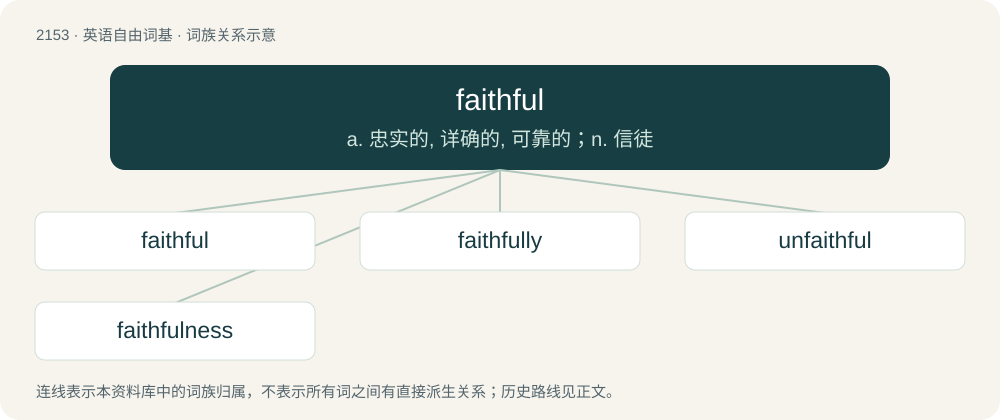

# 2261 · faithful — a. 忠实的, 详确的, 可靠的；n. 信徒

[总目录](../00_总目录_按常用程度.md)

**类型**：英语自由词基　｜　**来源语言**：见词源记录

## 核心含义与来源

- 核心含义：a. 忠实的, 详确的, 可靠的；n. 信徒
- 英文含义：Loyal; adhering firmly to person or cause.
- 词形：faithful

**来源记录 1**（形容词；Loyal; adhering firmly to person or cause.）

From Middle English feithful, equivalent to faith + -ful.

## 词族图

## 单词速览（常用到不常用）

| 单词 | 音标 | 释义 |
|---|---|---|
| [faithful](#w-1) | /ˈfeɪθ.fl̩/ | a. 忠实的, 详确的, 可靠的；n. 信徒 |
| [faithfully](#w-2) | /ˈfeɪθfəli/ | adv. 忠实地, 诚心诚意地, 深信着地 |
| [unfaithful](#w-3) | /.ʌnˈfeiθful/ | a. 不诚实的, 不忠实的；\[法\] 不正当的, 不信实的, 不正确的 |
| [faithfulness](#w-4) | /ˈfeiθfulnis/ | n. 忠诚, 诚实, 正确 |

## 逐词详解

### 1. faithful

**词性**：形容词　｜　**音标**：/ˈfeɪθ.fl̩/

**中文释义**：a. 忠实的, 详确的, 可靠的；n. 信徒

**英文义项**：Loyal; adhering firmly to person or cause. / Having faith.

**构词拆分**：faith + -ful

**词源与演化**：

From Middle English feithful, equivalent to faith + -ful.

**例句**：

> My dog is very faithful: he doesn't like to be petted by anybody else.

该用例对应义项：Loyal; adhering firmly to person or cause.

### 2. faithfully

**词性**：副词　｜　**音标**：/ˈfeɪθfəli/

**中文释义**：adv. 忠实地, 诚心诚意地, 深信着地

**英文义项**：In a faithful manner. / A conventional formula for ending a letter, used when the salutation addresses the person for whom the letter is intended using an honorific.

**构词拆分**：faithful + -ly

**词源与演化**：

From Middle English feithfulli, equivalent to faithful + -ly.

**例句**：

> It always came on, faithfully, like the radio.

该用例对应义项：in a faithful manner

### 3. unfaithful

**词性**：形容词　｜　**音标**：/.ʌnˈfeiθful/

**中文释义**：a. 不诚实的, 不忠实的；\[法\] 不正当的, 不信实的, 不正确的

**英文义项**：Not having religious faith. / Not keeping good faith; disloyal; not faithful.

**构词拆分**：un- + faithful

**词源与演化**：

From Middle English unfeithful, equivalent to un- + faithful.

**例句**：

> The painting was an unfaithful rendering of its subject.

该用例对应义项：Negligent or imperfect.

### 4. faithfulness

**词性**：名词　｜　**音标**：/ˈfeiθfulnis/

**中文释义**：n. 忠诚, 诚实, 正确

**英文义项**：Constancy of support, alliance, and respect. / Constancy of belief.

**构词拆分**：faithful + -ness

**词源与演化**：

From Middle English feithfulnesse, equivalent to faithful + -ness.

**例句**：

> His faithfulness kept him going through the darkest times.

该用例对应义项：Constancy of belief.
