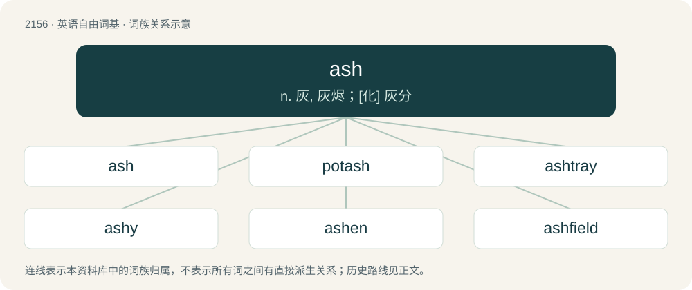

# 2262 · ash — n. 灰, 灰烬；\[化\] 灰分

[总目录](../00_总目录_按常用程度.md)

**类型**：英语自由词基　｜　**来源语言**：见词源记录

## 核心含义与来源

- 核心含义：n. 灰, 灰烬；\[化\] 灰分
- 英文含义：The solid remains of a fire.
- 词形：ash

**多个词源／构词路径**：同一拼写可能有不同来源；以下按词性和含义分别列出。

**来源记录 1**（名词；The solid remains of a fire.）

From Middle English aisshe, asche, ash, asshe, axe, eshe, esk, from Old English acse, asċe, axe, axse, æsċe, from Proto-West Germanic \*askā, from Proto-Germanic \*askǭ (“ash”), from Proto-Indo-European \*h₂eHs- (“to be dry; to burn; hearth; ashes”). Cognates Cognate with Yola ashen, oaskean (“ashes”), Saterland Frisian Ääske (“ash”), West Frisian jiske (“ash”), Alemannic German Äsche (“ash”), Cimbrian èssa (“ash”), Dutch as, asch (“ash”), German Asche (“ash”), Limburgish Aïsch, Aïsche, Äsch (“ash; grayling”), Luxembourgish Äsch (“ash”), Vilamovian oś, oš (“ash”), Yiddish אַש (ash, “ash”), Danish aske (“ash”), Faroese øska (“ash, ashes”), Icelandic and Swedish aska (“ash”), Norwegian Bokmål aske (“ash”), Norwegian Nynorsk oske (“ash”), Gothic 𐌰𐌶𐌲𐍉 (azgō, “ash; cinder”); Breton and Cornish ster (“stars”), Welsh sêr (“stars”), Latin āreō (“to be dry or parched; to be dried up or withered”), Greek αστέρας (astéras), αστέρι (astéri), άστρο (ástro, “star”), Armenian աստուճ (astuč), աշտուճ (aštuč, “dry (of bread)”), Avestan 𐬯𐬙𐬀𐬭 (star, “star”), Baluchi استار (astár / istár), استال (istál, “star”), Central Kurdish ئەستێرە (estêre, “star”), Northern Kurdish stêr (“star”), Ossetian стъалы (st’aly, “star”), Pashto ستوری (stóray, “star”), Persian سِتَارَه (setāra / sitâre, “star; destiny, fate; spark”), Hittite 𒄩𒀸𒊭𒀀𒀸 (ḫa-aš-ša-a-aš, “fireplace, hearth”), Ashkun istã́ (“star”), Tocharian A āştär (“pure”), Tocharian B astare (“pure”), Sanskrit आस (āsa, “ashes; dust”). The rare plural axen is from Middle English axen, axnen, from Old English axan, asċan (“ashes”) (plural of Old English axe, æsċe (“ash”)).

**来源记录 2**（名词；A shade tree of the genus Fraxinus.）

From Middle English aissh, asch, asche, ashe, assche, assh, asshe, esch, haish, from Old English æsċ, from Proto-West Germanic \*ask, from Proto-Germanic \*askaz (“ash”), from Proto-Indo-European \*Heh₃s- (“ash”). Cognates Cognate with Scots aish (“ash”), North Frisian eskebuum (“ash”), West Frisian esk (“ash”), Cimbrian ess (“ash”), Dutch es (“ash”), German Esche (“ash”), Limburgish èsj (“ash”), Luxembourgish Esch (“ash”), Yiddish אַשבוים (ashboym, “ash”), Danish, Norwegian Bokmål, Norwegian Nynorsk, and Swedish ask (“ash”), Faroese ask, askur (“ash”), Icelandic askur (“ash”); also Welsh onn, ynn (“ash”), Latin ornus (“rowan”), Greek οξιά (oxiá, “beech; wood”), Albanian ah (“beech”), Latgalian ūss (“ash”), Latvian osis (“ash”), Lithuanian uosis (“ash”), Belarusian, Russian, and Ukrainian я́сень (jásenʹ, “ash”), Bulgarian я́сен (jásen, “ash”), Czech jasan (“ash”), Macedonian јасен (jasen, “ash”), Polish jasion, jesion (“ash”), Serbo-Croatian ја̏се̄н, jȁsēn (“ash”), Slovak jaseň (“ash”), Slovene jésen (“ash”), Armenian հացի (hacʻi, “ash”).

## 词族图

## 单词速览（常用到不常用）

| 单词 | 音标 | 释义 |
|---|---|---|
| [ash](#w-1) | /ˈæʃ/ | n. 灰, 灰烬；\[化\] 灰分 |
| [potash](#w-2) | 英 /ˈpɒt.æʃ/；美 /ˈpɑt.æʃ/ | \[化\] 钾碱；\[医\] 钾硷, 碳酸钾, 草硷 |
| [ashtray](#w-3) | /ˈæʃ.tɹeɪ/ | n. 烟灰缸 |
| [ashy](#w-4) | /ˈæʃi/ | a. 灰的, 覆盖着灰的, 苍白的；\[机\] 灰的, 含灰的, 灰色的 |
| [ashen](#w-5) | /ˈæʃ.ən/ | a. 由灰烬构成的, 灰色的, 苍白的；\[机\] 灰的, 似灰的 |
| [ashfield](#w-6) |  | 【英文】A field that is covered in ash. |

## 逐词详解

### 1. ash

**词性**：名词　｜　**音标**：/ˈæʃ/

**中文释义**：n. 灰, 灰烬；\[化\] 灰分

**英文义项**：The solid remains of a fire. / The nonaqueous remains of a material subjected to any complete oxidation process.

**词源与演化**：

From Middle English aisshe, asche, ash, asshe, axe, eshe, esk, from Old English acse, asċe, axe, axse, æsċe, from Proto-West Germanic \*askā, from Proto-Germanic \*askǭ (“ash”), from Proto-Indo-European \*h₂eHs- (“to be dry; to burn; hearth; ashes”). Cognates Cognate with Yola ashen, oaskean (“ashes”), Saterland Frisian Ääske (“ash”), West Frisian jiske (“ash”), Alemannic German Äsche (“ash”), Cimbrian èssa (“ash”), Dutch as, asch (“ash”), German Asche (“ash”), Limburgish Aïsch, Aïsche, Äsch (“ash; grayling”), Luxembourgish Äsch (“ash”), Vilamovian oś, oš (“ash”), Yiddish אַש (ash, “ash”), Danish aske (“ash”), Faroese øska (“ash, ashes”), Icelandic and Swedish aska (“ash”), Norwegian Bokmål aske (“ash”), Norwegian Nynorsk oske (“ash”), Gothic 𐌰𐌶𐌲𐍉 (azgō, “ash; cinder”); Breton and Cornish ster (“stars”), Welsh sêr (“stars”), Latin āreō (“to be dry or parched; to be dried up or withered”), Greek αστέρας (astéras), αστέρι (astéri), άστρο (ástro, “star”), Armenian աստուճ (astuč), աշտուճ (aštuč, “dry (of bread)”), Avestan 𐬯𐬙𐬀𐬭 (star, “star”), Baluchi استار (astár / istár), استال (istál, “star”), Central Kurdish ئەستێرە (estêre, “star”), Northern Kurdish stêr (“star”), Ossetian стъалы (st’aly, “star”), Pashto ستوری (stóray, “star”), Persian سِتَارَه (setāra / sitâre, “star; destiny, fate; spark”), Hittite 𒄩𒀸𒊭𒀀𒀸 (ḫa-aš-ša-a-aš, “fireplace, hearth”), Ashkun istã́ (“star”), Tocharian A āştär (“pure”), Tocharian B astare (“pure”), Sanskrit आस (āsa, “ashes; dust”). The rare plural axen is from Middle English axen, axnen, from Old English axan, asċan (“ashes”) (plural of Old English axe, æsċe (“ash”)).

**例句**：

> The audience was more captivated by the growing ash at the end of his cigarette than by his words.

该用例对应义项：The solid remains of a fire.

### 2. potash

**词性**：名词　｜　**音标**：英 /ˈpɒt.æʃ/；美 /ˈpɑt.æʃ/

**中文释义**：\[化\] 钾碱；\[医\] 钾硷, 碳酸钾, 草硷

**英文义项**：The water-soluble part of wood ash, used for making soap and glass and as a fertilizer (chemically speaking, an impure form of potassium carbonate (K₂CO₃) mixed with other potassium salts). / A class of potassium minerals, of similar applicability to potassium carbonate, such as being a fertilizer. (ie. potassium chloride, potassium hydroxide)

**构词拆分**：pot + ash

**词源与演化**：

From pot + ash, because the substance was originally obtained by leaching ash in water and then boiling down the resulting solution in a pot. Compare Dutch potas, German Pottasche.

**例句**：

> These are the locations where potash is being mined today.

### 3. ashtray

**词性**：动词　｜　**音标**：/ˈæʃ.tɹeɪ/

**中文释义**：n. 烟灰缸

**英文义项**：To use an ashtray.

**构词拆分**：ash + tray

**词源与演化**：

From ash + tray. Compare German Aschenbecher.

**用法示例／搭配（非完整句）**：

> to ashtray a cigarette

该用例对应义项：To use an ashtray.

### 4. ashy

**词性**：形容词　｜　**音标**：/ˈæʃi/

**中文释义**：a. 灰的, 覆盖着灰的, 苍白的；\[机\] 灰的, 含灰的, 灰色的

**英文义项**：Resembling ashes (especially in colour); (of a person’s complexion) unusually pale as a result of strong emotion, illness, etc. / Comprising, containing, or covered with ash.

**构词拆分**：ash + -y

**词源与演化**：

From Middle English asshy, asky, equivalent to ash + -y.

### 5. ashen

**词性**：形容词　｜　**音标**：/ˈæʃ.ən/

**中文释义**：a. 由灰烬构成的, 灰色的, 苍白的；\[机\] 灰的, 似灰的

**英文义项**：Made from the wood of the ash-tree.

**构词拆分**：ash + -en (“made or consisting of”)

**词源与演化**：

From Middle English asshen, aisshen, esscen, from Old English æsċen (“made of ashwood”), equivalent to ash + -en (“made or consisting of”). Cognate with Scots aschin, eschin (“ashen”).

**例句**：

> An ashen bow and quiver of arrows beside.

该用例对应义项：Made from the wood of the ash-tree.

### 6. ashfield

**词性**：名词

**英文义项**：A field that is covered in ash.

**构词拆分**：ash + field

**词源与演化**：

From ash + field.
