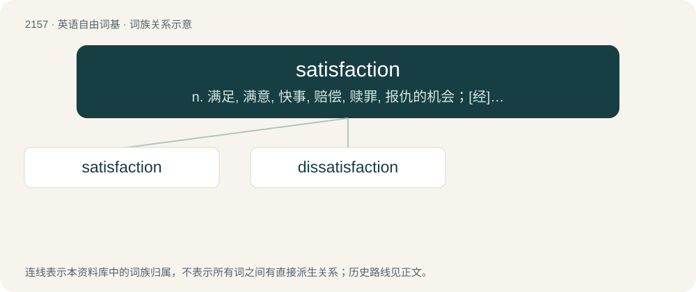

# 2263 · satisfaction — n. 满足, 满意, 快事, 赔偿, 赎罪, 报仇的机会；\[经\] 偿还, 赎回

[总目录](../00_总目录_按常用程度.md)

**类型**：英语自由词基　｜　**来源语言**：见词源记录

## 核心含义与来源

- 核心含义：n. 满足, 满意, 快事, 赔偿, 赎罪, 报仇的机会；\[经\] 偿还, 赎回
- 英文含义：A fulfilment of a need or desire.
- 词形：satisfaction

**来源记录 1**（名词；A fulfilment of a need or desire.）

From Middle English satisfaccioun, from Old French satisfaccion and Latin satisfactiō, satisfactiōnis.

## 词族图

## 单词速览（常用到不常用）

| 单词 | 音标 | 释义 |
|---|---|---|
| [satisfaction](#w-1) | /sætɪsˈfækʃən/ | n. 满足, 满意, 快事, 赔偿, 赎罪, 报仇的机会；\[经\] 偿还, 赎回 |
| [dissatisfaction](#w-2) | 英 /dɪsˌsætɪsˈfækʃən/；美 /dɪsˌsætɪsˈfækʃən/ | n. 不满, 不平 |

## 逐词详解

### 1. satisfaction

**词性**：名词　｜　**音标**：/sætɪsˈfækʃən/

**中文释义**：n. 满足, 满意, 快事, 赔偿, 赎罪, 报仇的机会；\[经\] 偿还, 赎回

**英文义项**：A fulfilment of a need or desire. / The pleasure obtained by the fulfillment of one or more needs or desires; a sense of contentment with one's situation and achievements.

**词源与演化**：

From Middle English satisfaccioun, from Old French satisfaccion and Latin satisfactiō, satisfactiōnis.

**例句**：

> The count demanded satisfaction in the form of a duel at dawn.

该用例对应义项：A vindication for a wrong suffered.

### 2. dissatisfaction

**词性**：名词　｜　**音标**：英 /dɪsˌsætɪsˈfækʃən/；美 /dɪsˌsætɪsˈfækʃən/

**中文释义**：n. 不满, 不平

**英文义项**：Unhappiness or discontent. / The cause of such feelings.

**构词拆分**：dis- + satisfaction

**词源与演化**：

From dis- + satisfaction.

**例句**：

> Job dissatisfaction results in high turnover.

该用例对应义项：Unhappiness or discontent.
