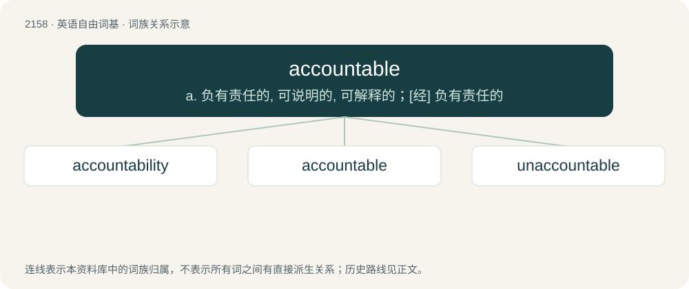

# 2264 · accountable — a. 负有责任的, 可说明的, 可解释的；\[经\] 负有责任的

[总目录](../00_总目录_按常用程度.md)

**类型**：英语自由词基　｜　**来源语言**：见词源记录

## 核心含义与来源

- 核心含义：a. 负有责任的, 可说明的, 可解释的；\[经\] 负有责任的
- 英文含义：Obliged, when called upon, to answer (for one’s deeds); answerable.
- 词形：accountable

**来源记录 1**（形容词；Obliged, when called upon, to answer (for one’s deeds); answerable.）

From account + -able. First attested around 1400.

## 词族图

## 单词速览（常用到不常用）

| 单词 | 音标 | 释义 |
|---|---|---|
| [accountability](#w-1) | 英 /əˌkaʊn.təˈbɪl.ə.ti/；美 /əˌkaʊn.təˈbɪl.ə.ti/ | n. 负有责任, 可说明性；\[化\] 衡算计量 |
| [accountable](#w-2) | /əˈkaʊntəbl̩/ | a. 负有责任的, 可说明的, 可解释的；\[经\] 负有责任的 |
| [unaccountable](#w-3) | /ˌʌnəˈkaʊntəbl̩/ | a. 无法解释的, 无责任的；\[法\] 难以申辩的, 不可解释的, 无关系的 |

## 逐词详解

### 1. accountability

**词性**：名词　｜　**音标**：英 /əˌkaʊn.təˈbɪl.ə.ti/；美 /əˌkaʊn.təˈbɪl.ə.ti/

**中文释义**：n. 负有责任, 可说明性；\[化\] 衡算计量

**英文义项**：The state of being accountable; liability to be called on to render an account or give an explanation; liability to be held responsible or answerable for something. / An open determination of one's responsibility for something and imposition of consequences.

**构词拆分**：accountable + -ity

**词源与演化**：

From accountable + -ity.

**例句**：

> Accountability is in the interest of the Government and the citizenry alike.

### 2. accountable

**词性**：形容词　｜　**音标**：/əˈkaʊntəbl̩/

**中文释义**：a. 负有责任的, 可说明的, 可解释的；\[经\] 负有责任的

**英文义项**：Obliged, when called upon, to answer (for one’s deeds); answerable. / Obliged to keep accurate records (of property or funds).

**构词拆分**：account + -able

**词源与演化**：

From account + -able. First attested around 1400.

**例句**：

> You will be held accountable for your misdemeanors.

该用例对应义项：Obliged, when called upon, to answer (for one’s deeds); answerable.

### 3. unaccountable

**词性**：形容词　｜　**音标**：/ˌʌnəˈkaʊntəbl̩/

**中文释义**：a. 无法解释的, 无责任的；\[法\] 难以申辩的, 不可解释的, 无关系的

**英文义项**：Inexplicable; unable to be accounted for or explained. / Not responsible; free from accountability or control.

**构词拆分**：un- + accountable

**词源与演化**：

From un- + accountable.

**例句**：

> Perceptible only as unaccountable influences that hinder progress.

该用例对应义项：not to be accounted for or explained
