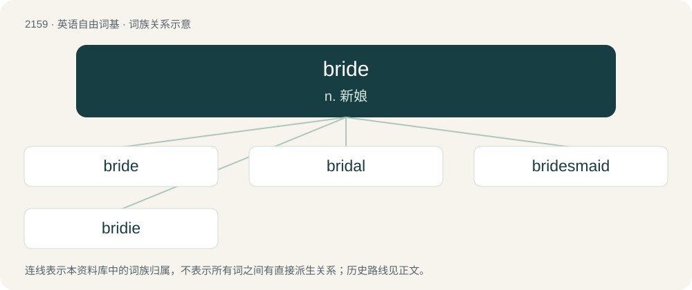

# 2265 · bride — n. 新娘

[总目录](../00_总目录_按常用程度.md)

**类型**：英语自由词基　｜　**来源语言**：见词源记录

## 核心含义与来源

- 核心含义：n. 新娘
- 英文含义：A woman in the context of her own wedding; one who is going to marry or has just been married.
- 词形：bride

**多个词源／构词路径**：同一拼写可能有不同来源；以下按词性和含义分别列出。

**来源记录 1**（名词；A woman in the context of her own wedding; one who is going to marry or has just been married.）

From Middle English bride, from Old English brȳd (“bride”), from Proto-West Germanic \*brūdi, from Proto-Germanic \*brūdiz (“bride”). Cognates Cognate with Yola breede (“bride”), Saterland Frisian Bräid (“bride”), Alemannic German Bruut (“bride”), Central Franconian Brock, Brutt, Bruut (“bride”), Dutch bruid (“bride”), German and Luxembourgish Braut (“bride”), Danish, Norwegian Bokmål, Norwegian Nynorsk, and Swedish brud (“bride”), Faroese and Icelandic brúður (“bride”), Norwegian Nynorsk brud, brur (“bride”), Gothic 𐌱𐍂𐌿𐌸𐍃 (bruþs, “bride”), French bru (“daughter-in-law”), Friulian brût (“daughter-in-law”) (from Old High German brut (“bride”)).

**来源记录 2**（名词；an individual loop or other device connecting the patterns in lacework）

Borrowed from French bride (“bridle”).

## 词族图

## 单词速览（常用到不常用）

| 单词 | 音标 | 释义 |
|---|---|---|
| [bride](#w-1) | 英 /bɹaɪd/；美 /bɹaɪd/ | n. 新娘 |
| [bridal](#w-2) | 英 /ˈbraɪ.dl̩/；美 /ˈbɹaɪd(ə)l/ | a. 新娘的, 婚礼的 |
| [bridesmaid](#w-3) | /ˈbɹaɪdzˌmeɪd/ | n. 女傧相 |
| [bridie](#w-4) | /ˈbɹaɪdi/ | 【英文】A Scottish meat pastry, similar to a Cornish pasty. |

## 逐词详解

### 1. bride

**词性**：名词　｜　**音标**：英 /bɹaɪd/；美 /bɹaɪd/

**中文释义**：n. 新娘

**英文义项**：A woman in the context of her own wedding; one who is going to marry or has just been married.

**词源与演化**：

From Middle English bride, from Old English brȳd (“bride”), from Proto-West Germanic \*brūdi, from Proto-Germanic \*brūdiz (“bride”). Cognates Cognate with Yola breede (“bride”), Saterland Frisian Bräid (“bride”), Alemannic German Bruut (“bride”), Central Franconian Brock, Brutt, Bruut (“bride”), Dutch bruid (“bride”), German and Luxembourgish Braut (“bride”), Danish, Norwegian Bokmål, Norwegian Nynorsk, and Swedish brud (“bride”), Faroese and Icelandic brúður (“bride”), Norwegian Nynorsk brud, brur (“bride”), Gothic 𐌱𐍂𐌿𐌸𐍃 (bruþs, “bride”), French bru (“daughter-in-law”), Friulian brût (“daughter-in-law”) (from Old High German brut (“bride”)).

**例句**：

> I'd like to dedicate this next song to the bride and groom.

### 2. bridal

**词性**：形容词　｜　**音标**：英 /ˈbraɪ.dl̩/；美 /ˈbɹaɪd(ə)l/

**中文释义**：a. 新娘的, 婚礼的

**英文义项**：Of or pertaining to a bride, or to wedding; nuptial.

**构词拆分**：bride + -al

**词源与演化**：

From Middle English bridale, from Old English brȳdealo (“wedding ale; wedding feast”). The attributive usage was strengthened by association with bride + -al.

**用法示例／搭配（非完整句）**：

> bridal ornaments; a bridal outfit; a bridal chamber

该用例对应义项：Of or pertaining to a bride, or to wedding; nuptial.

### 3. bridesmaid

**词性**：名词　｜　**音标**：/ˈbɹaɪdzˌmeɪd/

**中文释义**：n. 女傧相

**英文义项**：A woman who attends a bride during her wedding ceremony, as part of the main wedding party. / A person or team that perennially finishes well, but never first.

**构词拆分**：bride + -s- + maid

**词源与演化**：

From bride + -s- + maid. In the sports and entertainment sense: in reference to the saying always a bridesmaid, never a bride.

**例句**：

> I'd love to be your bridesmaid at the wedding.

该用例对应义项：A woman who attends a bride during her wedding ceremony, as part of the main wedding party.

### 4. bridie

**词性**：名词　｜　**音标**：/ˈbɹaɪdi/

**英文义项**：A Scottish meat pastry, similar to a Cornish pasty.

**构词拆分**：bride + -ie

**词源与演化**：

Perhaps bride + -ie, from being traditionally served at weddings; perhaps from Bridie, a maker's surname.

**例句**：

> Please may I have two pies, a plain bridie and an onion one as well.
