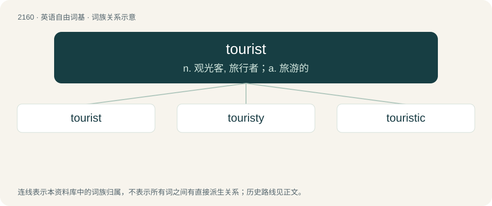

# 2266 · tourist — n. 观光客, 旅行者；a. 旅游的

[总目录](../00_总目录_按常用程度.md)

**类型**：英语自由词基　｜　**来源语言**：见词源记录

## 核心含义与来源

- 核心含义：n. 观光客, 旅行者；a. 旅游的
- 英文含义：Someone who travels for pleasure rather than for business; a leisure visitor.
- 词形：tourist

**来源记录 1**（名词；Someone who travels for pleasure rather than for business; a leisure visitor.）

From tour + -ist. Doublet of turista.

## 词族图

## 单词速览（常用到不常用）

| 单词 | 音标 | 释义 |
|---|---|---|
| [tourist](#w-1) | 英 /ˈtʊəɹɪst/；美 /ˈtʊɹɪst/ | n. 观光客, 旅行者；a. 旅游的 |
| [touristy](#w-2) | 英 /ˈtʊəɹɪsti/ | a. 游览者的, 游览者喜欢的 |
| [touristic](#w-3) | 英 /tʊəˈɹɪstɪk/；美 /tʊɹˈɪstɪk/ | a. 观光的, 旅游者的 |

## 逐词详解

### 1. tourist

**词性**：名词　｜　**音标**：英 /ˈtʊəɹɪst/；美 /ˈtʊɹɪst/

**中文释义**：n. 观光客, 旅行者；a. 旅游的

**英文义项**：Someone who travels for pleasure rather than for business; a leisure visitor. / One who only has a superficial interest in something.

**构词拆分**：tour + -ist

**词源与演化**：

From tour + -ist. Doublet of turista.

**例句**：

> Tourist shops are full of kitsch.

该用例对应义项：Someone who travels for pleasure rather than for business; a leisure visitor.

### 2. touristy

**词性**：形容词　｜　**音标**：英 /ˈtʊəɹɪsti/

**中文释义**：a. 游览者的, 游览者喜欢的

**英文义项**：Catering to tourists; touristic. / Typical of tourists.

**构词拆分**：tourist + -y

**词源与演化**：

From tourist + -y.

**例句**：

> Windsor is very touristy.

该用例对应义项：Catering to tourists; touristic.

### 3. touristic

**词性**：形容词　｜　**音标**：英 /tʊəˈɹɪstɪk/；美 /tʊɹˈɪstɪk/

**中文释义**：a. 观光的, 旅游者的

**英文义项**：Catering to tourists; touristy. / Typical of tourists.

**构词拆分**：tourist + -ic

**词源与演化**：

From tourist + -ic, popularized by its similarity to Romance words like French touristique and Spanish turístico.

**例句**：

> Marioupol is no touristic destination, it’s a worldwide crime scene!
