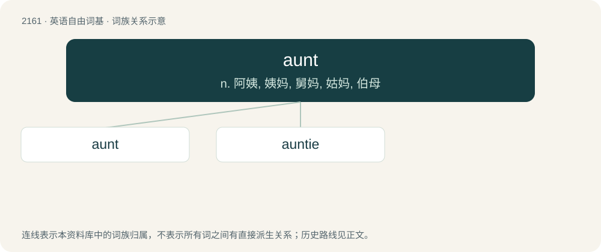

# 2267 · aunt — n. 阿姨, 姨妈, 舅妈, 姑妈, 伯母

[总目录](../00_总目录_按常用程度.md)

**类型**：英语自由词基　｜　**来源语言**：见词源记录

## 核心含义与来源

- 核心含义：n. 阿姨, 姨妈, 舅妈, 姑妈, 伯母
- 英文含义：The sister or sister-in-law of one’s parent.
- 词形：aunt

**来源记录 1**（名词；The sister or sister-in-law of one’s parent.）

From Middle English aunte, from Anglo-Norman aunte, from Old French ante, from Latin amita (“father's sister”). Displaced native Middle English modrie (“aunt”) (from Old English mōdriġe (“maternal aunt”); compare Old English faþu, faþe (“paternal aunt”)). Notes on pronunciation and spelling The digraph ⟨au⟩ representing /æ ~ ɑː/ (rather than /ɔː/) is irregular. It likely reflects a development of Middle English /au̯/ to \[aː~æː\] before /m n/ in some varieties of Early Modern English, which later came to be identified with either /æ/ or \[æː\] from pre-fricative lengthening (in the latter case, creating a phoneme /æː/; this is the basis of the bath lexical set). Such pronunciations historically competed with more learned ones where /au̯/ underwent its normal development to /ɔː/, with the standard language eventually adopting /æ ~ ɑː/ in words that came to be spelt with ⟨a⟩ and /ɔː/ in those which came to be spelt with ⟨au⟩ except in this word. However, dialects may have /æ/ or /ɑː/ in other words such as launch, especially in the UK. An alternative explanation derives /æ ~ ɑː/ in this word (and other instances of bath before /m n/) from a collateral Middle English form with /a/, which would've undergone lengthening before nasals analogous to that occuring before fricatives. Though such a collateral form may be ancestral to pronunciations with /a ~ æ/ in some varieties, this hypothesis cannot explain why inherited instances of bath before /m n/ only derive from Middle English words which had variants in /au̯m au̯n/.

## 词族图

## 单词速览（常用到不常用）

| 单词 | 音标 | 释义 |
|---|---|---|
| [aunt](#w-1) | /ɑːnt/ | n. 阿姨, 姨妈, 舅妈, 姑妈, 伯母 |
| [auntie](#w-2) | 英 /ˈæn.ti/；/ˈɐn.ti/ | n. 阿姨, 姨妈, 舅妈, 姑妈, 伯母 |

## 逐词详解

### 1. aunt

**词性**：名词　｜　**音标**：/ɑːnt/

**中文释义**：n. 阿姨, 姨妈, 舅妈, 姑妈, 伯母

**英文义项**：The sister or sister-in-law of one’s parent. / The female cousin or cousin-in-law of one’s parent.

**词源与演化**：

From Middle English aunte, from Anglo-Norman aunte, from Old French ante, from Latin amita (“father's sister”). Displaced native Middle English modrie (“aunt”) (from Old English mōdriġe (“maternal aunt”); compare Old English faþu, faþe (“paternal aunt”)). Notes on pronunciation and spelling The digraph ⟨au⟩ representing /æ ~ ɑː/ (rather than /ɔː/) is irregular. It likely reflects a development of Middle English /au̯/ to \[aː~æː\] before /m n/ in some varieties of Early Modern English, which later came to be identified with either /æ/ or \[æː\] from pre-fricative lengthening (in the latter case, creating a phoneme /æː/; this is the basis of the bath lexical set). Such pronunciations historically competed with more learned ones where /au̯/ underwent its normal development to /ɔː/, with the standard language eventually adopting /æ ~ ɑː/ in words that came to be spelt with ⟨a⟩ and /ɔː/ in those which came to be spelt with ⟨au⟩ except in this word. However, dialects may have /æ/ or /ɑː/ in other words such as launch, especially in the UK. An alternative explanation derives /æ ~ ɑː/ in this word (and other instances of bath before /m n/) from a collateral Middle English form with /a/, which would've undergone lengthening before nasals analogous to that occuring before fricatives. Though such a collateral form may be ancestral to pronunciations with /a ~ æ/ in some varieties, this hypothesis cannot explain why inherited instances of bath before /m n/ only derive from Middle English words which had variants in /au̯m au̯n/.

**例句**：

> My aunt allowed me to park my car in her parking space.

### 2. auntie

**词性**：名词　｜　**音标**：英 /ˈæn.ti/；/ˈɐn.ti/

**中文释义**：n. 阿姨, 姨妈, 舅妈, 姑妈, 伯母

**英文义项**：Term of familiarity or respect for a middle-aged or elderly woman. / Female domestic helper.

**构词拆分**：aunt + -ie

**词源与演化**：

From aunt + -ie.

**例句**：

> We won't be seeing Auntie Jo this time round – maybe next time.
