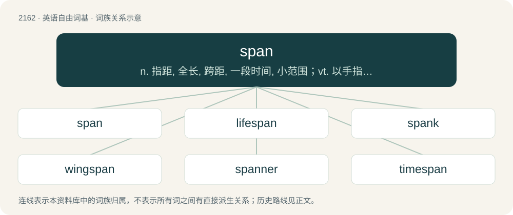

# 2268 · span — n. 指距, 全长, 跨距, 一段时间, 小范围；vt. 以手指测量, 跨越, 架设, 持续

[总目录](../00_总目录_按常用程度.md)

**类型**：英语自由词基　｜　**来源语言**：见词源记录

## 核心含义与来源

- 核心含义：n. 指距, 全长, 跨距, 一段时间, 小范围；vt. 以手指测量, 跨越, 架设, 持续
- 英文含义：The full width of an open hand from the end of the thumb to the end of the little finger used as an informal unit of length.
- 词形：span

**多个词源／构词路径**：同一拼写可能有不同来源；以下按词性和含义分别列出。

**来源记录 1**（名词；The full width of an open hand from the end of the thumb to the end of the little finger used as an informal unit of length.）

From Middle English spanne, from Old English spann, from Proto-Germanic \*spannō (“span, handbreadth”), from Proto-Indo-European \*(s)pend- (“to stretch”). Cognate with Dutch span, spanne, German Spanne. The sense “pair of horses” is probably from Old English ġespan, ġespann (“a joining; a fastening together; clasp; yoke”), from Proto-West Germanic \[Term?\]. Cognate with Dutch gespan, German Gespann.

**来源记录 2**（动词；To extend across (a gap or space between two sides).）

From Middle English spannen, from Old English spannan, from Proto-Germanic \*spannaną (“to stretch, span”). Cognate with German spannen, Dutch spannen.

## 词族图

## 单词速览（常用到不常用）

| 单词 | 音标 | 释义 |
|---|---|---|
| [span](#w-1) | 英 /spæn/ | n. 指距, 全长, 跨距, 一段时间, 小范围；vt. 以手指测量, 跨越, 架设, 持续 |
| [lifespan](#w-2) | /ˈlaɪf.spæn/ | n. 预期生命期限；寿命；预期使用期限 |
| [spank](#w-3) | 美 /ˈspeɪ̯ŋk/；/ˈspæŋk/ | 【英文】To move quickly and nimbly on foot; to stride or run at a brisk pace. |
| [wingspan](#w-4) | /ˈwɪŋ.spæn/ | n. 翼展 |
| [spanner](#w-5) | 英 /ˈspænə/；/ˈspænə/ | n. 扳手；\[化\] 扳手; 紧固扳手; 紧固器 |
| [timespan](#w-6) |  | \[医\]（罗氏公司）定时释放片剂 |

## 逐词详解

### 1. span

**词性**：名词　｜　**音标**：英 /spæn/

**中文释义**：n. 指距, 全长, 跨距, 一段时间, 小范围；vt. 以手指测量, 跨越, 架设, 持续

**英文义项**：The full width of an open hand from the end of the thumb to the end of the little finger used as an informal unit of length. / Any of various traditional units of length approximating this distance, especially the English handspan of 9 inches forming ⅛ fathom and equivalent to 22.86 cm.

**词源与演化**：

From Middle English spanne, from Old English spann, from Proto-Germanic \*spannō (“span, handbreadth”), from Proto-Indo-European \*(s)pend- (“to stretch”). Cognate with Dutch span, spanne, German Spanne. The sense “pair of horses” is probably from Old English ġespan, ġespann (“a joining; a fastening together; clasp; yoke”), from Proto-West Germanic \[Term?\]. Cognate with Dutch gespan, German Gespann.

**例句**：

> He has a short attention span and gets bored within minutes.

该用例对应义项：A small space or a brief portion of time.

### 2. lifespan

**词性**：名词　｜　**音标**：/ˈlaɪf.spæn/

**中文释义**：n. 预期生命期限；寿命；预期使用期限

**英文义项**：The length of time for which an organism lives. / The length of time for which something exists or is current, valid, or usable.

**构词拆分**：life + span

**词源与演化**：

From life + span.

**例句**：

> Some clams have lifespans far longer than those of human beings.

该用例对应义项：The length of time for which an organism lives.

### 3. spank

**词性**：动词　｜　**音标**：美 /ˈspeɪ̯ŋk/；/ˈspæŋk/

**英文义项**：To move quickly and nimbly on foot; to stride or run at a brisk pace. / To move or turn rapidly, as the gears of a machine or the sails of a ship.

**构词拆分**：span + -k

**词源与演化**：

Uncertain. Likely of Dutch or Low German origin. Compare North Frisian spanke (“to step with pride”), Saterland Frisian spankje (“to splash”), dialectal Dutch spanken (“to limp, hobble”), Dutch spankeren (“to run away quickly, gallop off”), German Low German spenkern (“to burst, explode, shatter, splash, spray”), Danish spanke (“to strut”), Swedish spånka (“to strut proudly”); originally, equivalent to span + -k. Compare also dialectal English spang (“to leap, bound; shoot out, fling”).

**例句**：

> The ship was really spanking along.

该用例对应义项：To move or turn rapidly, as the gears of a machine or the sails of a ship.

### 4. wingspan

**词性**：名词　｜　**音标**：/ˈwɪŋ.spæn/

**中文释义**：n. 翼展

**英文义项**：The distance from the left wingtip to the right wingtip (of a bird, airplane etc.). / Synonym of arm span.

**构词拆分**：wing + span

**词源与演化**：

From wing + span.

**例句**：

> The Airbus A380 has one of the largest wingspans among aircraft; only a few surpass it.

该用例对应义项：The distance from the left wingtip to the right wingtip (of a bird, airplane etc.).

### 5. spanner

**词性**：名词　｜　**音标**：英 /ˈspænə/；/ˈspænə/

**中文释义**：n. 扳手；\[化\] 扳手; 紧固扳手; 紧固器

**英文义项**：A hand tool for adjusting nuts and bolts. / Any of certain types of such a tool that have a pin or hook to engage the driven object.

**构词拆分**：span + -er

**词源与演化**：

From span + -er.

**例句**：

> The groove in this toolholder is what the spanner grabs onto when you are changing the tool.

该用例对应义项：Any of certain types of such a tool that have a pin or hook to engage the driven object.

### 6. timespan

**词性**：名词

**中文释义**：\[医\]（罗氏公司）定时释放片剂

**英文义项**：An interval of time.

**构词拆分**：time + span

**词源与演化**：

From time + span.
