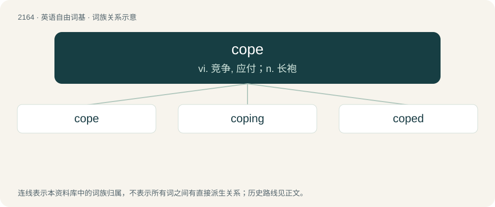

# 2269 · cope — vi. 竞争, 应付；n. 长袍

[总目录](../00_总目录_按常用程度.md)

**类型**：英语自由词基　｜　**来源语言**：见词源记录

## 核心含义与来源

- 核心含义：vi. 竞争, 应付；n. 长袍
- 英文含义：To deal effectively with something, especially if difficult.
- 词形：cope

**多个词源／构词路径**：同一拼写可能有不同来源；以下按词性和含义分别列出。

**来源记录 1**（动词；To deal effectively with something, especially if difficult.）

From Middle English coupen, from Old French coper, couper (“to strike, to cut”). The noun use went mainstream around 2020.

**来源记录 2**（名词；A long, loose cloak worn by a priest, deacon, or bishop when presiding over a ceremony other than the Mass.）

From Middle English cope, from Medieval Latin cāpa (“cape”) Doublet of cap, cape, and chape.

## 词族图

## 单词速览（常用到不常用）

| 单词 | 音标 | 释义 |
|---|---|---|
| [cope](#w-1) | 英 /ˈkəʊp/；美 /ˈkoʊp/ | vi. 竞争, 应付；n. 长袍 |
| [coping](#w-2) | /ˈkəupiŋ/ | n. 墙压顶, 顶部, 顶盖, 墙的顶部；\[医\] 盖 |
| [coped](#w-3) | /kəupt/ | v. 成功地应付, 对付( cope的过去式和过去分词 ) |

## 逐词详解

### 1. cope

**词性**：动词　｜　**音标**：英 /ˈkəʊp/；美 /ˈkoʊp/

**中文释义**：vi. 竞争, 应付；n. 长袍

**英文义项**：To deal effectively with something, especially if difficult. / To cut and form a mitred joint in wood or metal.

**词源与演化**：

From Middle English coupen, from Old French coper, couper (“to strike, to cut”). The noun use went mainstream around 2020.

**例句**：

> Everybody in this world has to cope with a lot of difficulties.

### 2. coping

**词性**：名词　｜　**音标**：/ˈkəupiŋ/

**中文释义**：n. 墙压顶, 顶部, 顶盖, 墙的顶部；\[医\] 盖

**英文义项**：The top layer of a brick wall, especially one that slopes in order to throw off water. / The process of managing taxing circumstances, expending effort to solve personal and interpersonal problems, and seeking to master, minimize, reduce or tolerate stress or conflict.

**构词拆分**：cope + -ing

**词源与演化**：

From cope + -ing. The sense referring to a brick wall is cope (sense 2), used in the sense "dress in a cope," "to cover."

**例句**：

> Tom is having trouble coping with the fact that his son committed suicide.

### 3. coped

**词性**：形容词　｜　**音标**：/kəupt/

**中文释义**：v. 成功地应付, 对付( cope的过去式和过去分词 )

**英文义项**：Clad in a cope.

**构词拆分**：cope + -ed

**词源与演化**：

From cope + -ed. Piecewise doublet of caped, capped, and chaped.

**例句**：

> Without Boldi, Martha would never have coped with that problem.
