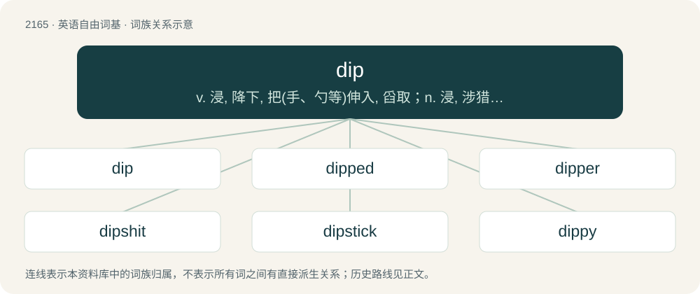

# 2270 · dip — v. 浸, 降下, 把(手、勺等)伸入, 舀取；n. 浸, 涉猎；\[计\] 双列直插式组件, 分布式输入输出系统, 双排直插封装

[总目录](../00_总目录_按常用程度.md)

**类型**：英语自由词基　｜　**来源语言**：见词源记录

## 核心含义与来源

- 核心含义：v. 浸, 降下, 把(手、勺等)伸入, 舀取；n. 浸, 涉猎；\[计\] 双列直插式组件, 分布式输入输出系统, 双排直插封装
- 英文含义：A lower section of a road or geological feature.
- 词形：dip

**多个词源／构词路径**：同一拼写可能有不同来源；以下按词性和含义分别列出。

**来源记录 1**（名词；A lower section of a road or geological feature.）

From Middle English dippen, from Old English dyppan, from Proto-West Germanic \*duppjan, from Proto-Germanic \*dupjaną; see \*daupijaną (“to dip”). Related to deep.

**来源记录 2**（名词；A foolish person.）

Back-formation from dippy.

**来源记录 3**（名词；A diplomat.）

Shortenings.

## 词族图

## 单词速览（常用到不常用）

| 单词 | 音标 | 释义 |
|---|---|---|
| [dip](#w-1) | /dɪp/ | v. 浸, 降下, 把(手、勺等)伸入, 舀取；n. 浸, 涉猎；\[计\] 双列直插式组件, 分布式输入输出系统, 双排直插封装 |
| [dipped](#w-2) | 英 /dɪpt/ | v. 浸( dip的过去式和过去分词 ); （把烛芯浸在融蜡里）制造（蜡烛）; 把（汽车前灯）的远光调为近光; 洗药水浴 |
| [dipper](#w-3) | 英 /ˈdɪpə/；美 /ˈdɪpɚ/ | n. 显影液槽, 浸礼会教友, 浸染工, 北斗七星；\[机\] 杓 |
| [dipshit](#w-4) | /ˈdɪpʃɪt/ | 笨蛋 |
| [dipstick](#w-5) | /ˈdɪpstɪk/ | n. 量油尺 |
| [dippy](#w-6) | /ˈdɪpi/ | a. 脑筋不正常的, 昏头昏脑的 |

## 逐词详解

### 1. dip

**词性**：名词　｜　**音标**：/dɪp/

**中文释义**：v. 浸, 降下, 把(手、勺等)伸入, 舀取；n. 浸, 涉猎；\[计\] 双列直插式组件, 分布式输入输出系统, 双排直插封装

**英文义项**：A lower section of a road or geological feature. / Inclination downward; direction below a horizontal line; slope; pitch.

**词源与演化**：

From Middle English dippen, from Old English dyppan, from Proto-West Germanic \*duppjan, from Proto-Germanic \*dupjaną; see \*daupijaną (“to dip”). Related to deep.

**例句**：

> I’m going for a dip before breakfast.

该用例对应义项：A swim, usually a short swim to refresh.

### 2. dipped

**词性**：形容词　｜　**音标**：英 /dɪpt/

**中文释义**：v. 浸( dip的过去式和过去分词 ); （把烛芯浸在融蜡里）制造（蜡烛）; 把（汽车前灯）的远光调为近光; 洗药水浴

**英文义项**：That has been briefly immersed in a liquid. / Of headlights: lowered.

**构词拆分**：From dip + -ed.

**词源与演化**：

From dip + -ed.

**例句**：

> The road dipped into a valley, then swept up over a hill.

### 3. dipper

**词性**：名词　｜　**音标**：英 /ˈdɪpə/；美 /ˈdɪpɚ/

**中文释义**：n. 显影液槽, 浸礼会教友, 浸染工, 北斗七星；\[机\] 杓

**英文义项**：One who, or that which, dips (immerses something, or itself, into a liquid). / Any of various small passerine birds of the genus Cinclus that live near fast-flowing streams and feed along the bottom.

**构词拆分**：dip + -er

**词源与演化**：

From Middle English dippere; equivalent to dip + -er.

**例句**：

> One constellation that most people know is the Big Dipper.

### 4. dipshit

**词性**：名词　｜　**音标**：/ˈdɪpʃɪt/

**中文释义**：笨蛋

**英文义项**：A stupid, obnoxious, or undesirable person.

**构词拆分**：dip (“foolish person”) + shit

**词源与演化**：

Compound of dip (“foolish person”) + shit. First attested in c. 1960s.

**例句**：

> That guy at work is such a dipshit!

该用例对应义项：A stupid, obnoxious, or undesirable person.

### 5. dipstick

**词性**：名词　｜　**音标**：/ˈdɪpstɪk/

**中文释义**：n. 量油尺

**英文义项**：A stick or rod used to measure the depth of a liquid. Often used to check the level at which a liquid in an opaque or inaccessible tank or reservoir stands; gauge. / The penis.

**构词拆分**：dip + stick

**词源与演化**：

From dip + stick.

**例句**：

> I haven't checked the oil level of my car's motor since I lost the dipstick three months ago.

该用例对应义项：A stick or rod used to measure the depth of a liquid. Often used to check the level at which a liquid in an opaque or inaccessible tank or reservoir stands; gauge.

### 6. dippy

**词性**：形容词　｜　**音标**：/ˈdɪpi/

**中文释义**：a. 脑筋不正常的, 昏头昏脑的

**英文义项**：Lacking common sense. / Having romantic feelings for; excited or enthusiastic about.

**构词拆分**：From dip + -y.

**词源与演化**：

From dip + -y.
