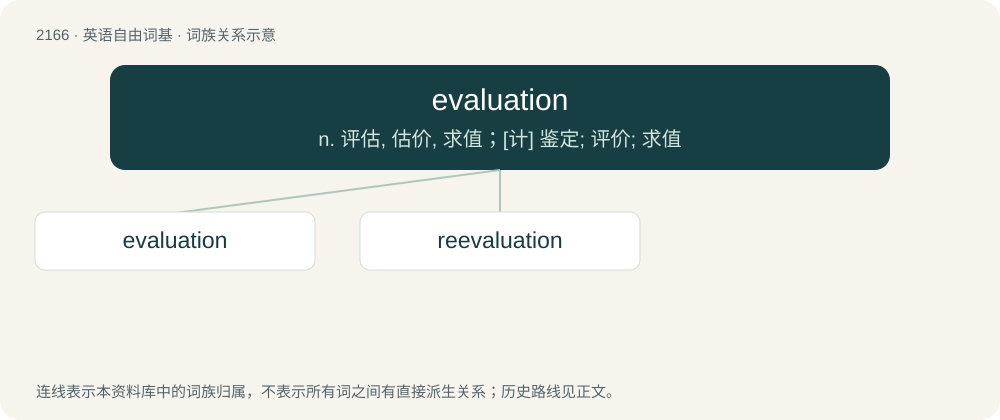

# 2271 · evaluation — n. 评估, 估价, 求值；\[计\] 鉴定; 评价; 求值

[总目录](../00_总目录_按常用程度.md)

**类型**：英语自由词基　｜　**来源语言**：见词源记录

## 核心含义与来源

- 核心含义：n. 评估, 估价, 求值；\[计\] 鉴定; 评价; 求值
- 英文含义：An assessment, such as an annual personnel performance review used as the basis for a salary increase or bonus, or a summary of a particular situation.
- 词形：evaluation

**来源记录 1**（名词；An assessment, such as an annual personnel performance review used as the basis for a salary increase or bonus, or a summary of a particular situation.）

From French évaluation. By surface analysis, evaluate + -ion.

## 词族图

## 单词速览（常用到不常用）

| 单词 | 音标 | 释义 |
|---|---|---|
| [evaluation](#w-1) | /ɪˌvæljuˈeɪʃn̩/ | n. 评估, 估价, 求值；\[计\] 鉴定; 评价; 求值 |
| [reevaluation](#w-2) | /ˈriːivæljuˈeiʃən/ | 重估计, 重求值 |

## 逐词详解

### 1. evaluation

**词性**：名词　｜　**音标**：/ɪˌvæljuˈeɪʃn̩/

**中文释义**：n. 评估, 估价, 求值；\[计\] 鉴定; 评价; 求值

**英文义项**：An assessment, such as an annual personnel performance review used as the basis for a salary increase or bonus, or a summary of a particular situation. / A completion of a mathematical operation; a valuation.

**词源与演化**：

From French évaluation. By surface analysis, evaluate + -ion.

**例句**：

> The result of the semestral evaluation will go towards your final score.

该用例对应义项：An assessment, such as an annual personnel performance review used as the basis for a salary increase or bonus, or a summary of a particular situation.

### 2. reevaluation

**词性**：名词　｜　**音标**：/ˈriːivæljuˈeiʃən/

**中文释义**：重估计, 重求值

**英文义项**：A second or subsequent evaluation or rating

**构词拆分**：re- + evaluation

**词源与演化**：

From re- + evaluation.

**例句**：

> Science involves constant questioning and reevaluation.
