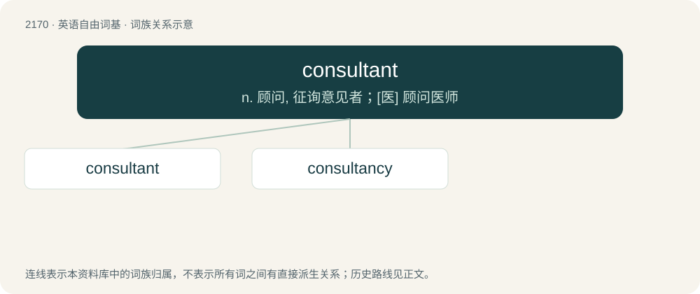

# 2273 · consultant — n. 顾问, 征询意见者；\[医\] 顾问医师

[总目录](../00_总目录_按常用程度.md)

**类型**：英语自由词基　｜　**来源语言**：见词源记录

## 核心含义与来源

- 核心含义：n. 顾问, 征询意见者；\[医\] 顾问医师
- 英文含义：A person or party that is consulted.
- 词形：consultant

**来源记录 1**（名词；A person or party that is consulted.）

From French consultant, present participle of consulter, from Latin cōnsultāre (“to deliberate, consult”), frequentative of cōnsulere (“to consult, deliberate, consider, reflect upon, ask advice”), from com- (“together”) + -sulere, of uncertain origin.

## 词族图

## 单词速览（常用到不常用）

| 单词 | 音标 | 释义 |
|---|---|---|
| [consultant](#w-1) | 英 /kənˈsʌl.tənt/ | n. 顾问, 征询意见者；\[医\] 顾问医师 |
| [consultancy](#w-2) | 英 /kənˈsʌl.tən.si/ | n. 商量, 协商, 磋商, 会诊, 与...商量, 咨询, 请教, 找(医生)看病, 查阅, 考虑；\[经\] 咨询业务, 咨询服务 |

## 逐词详解

### 1. consultant

**词性**：名词　｜　**音标**：英 /kənˈsʌl.tənt/

**中文释义**：n. 顾问, 征询意见者；\[医\] 顾问医师

**英文义项**：A person or party that is consulted. / A person whose occupation is to be consulted for their expertise, advice, service or help in an area or specialty; a party whose business is to be similarly consulted.

**词源与演化**：

From French consultant, present participle of consulter, from Latin cōnsultāre (“to deliberate, consult”), frequentative of cōnsulere (“to consult, deliberate, consider, reflect upon, ask advice”), from com- (“together”) + -sulere, of uncertain origin.

**例句**：

> The debate over which consultant to use went on for hours.

### 2. consultancy

**词性**：名词　｜　**音标**：英 /kənˈsʌl.tən.si/

**中文释义**：n. 商量, 协商, 磋商, 会诊, 与...商量, 咨询, 请教, 找(医生)看病, 查阅, 考虑；\[经\] 咨询业务, 咨询服务

**英文义项**：A consultant or consulting firm. / The services offered by a consultant.

**构词拆分**：consultant + -cy；consult + -ancy

**词源与演化**：

From consultant + -cy or consult + -ancy.

**例句**：

> For a PR campaign like never before, one needs a consultancy of unprecedented scope and power.

该用例对应义项：A consultant or consulting firm.
