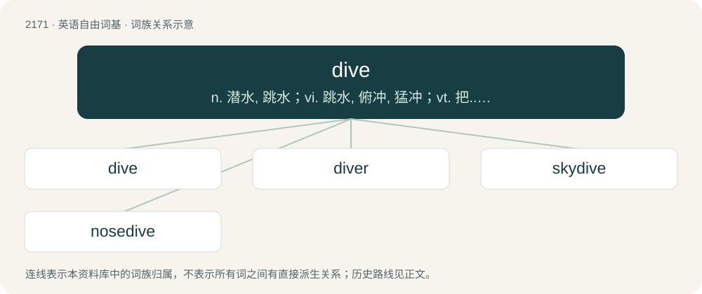

# 2274 · dive — n. 潜水, 跳水；vi. 跳水, 俯冲, 猛冲；vt. 把...突然伸入

[总目录](../00_总目录_按常用程度.md)

**类型**：英语自由词基　｜　**来源语言**：见词源记录

## 核心含义与来源

- 核心含义：n. 潜水, 跳水；vi. 跳水, 俯冲, 猛冲；vt. 把...突然伸入
- 英文含义：To swim under water.
- 词形：dive

**来源记录 1**（动词；To swim under water.）

From Middle English diven, duven, from the merger of Old English dȳfan (“to dip, immerse”, transitive weak verb) (from Proto-Germanic \*dūbijaną) and dūfan (“to duck, dive, sink, penetrate”, intransitive strong verb) (past participle ġedofen). Cognate with Icelandic dýfa (“to dip, dive”), Low German bedaven (“covered, covered with water”). See also deep, dip.

## 词族图

## 单词速览（常用到不常用）

| 单词 | 音标 | 释义 |
|---|---|---|
| [dive](#w-1) | /daɪv/ | n. 潜水, 跳水；vi. 跳水, 俯冲, 猛冲；vt. 把...突然伸入 |
| [diver](#w-2) | /ˈdaɪ̯və(ɹ)/ | n. 潜水者 |
| [skydive](#w-3) | /ˈskaɪˌdaɪv/ | v. 跳伞运动员在降落伞张开前做空中造型动作 |
| [nosedive](#w-4) | /ˈnəʊzdaɪv/ | vi. 俯冲, (价格)猛跌, 暴落 |

## 逐词详解

### 1. dive

**词性**：动词　｜　**音标**：/daɪv/

**中文释义**：n. 潜水, 跳水；vi. 跳水, 俯冲, 猛冲；vt. 把...突然伸入

**英文义项**：To swim under water. / To jump into water head-first.

**词源与演化**：

From Middle English diven, duven, from the merger of Old English dȳfan (“to dip, immerse”, transitive weak verb) (from Proto-Germanic \*dūbijaną) and dūfan (“to duck, dive, sink, penetrate”, intransitive strong verb) (past participle ġedofen). Cognate with Icelandic dýfa (“to dip, dive”), Low German bedaven (“covered, covered with water”). See also deep, dip.

**用法示例／搭配（非完整句）**：

> to dive into home plate

该用例对应义项：To jump headfirst toward the ground or into another substance.

### 2. diver

**词性**：名词　｜　**音标**：/ˈdaɪ̯və(ɹ)/

**中文释义**：n. 潜水者

**英文义项**：Someone who dives, especially as a sport. / Someone who works underwater; a frogman.

**构词拆分**：dive + -er

**词源与演化**：

From dive + -er.

**例句**：

> Chinese diver Chen Aisen earned a perfect score on his last dive.

### 3. skydive

**词性**：名词　｜　**音标**：/ˈskaɪˌdaɪv/

**中文释义**：v. 跳伞运动员在降落伞张开前做空中造型动作

**英文义项**：An instance of skydiving.

**构词拆分**：sky + dive

**词源与演化**：

From sky + dive.

**例句**：

> Tom wanted to skydive on his 30th birthday.

### 4. nosedive

**词性**：名词　｜　**音标**：/ˈnəʊzdaɪv/

**中文释义**：vi. 俯冲, (价格)猛跌, 暴落

**英文义项**：A headfirst fall or jump. / A drop in altitude with the nose of the craft angled downwards.

**构词拆分**：nose + dive

**词源与演化**：

From nose + dive.

**例句**：

> The stock took a nosedive.

该用例对应义项：a sudden sharp drop or rapid decline
