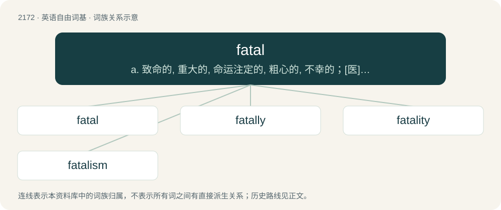

# 2275 · fatal — a. 致命的, 重大的, 命运注定的, 粗心的, 不幸的；\[医\] 致命的, 致死的

[总目录](../00_总目录_按常用程度.md)

**类型**：英语自由词基　｜　**来源语言**：见词源记录

## 核心含义与来源

- 核心含义：a. 致命的, 重大的, 命运注定的, 粗心的, 不幸的；\[医\] 致命的, 致死的
- 英文含义：Causing death or destruction.
- 词形：fatal

**来源记录 1**（形容词；Causing death or destruction.）

From Middle French fatal, from Latin fātālis (“fatal”).

## 词族图

## 单词速览（常用到不常用）

| 单词 | 音标 | 释义 |
|---|---|---|
| [fatal](#w-1) | /ˈfeɪ.təl/ | a. 致命的, 重大的, 命运注定的, 粗心的, 不幸的；\[医\] 致命的, 致死的 |
| [fatally](#w-2) | /ˈfeɪtəli/ | adv. 致命地, 不幸地, 宿命地 |
| [fatality](#w-3) | 英 /fəˈtælətɪ/；美 /feɪˈtælɪti/ | n. 不幸, 厄运, 致命性, 死亡者, 厄运, 天命 |
| [fatalism](#w-4) | /ˈfeɪ.təl.ɪz.əm/ | n. 宿命论 |

## 逐词详解

### 1. fatal

**词性**：形容词　｜　**音标**：/ˈfeɪ.təl/

**中文释义**：a. 致命的, 重大的, 命运注定的, 粗心的, 不幸的；\[医\] 致命的, 致死的

**英文义项**：Causing death or destruction. / Causing a sudden end to the running of a program.

**词源与演化**：

From Middle French fatal, from Latin fātālis (“fatal”).

**用法示例／搭配（非完整句）**：

> a fatal wound; a fatal disease; that fatal day; a fatal mistake

该用例对应义项：Causing death or destruction.

### 2. fatally

**词性**：副词　｜　**音标**：/ˈfeɪtəli/

**中文释义**：adv. 致命地, 不幸地, 宿命地

**英文义项**：In a deadly manner; lethally. / Ultimately, with finality or irrevocability, moving towards the demise of something.

**构词拆分**：fatal + -ly

**词源与演化**：

From fatal + -ly.

**例句**：

> Fatally, the city’s governor allowed public festivities and mass gatherings to continue.

### 3. fatality

**词性**：名词　｜　**音标**：英 /fəˈtælətɪ/；美 /feɪˈtælɪti/

**中文释义**：n. 不幸, 厄运, 致命性, 死亡者, 厄运, 天命

**英文义项**：The state proceeding from destiny; invincible necessity, superior to, and independent of, free and rational control. / Tendency to death, destruction or danger, as if by decree of fate.

**构词拆分**：fatal + -ity

**词源与演化**：

From French fatalité. equivalent to fatal + -ity. The video game move sense was popularized by the Mortal Kombat series.

**例句**：

> Oslo and Helsinki did not record a single pedestrian fatality in 2019.

### 4. fatalism

**词性**：名词　｜　**音标**：/ˈfeɪ.təl.ɪz.əm/

**中文释义**：n. 宿命论

**英文义项**：The doctrine that all events are subject to fate or inevitable necessity, or determined in advance in such a way that human beings cannot alter them.

**构词拆分**：fatal + -ism

**词源与演化**：

From fatal + -ism.

**例句**：

> Your fatalism is ruining everyone's mood.
