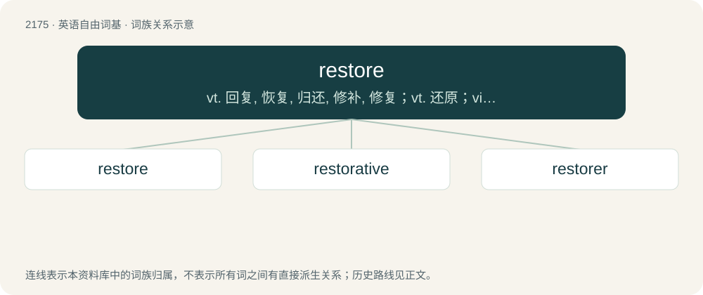

# 2276 · restore — vt. 回复, 恢复, 归还, 修补, 修复；vt. 还原；vi. 还原

[总目录](../00_总目录_按常用程度.md)

**类型**：英语自由词基　｜　**来源语言**：见词源记录

## 核心含义与来源

- 核心含义：vt. 回复, 恢复, 归还, 修补, 修复；vt. 还原；vi. 还原
- 英文含义：To reestablish, or bring back into existence.
- 词形：restore

**来源记录 1**（动词；To reestablish, or bring back into existence.）

From Middle English restoren, from Old French restorer, from Latin rēstaurāre. By surface analysis, re- + store.

## 词族图

## 单词速览（常用到不常用）

| 单词 | 音标 | 释义 |
|---|---|---|
| [restore](#w-1) | 英 /ɹɪˈstɔː/；美 /ɹɪˈstoɹ/ | vt. 回复, 恢复, 归还, 修补, 修复；vt. 还原；vi. 还原 |
| [restorative](#w-2) | /ɹɪˈstɒɹətɪv/ | a. 恢复健康的, 滋补的；n. 兴奋药, 补药 |
| [restorer](#w-3) | /risˈtɔːrə/ | n. 修补者, 修建者, 修补物, 恢复剂；\[计\] 恢复设备, 复位器 |

## 逐词详解

### 1. restore

**词性**：动词　｜　**音标**：英 /ɹɪˈstɔː/；美 /ɹɪˈstoɹ/

**中文释义**：vt. 回复, 恢复, 归还, 修补, 修复；vt. 还原；vi. 还原

**英文义项**：To reestablish, or bring back into existence. / To bring back to good condition from a state of decay or ruin.

**构词拆分**：By surface analysis, re- + store

**词源与演化**：

From Middle English restoren, from Old French restorer, from Latin rēstaurāre. By surface analysis, re- + store.

**用法示例／搭配（非完整句）**：

> to restore harmony among those who are at variance

该用例对应义项：To reestablish, or bring back into existence.

### 2. restorative

**词性**：形容词　｜　**音标**：/ɹɪˈstɒɹətɪv/

**中文释义**：a. 恢复健康的, 滋补的；n. 兴奋药, 补药

**英文义项**：Serving to restore.

**构词拆分**：restore + -ative

**词源与演化**：

From Middle English restoratif, restoratyve, from Old French restoratif, restauratif and Medieval Latin restaurātīvus. Equivalent to restore + -ative.

**例句**：

> After a long day working in the fields Clarence took comfort in a restorative pint of beer.

该用例对应义项：Serving to restore.

### 3. restorer

**词性**：名词　｜　**音标**：/risˈtɔːrə/

**中文释义**：n. 修补者, 修建者, 修补物, 恢复剂；\[计\] 恢复设备, 复位器

**英文义项**：Something or someone that restores.

**构词拆分**：From restore + -er.

**词源与演化**：

From restore + -er.
