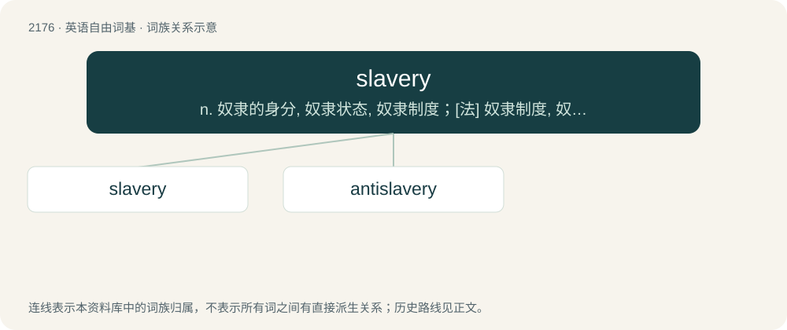

# 2277 · slavery — n. 奴隶的身分, 奴隶状态, 奴隶制度；\[法\] 奴隶制度, 奴役, 苦役

[总目录](../00_总目录_按常用程度.md)

**类型**：英语自由词基　｜　**来源语言**：见词源记录

## 核心含义与来源

- 核心含义：n. 奴隶的身分, 奴隶状态, 奴隶制度；\[法\] 奴隶制度, 奴役, 苦役
- 英文含义：An institution or social practice of owning human beings as property, especially for use as forced laborers.
- 词形：slavery

**多个词源／构词路径**：同一拼写可能有不同来源；以下按词性和含义分别列出。

**来源记录 1**（名词；An institution or social practice of owning human beings as property, especially for use as forced laborers.）

From slave + -ery.

**来源记录 2**（形容词；Covered in slaver; slobbery.）

From slaver + -y.

## 词族图

## 单词速览（常用到不常用）

| 单词 | 音标 | 释义 |
|---|---|---|
| [slavery](#w-1) | /ˈsleɪvəɹi/ | n. 奴隶的身分, 奴隶状态, 奴隶制度；\[法\] 奴隶制度, 奴役, 苦役 |
| [antislavery](#w-2) | /.æntiˈsleivəri/ | n. 反对奴隶制；a. 反对奴隶制度的 |

## 逐词详解

### 1. slavery

**词性**：名词　｜　**音标**：/ˈsleɪvəɹi/

**中文释义**：n. 奴隶的身分, 奴隶状态, 奴隶制度；\[法\] 奴隶制度, 奴役, 苦役

**英文义项**：An institution or social practice of owning human beings as property, especially for use as forced laborers. / Forced labor in general, regardless of legality.

**构词拆分**：slave + -ery

**词源与演化**：

From slave + -ery.

**例句**：

> Slavery was abolished in the nineteenth century.

该用例对应义项：An institution or social practice of owning human beings as property, especially for use as forced laborers.

### 2. antislavery

**词性**：形容词　｜　**音标**：/.æntiˈsleivəri/

**中文释义**：n. 反对奴隶制；a. 反对奴隶制度的

**英文义项**：Opposed to the practice of slavery.

**构词拆分**：anti- + slavery

**词源与演化**：

From anti- + slavery.

**例句**：

> Prior to the U.S. Civil War, there were a number of northern periodicals devoted to publishing antislavery content.

该用例对应义项：Opposed to the practice of slavery.
