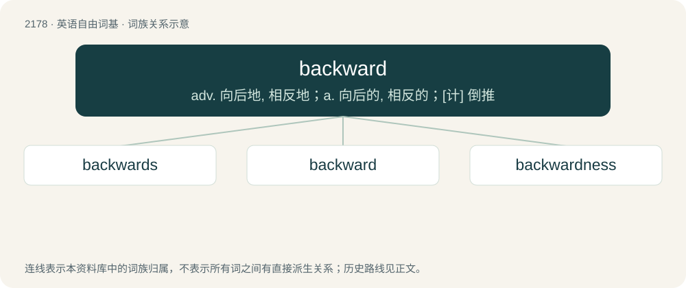

# 2279 · backward — adv. 向后地, 相反地；a. 向后的, 相反的；\[计\] 倒推

[总目录](../00_总目录_按常用程度.md)

**类型**：英语自由词基　｜　**来源语言**：见词源记录

## 核心含义与来源

- 核心含义：adv. 向后地, 相反地；a. 向后的, 相反的；\[计\] 倒推
- 英文含义：Situated toward or at the rear of something.
- 词形：backward

**来源记录 1**（形容词；Situated toward or at the rear of something.）

From Middle English bakwarde, abakward, equivalent to back (adverb) + -ward. Cognate with Old Frisian bekward (“backward”).

## 词族图

## 单词速览（常用到不常用）

| 单词 | 音标 | 释义 |
|---|---|---|
| [backwards](#w-1) | 英 /ˈbækwɜːdz/；美 /ˈbækwɜɹdz/ | adv. 向后 |
| [backward](#w-2) | 英 /ˈbæk.wə(ɹ)d/；美 /ˈbækwɚd/ | adv. 向后地, 相反地；a. 向后的, 相反的；\[计\] 倒推 |
| [backwardness](#w-3) |  | n. (无比较级)向后, 相反, 倒, 回顾, 倒向, 落后, 进展缓慢, 迟疑, 智力差, 畏缩；\[医\] 精神\[发育\]迟缓 |

## 逐词详解

### 1. backwards

**词性**：形容词　｜　**音标**：英 /ˈbækwɜːdz/；美 /ˈbækwɜɹdz/

**中文释义**：adv. 向后

**英文义项**：Synonym of backward; see usage notes there.

**构词拆分**：backward + -s

**词源与演化**：

From backward + -s. See also -s (“used in the formation of certain adverbs: backwards, downwards, inwards, etc.”).

**例句**：

> I've just invented a new word processor allowing to pronounce words backwards.

### 2. backward

**词性**：形容词　｜　**音标**：英 /ˈbæk.wə(ɹ)d/；美 /ˈbækwɚd/

**中文释义**：adv. 向后地, 相反地；a. 向后的, 相反的；\[计\] 倒推

**英文义项**：Situated toward or at the rear of something. / Acting or moving in the direction opposite to that in which someone or something is facing.

**构词拆分**：back (adverb) + -ward

**词源与演化**：

From Middle English bakwarde, abakward, equivalent to back (adverb) + -ward. Cognate with Old Frisian bekward (“backward”).

**例句**：

> The occasional apparent backward movement of planets is evidence that they revolve around the sun.

该用例对应义项：Acting or moving in the direction opposite to the usual direction of movement.

### 3. backwardness

**词性**：名词

**中文释义**：n. (无比较级)向后, 相反, 倒, 回顾, 倒向, 落后, 进展缓慢, 迟疑, 智力差, 畏缩；\[医\] 精神\[发育\]迟缓

**英文义项**：The state of being backward. / Reluctance.

**构词拆分**：backward + -ness

**词源与演化**：

From backward + -ness.

**例句**：

> The backwardness of that country is well known.
