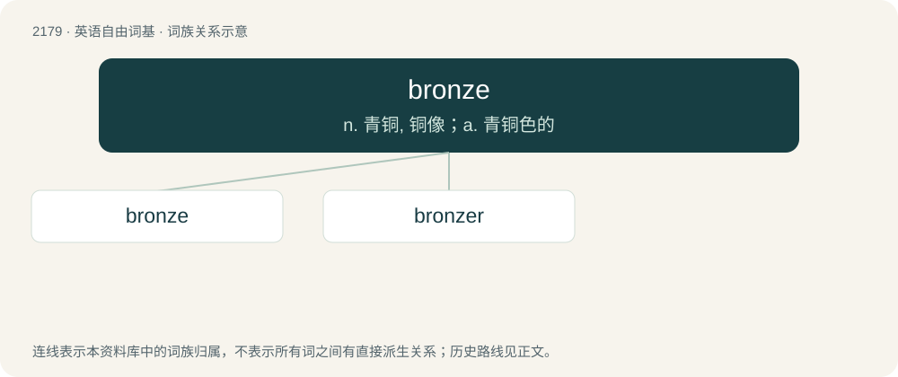

# 2280 · bronze — n. 青铜, 铜像；a. 青铜色的

[总目录](../00_总目录_按常用程度.md)

**类型**：英语自由词基　｜　**来源语言**：见词源记录

## 核心含义与来源

- 核心含义：n. 青铜, 铜像；a. 青铜色的
- 英文含义：A naturally occurring or man-made alloy of copper, usually in combination with tin, but also with one or more other metals.
- 词形：bronze

**来源记录 1**（名词；A naturally occurring or man-made alloy of copper, usually in combination with tin, but also with one or more other metals.）

From French bronze (1511); from Italian bronzo (13th c.), of uncertain origin (q.v.). First use appears c. 1721 in the writings of Matthew Prior (for which, see citation below).

## 词族图

## 单词速览（常用到不常用）

| 单词 | 音标 | 释义 |
|---|---|---|
| [bronze](#w-1) | 英 /bɹɒnz/；美 /bɹɑnz/ | n. 青铜, 铜像；a. 青铜色的 |
| [bronzer](#w-2) | /ˈbrɔnzə(r)/ | n. 古铜色化妆品 |

## 逐词详解

### 1. bronze

**词性**：名词　｜　**音标**：英 /bɹɒnz/；美 /bɹɑnz/

**中文释义**：n. 青铜, 铜像；a. 青铜色的

**英文义项**：A naturally occurring or man-made alloy of copper, usually in combination with tin, but also with one or more other metals. / A reddish-brown colour, the colour of bronze.

**词源与演化**：

From French bronze (1511); from Italian bronzo (13th c.), of uncertain origin (q.v.). First use appears c. 1721 in the writings of Matthew Prior (for which, see citation below).

**例句**：

> She wanted to win the tournament, but had to settle for the bronze after being beaten in the semi-finals.

该用例对应义项：A bronze medal; third place.

### 2. bronzer

**词性**：名词　｜　**音标**：/ˈbrɔnzə(r)/

**中文释义**：n. 古铜色化妆品

**英文义项**：A cosmetic product intended to give the skin a temporary bronzed colour resembling a suntan.

**构词拆分**：bronze + -er

**词源与演化**：

From bronze (“to tan skin”) + -er (agent noun suffix).
