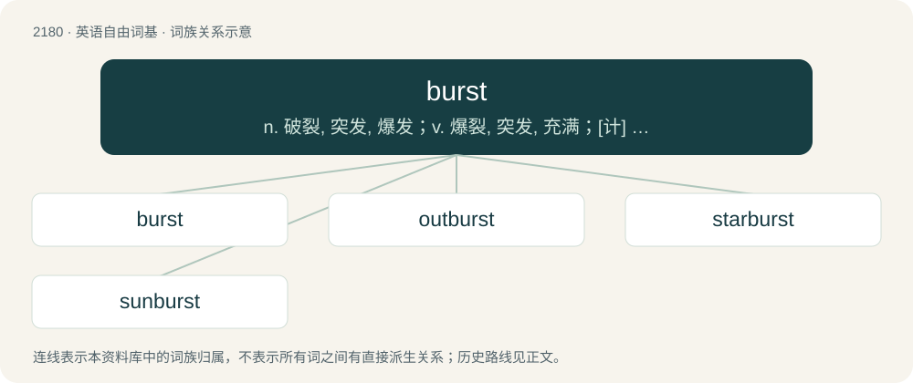

# 2281 · burst — n. 破裂, 突发, 爆发；v. 爆裂, 突发, 充满；\[计\] 二进制位组; 字符组; 脉冲串

[总目录](../00_总目录_按常用程度.md)

**类型**：英语自由词基　｜　**来源语言**：见词源记录

## 核心含义与来源

- 核心含义：n. 破裂, 突发, 爆发；v. 爆裂, 突发, 充满；\[计\] 二进制位组; 字符组; 脉冲串
- 英文含义：To break from internal pressure.
- 词形：burst

**来源记录 1**（动词；To break from internal pressure.）

From Middle English bresten, bersten, from Old English berstan, from Proto-West Germanic \*brestan, from Proto-Germanic \*brestaną, from Proto-Indo-European \*bʰres- (“to burst, break, crack, split, separate”), enlargement of \*bʰreHi- (“to snip, split”). See also West Frisian boarste, Dutch barsten, Danish briste, Swedish brista; also Irish bris (“to break”)). More at brine. Also cognate to debris.

## 词族图

## 单词速览（常用到不常用）

| 单词 | 音标 | 释义 |
|---|---|---|
| [burst](#w-1) | 英 /bɜːst/；美 /bɝst/ | n. 破裂, 突发, 爆发；v. 爆裂, 突发, 充满；\[计\] 二进制位组; 字符组; 脉冲串 |
| [outburst](#w-2) | 英 /ˈaʊ̯tˌbɜːst/；美 /ˈaʊ̯tˌbɝst/ | n. 爆发, 突发, 破裂, 暴乱 |
| [starburst](#w-3) | /ˈstɑːbɜːst/ | n. 星暴; 光芒四射的亮光 |
| [sunburst](#w-4) | /ˈsʌnbəːst/ | n. 阳光突现 |

## 逐词详解

### 1. burst

**词性**：动词　｜　**音标**：英 /bɜːst/；美 /bɝst/

**中文释义**：n. 破裂, 突发, 爆发；v. 爆裂, 突发, 充满；\[计\] 二进制位组; 字符组; 脉冲串

**英文义项**：To break from internal pressure. / To cause to break from internal pressure.

**词源与演化**：

From Middle English bresten, bersten, from Old English berstan, from Proto-West Germanic \*brestan, from Proto-Germanic \*brestaną, from Proto-Indo-European \*bʰres- (“to burst, break, crack, split, separate”), enlargement of \*bʰreHi- (“to snip, split”). See also West Frisian boarste, Dutch barsten, Danish briste, Swedish brista; also Irish bris (“to break”)). More at brine. Also cognate to debris.

**例句**：

> I printed the report on form-feed paper, then burst the sheets.

该用例对应义项：To separate (printer paper) at perforation lines.

### 2. outburst

**词性**：名词　｜　**音标**：英 /ˈaʊ̯tˌbɜːst/；美 /ˈaʊ̯tˌbɝst/

**中文释义**：n. 爆发, 突发, 破裂, 暴乱

**英文义项**：An intense period of activity. / A sudden, often violent expression of emotion

**构词拆分**：By surface analysis, out- + burst

**词源与演化**：

Inherited from Middle English outbersten, outbresten. Cognate with Dutch uitbarsten (“to erupt; burst out”), German ausbersten (“to burst out; erupt”). By surface analysis, out- + burst.

**例句**：

> The man greeted us with an outburst of invective.

该用例对应义项：An intense period of activity.

### 3. starburst

**词性**：名词　｜　**音标**：/ˈstɑːbɜːst/

**中文释义**：n. 星暴; 光芒四射的亮光

**英文义项**：A violent explosion, or the pattern (likened to the shape of a star) supposed to be made by such an explosion. / A symbol similar to an asterisk, but with additional rays: ✺.

**构词拆分**：star + burst

**词源与演化**：

From star + burst.

**例句**：

> The Milky Way will see a starburst in approximately 200,000,000 years.

该用例对应义项：A period in time during which a region of space experiences an unusually high rate of star formation.

### 4. sunburst

**词性**：名词　｜　**音标**：/ˈsʌnbəːst/

**中文释义**：n. 阳光突现

**英文义项**：A figure or shape showing rays radiating from a central point. / A strong outburst of sunlight.

**构词拆分**：sun + burst

**词源与演化**：

From sun + burst.
