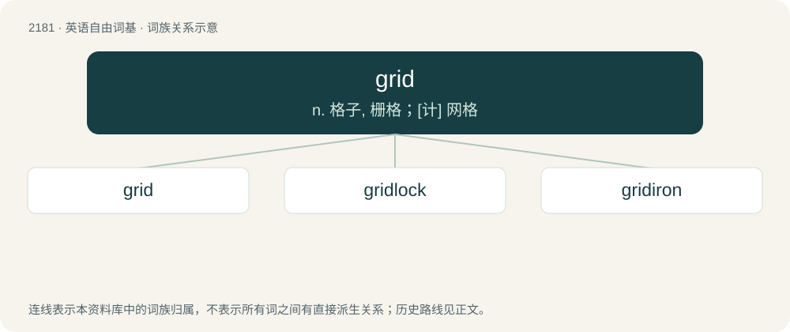

# 2282 · grid — n. 格子, 栅格；\[计\] 网格

[总目录](../00_总目录_按常用程度.md)

**类型**：英语自由词基　｜　**来源语言**：见词源记录

## 核心含义与来源

- 核心含义：n. 格子, 栅格；\[计\] 网格
- 英文含义：A rectangular array of squares or rectangles of equal size, such as in a crossword puzzle.
- 词形：grid

**来源记录 1**（名词；A rectangular array of squares or rectangles of equal size, such as in a crossword puzzle.）

Back-formation or clipping of griddle or gridiron.

## 词族图

## 单词速览（常用到不常用）

| 单词 | 音标 | 释义 |
|---|---|---|
| [grid](#w-1) | /ɡɹɪd/ | n. 格子, 栅格；\[计\] 网格 |
| [gridlock](#w-2) | 英 /ˈɡɹɪdˌlɒk/；美 /ˈɡɹɪdˌlɑk/ | n. 交通全面大堵塞; 僵局；v. （交通等）堵塞 |
| [gridiron](#w-3) | 英 /ˈɡɹɪdaɪən/ | n. 烤架, 格状物 |

## 逐词详解

### 1. grid

**词性**：动词　｜　**音标**：/ɡɹɪd/

**中文释义**：n. 格子, 栅格；\[计\] 网格

**英文义项**：To mark with a grid. / To assign a reference grid to.

**词源与演化**：

Back-formation or clipping of griddle or gridiron.

**例句**：

> On the SAT, to answer a grid-in question, you grid in your answer by filling out the ovals.

该用例对应义项：To enter in a grid.

### 2. gridlock

**词性**：名词　｜　**音标**：英 /ˈɡɹɪdˌlɒk/；美 /ˈɡɹɪdˌlɑk/

**中文释义**：n. 交通全面大堵塞; 僵局；v. （交通等）堵塞

**英文义项**：A condition of total, interlocking traffic congestion on the streets or highways of a crowded city, in which no one can move because everyone is in someone else's way. / On a smaller scale, the situation in which cars enter a signal-controlled intersection too late during the green light cycle, and are unable to clear the intersection (due to congestion in the next block) when the light turns red, thus blocking the cross traffic when it's their turn to go. Repeated at enough intersections, this phenomenon can lead to citywide gridlock.

**构词拆分**：grid + lock

**词源与演化**：

From grid + lock.

**例句**：

> That really would cause some serious gridlock.

### 3. gridiron

**词性**：名词　｜　**音标**：英 /ˈɡɹɪdaɪən/

**中文释义**：n. 烤架, 格状物

**英文义项**：An instrument of torture on which people were secured before being burned by fire. / An iron rack or grate used for broiling meat and fish over coals.

**构词拆分**：grid + iron

**词源与演化**：

From Middle English gridirne, gredirne, gredyron, gredeyron, grydern, grydyryne, girdirin, girderen, variants of Middle English gredire, gredyre, itself an alteration of Middle English gridel (“griddle”). The ending was assimilated to iron, as if from grid + iron, whence grid was later derived.

**例句**：

> Why do gridiron football players wear pads?
