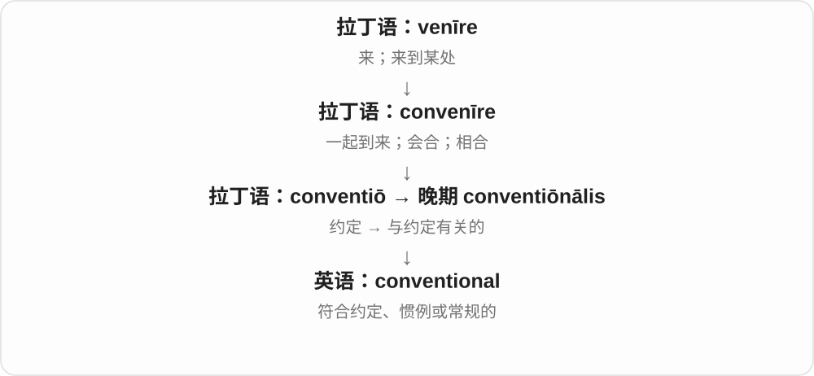
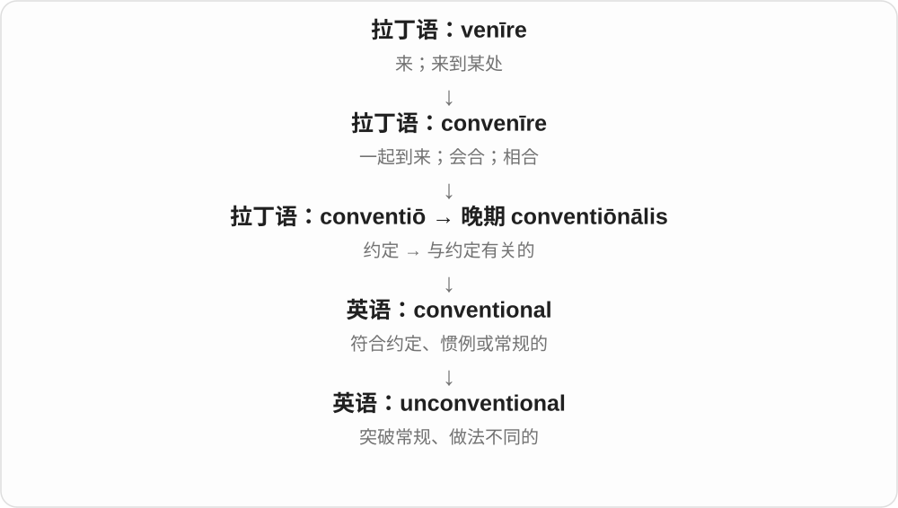

# 2283 · conventional — 约定、惯例形成的常规性质，以及按这种常规行事

[逐词精讲目录](../00_逐词精讲目录.md) · [总目录](../00_总目录_按常用程度.md)

## 核心词根与来源

惯例来自共同使用，不等于自然界唯一可能。常规与非常规也不是好坏的自动判定。

**CONVENTIONAL：依照常规；CONVENTIONALLY：按常规方式**

conventional → conventionally；unconventional 偏离常规。

- **常规、方式与非常规**：conventional · conventionally · unconventional

## 词形与演化规律

convention → conventional；-ly 副词，un- 否定常规性质。

## 单词速览（按词族由简到繁）

同一基础词的相关扩展放在一起，先读基础形式，再读扩展；各组之间优先读常用的。具体词源关系见各词讲解。

| 单词 | 音标 | 核心意思 |
|---|---|---|
| [conventional](#w-1) | /kənˈvenʃənəl/ | 常规的；传统的；遵循惯例的 |
| [conventionally](#w-3) | /kənˈvenʃənəli/，也可弱化为 /kənˈvenʃənli/ | 按惯例、传统地；通常地 |
| [unconventional](#w-2) | /ˌʌnkənˈvenʃənəl/ | 不循常规的；非传统的 |

## 逐词讲解

### 1. conventional — 常规的；传统的；遵循惯例的

**音标**：/kənˈvenʃənəl/

**先抓住这个画面**

大家通常就这么做，这个方案也沿着熟悉的路走，就是 conventional。

**怎么拆**

借自晚期拉丁语 conventiōnālis“与约定有关的”；现代可按 convention（惯例、约定）+ -al 理解。

**怎么变成今天的意思**

可以是中性的常规技术，也可暗示想法守旧、不新颖。conventional wisdom 是普遍接受的看法，不保证它一定正确。

**常见搭配与例句**

a conventional approach；conventional wisdom；conventional methods。

> The team chose a conventional design that was easy to maintain.

团队选择了便于维护的常规设计。

> Her findings challenged conventional wisdom.

她的研究结果挑战了普遍接受的看法。

**别混淆**

common 强调常见；conventional 强调符合习惯、通行模式。traditional 更突出历史传承。

### 2. conventionally — 按惯例、传统地；通常地

**音标**：/kənˈvenʃənəli/，也可弱化为 /kənˈvenʃənli/

**先抓住这个画面**

大家习惯怎么做、怎么理解，就按那个方式来，是 conventionally。它说遵从约定或常规，不是在断言自然规律必然如此。

**怎么拆**

conventional + -ly。convention 接拉丁 convenīre 聚到一起、达成一致等来源；约定、惯例义形成常规的形容词，再成副词。

**怎么变成今天的意思**

**拉丁 convenīre → conventiō 经法语等 → convention**  
聚合、约定；惯例

↓

**conventional + -ly → conventionally**  
依常规、按惯例的方式

conventionally defined 按惯例定义，conventionally produced 按常规方式生产，conventionally attractive 符合传统审美的。含义取决于具体领域的常规。

**常见搭配与例句**

conventionally defined；conventionally produced；conventionally attractive。

> The term is conventionally used in this narrower sense.

这个术语按惯例用于这个较窄的意思。

> The exhibition challenges conventionally accepted ideas of beauty.

展览挑战了传统接受的美的观念。

**别混淆**

conventionally 不等于 universally 所有人、所有地方都一样。常规做法也不因使用这个词就被判定优劣。

### 3. unconventional — 不循常规的；非传统的

**音标**：/ˌʌnkənˈvenʃənəl/

**先抓住这个画面**

别人都按一条熟悉的路线走，你用了另一套做法，这就可以是 unconventional。

**怎么拆**

un-（不）+ conventional（按惯例的）。

**怎么变成今天的意思**

它先说明与常规不同，可以赞赏创新，也可以仅作客观分类。做法新奇不自动证明有效。

**常见搭配与例句**

an unconventional solution；unconventional methods；an unconventional career。

> She found an unconventional way to teach fractions.

她找到了一种不循常规的分数教学方法。

> His career followed an unconventional path.

他的职业经历走了一条不寻常的道路。

**别混淆**

unconventional 是不走常规；illegal 是违法。与众不同并不等于违反法律。

## 这一组要分清什么

conventional 不只表示保守的人，conventionally 也不等于 universal。

## 串起来练习

The unconventional design questioned what was conventionally accepted.

这个非常规设计对传统接受的做法提出了疑问。
