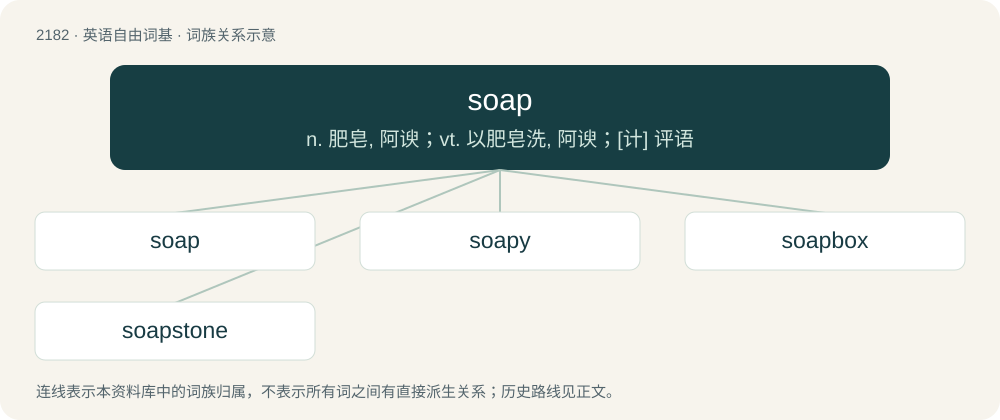

# 2284 · soap — n. 肥皂, 阿谀；vt. 以肥皂洗, 阿谀；\[计\] 评语

[总目录](../00_总目录_按常用程度.md)

**类型**：英语自由词基　｜　**来源语言**：见词源记录

## 核心含义与来源

- 核心含义：n. 肥皂, 阿谀；vt. 以肥皂洗, 阿谀；\[计\] 评语
- 英文含义：A metallic salt derived from a fatty acid, commonly used in cleaning products.
- 词形：soap

**多个词源／构词路径**：同一拼写可能有不同来源；以下按词性和含义分别列出。

**来源记录 1**（名词；A metallic salt derived from a fatty acid, commonly used in cleaning products.）

From Middle English sope, sape, from Old English sāpe (“soap, salve”), from Proto-West Germanic \*saipā, from Proto-Germanic \*saipǭ, from Proto-Indo-European \*seyb-, \*seyp- (“to pour out, drip, trickle, strain”). Cognate with Scots saip, sape (“soap”), Saterland Frisian Seepe (“soap”), West Frisian sjippe (“soap”), Dutch zeep (“soap”), German Low German Seep (“soap”), German Seife (“soap”), Danish sæbe (“soap”), Swedish såpa (“soap”), Norwegian Bokmål såpe (“soap”), Norwegian Nynorsk såpe (“soap”), Faroese sápa (“soap”), Icelandic sápa (“soap”), Finnish saippua (“soap”), Finnish suopa (“soft soap”). Related also to Old English sāp (“amber, resin, pomade, unguent”), Latin sēbum (“tallow, fat, grease”). See seep. Latin sāpō (“soap”) is a borrowing from the Germanic.

**来源记录 2**（名词；thiopental (sodium pentothal)）

Probably an abbreviation of sodium pentothal.

## 词族图

## 单词速览（常用到不常用）

| 单词 | 音标 | 释义 |
|---|---|---|
| [soap](#w-1) | 英 /səʊp/；美 /soʊp/ | n. 肥皂, 阿谀；vt. 以肥皂洗, 阿谀；\[计\] 评语 |
| [soapy](#w-2) | 英 /ˈsəʊpi/；美 /ˈsoʊpi/ | a. 涂着肥皂的, 谄媚的, 圆滑的 |
| [soapbox](#w-3) | /ˈsəʊpbɒks/ | n. 肥皂盒, 临时演说台；a. 街头演说的 |
| [soapstone](#w-4) | 美 /ˈsoʊpˌstoʊn/ | n. 皂石 |

## 逐词详解

### 1. soap

**词性**：名词　｜　**音标**：英 /səʊp/；美 /soʊp/

**中文释义**：n. 肥皂, 阿谀；vt. 以肥皂洗, 阿谀；\[计\] 评语

**英文义项**：A metallic salt derived from a fatty acid, commonly used in cleaning products. / Some other substance, often a detergent or another surfactant, able to mix with both oil and water, used for cleaning.

**词源与演化**：

From Middle English sope, sape, from Old English sāpe (“soap, salve”), from Proto-West Germanic \*saipā, from Proto-Germanic \*saipǭ, from Proto-Indo-European \*seyb-, \*seyp- (“to pour out, drip, trickle, strain”). Cognate with Scots saip, sape (“soap”), Saterland Frisian Seepe (“soap”), West Frisian sjippe (“soap”), Dutch zeep (“soap”), German Low German Seep (“soap”), German Seife (“soap”), Danish sæbe (“soap”), Swedish såpa (“soap”), Norwegian Bokmål såpe (“soap”), Norwegian Nynorsk såpe (“soap”), Faroese sápa (“soap”), Icelandic sápa (“soap”), Finnish saippua (“soap”), Finnish suopa (“soft soap”). Related also to Old English sāp (“amber, resin, pomade, unguent”), Latin sēbum (“tallow, fat, grease”). See seep. Latin sāpō (“soap”) is a borrowing from the Germanic.

**例句**：

> I tried washing my hands with soap, but the stain wouldn't go away.

该用例对应义项：Some other substance, often a detergent or another surfactant, able to mix with both oil and water, used for cleaning.

### 2. soapy

**词性**：形容词　｜　**音标**：英 /ˈsəʊpi/；美 /ˈsoʊpi/

**中文释义**：a. 涂着肥皂的, 谄媚的, 圆滑的

**英文义项**：Resembling soap. / Full of soap.

**构词拆分**：soap + -y

**词源与演化**：

From soap + -y. Compare German Low German sepig (“soapy”), German seifig (“soapy”), Swedish såpig (“soapy”).

**例句**：

> The dishwasher uses hot soapy water to clean the dishes and silverware.

该用例对应义项：Full of soap.

### 3. soapbox

**词性**：名词　｜　**音标**：/ˈsəʊpbɒks/

**中文释义**：n. 肥皂盒, 临时演说台；a. 街头演说的

**英文义项**：A crate for packing soap. / A small platform, being or resembling a literal soapbox, on which a person stands in order to give an impromptu speech or espouse their views.

**构词拆分**：soap + box

**词源与演化**：

From soap + box. The figurative use of the word derives from the fact that soap products in the US used to be commonly transported to stores in large wooden boxes. It used to be common for individuals to give impromptu rally speeches to their neighbors by finding something to stand on like a soapbox.

**例句**：

> Please stop using council meetings as your own personal soapbox.

该用例对应义项：A platform or outlet, such as a media platform, that a person uses to express their opinions.

### 4. soapstone

**词性**：名词　｜　**音标**：美 /ˈsoʊpˌstoʊn/

**中文释义**：n. 皂石

**英文义项**：A soft rock, rich in talc, also containing serpentine and either magnetite, dolomite or calcite. / Synonym of saponite.

**构词拆分**：soap + stone

**词源与演化**：

From soap + stone; so called because the archetypal varieties of the stone resemble soap in multiple ways: their feel, appearance, and carvability. First use appears c. 1681, in the writings of Nehemiah Grew.

**例句**：

> Atuqtuaq is an apprentice at soapstone carving.
