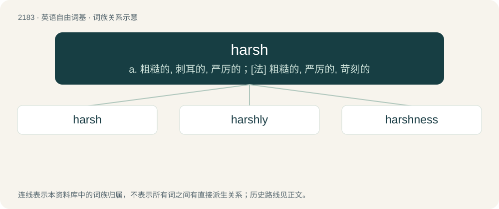

# 2285 · harsh — a. 粗糙的, 刺耳的, 严厉的；\[法\] 粗糙的, 严厉的, 苛刻的

[总目录](../00_总目录_按常用程度.md)

**类型**：英语自由词基　｜　**来源语言**：见词源记录

## 核心含义与来源

- 核心含义：a. 粗糙的, 刺耳的, 严厉的；\[法\] 粗糙的, 严厉的, 苛刻的
- 英文含义：Unpleasantly rough to the touch or other senses.
- 词形：harsh

**来源记录 1**（形容词；Unpleasantly rough to the touch or other senses.）

From Middle English harsk, harisk(e), hask(e), herris. Century derived the term from Old Norse harskr (whence Danish harsk (“rancid”), dialectal Norwegian hersk, Swedish härsk, Swedish härsken); the Middle English Dictionary derives it from that and Middle Low German harsch (“rough”, literally “hairy”) (whence also German harsch), from haer (“hair”), from Old Saxon hār, from Proto-West Germanic \*hār; the Oxford Dictionary of English derives it from Middle Low German alone.

## 词族图

## 单词速览（常用到不常用）

| 单词 | 音标 | 释义 |
|---|---|---|
| [harsh](#w-1) | 英 /ˈhɑːʃ/；美 /ˈhɑɹʃ/ | a. 粗糙的, 刺耳的, 严厉的；\[法\] 粗糙的, 严厉的, 苛刻的 |
| [harshly](#w-2) | 英 /ˈhɑːʃli/ | adv. 粗糙地, 粗暴地, 刺耳地 |
| [harshness](#w-3) | /ˈhɑːʃnis/ | n. 粗糙事物, 刺耳, 严肃 |

## 逐词详解

### 1. harsh

**词性**：形容词　｜　**音标**：英 /ˈhɑːʃ/；美 /ˈhɑɹʃ/

**中文释义**：a. 粗糙的, 刺耳的, 严厉的；\[法\] 粗糙的, 严厉的, 苛刻的

**英文义项**：Unpleasantly rough to the touch or other senses. / Severe or cruel.

**词源与演化**：

From Middle English harsk, harisk(e), hask(e), herris. Century derived the term from Old Norse harskr (whence Danish harsk (“rancid”), dialectal Norwegian hersk, Swedish härsk, Swedish härsken); the Middle English Dictionary derives it from that and Middle Low German harsch (“rough”, literally “hairy”) (whence also German harsch), from haer (“hair”), from Old Saxon hār, from Proto-West Germanic \*hār; the Oxford Dictionary of English derives it from Middle Low German alone.

**用法示例／搭配（非完整句）**：

> harsh decision

该用例对应义项：Severe or cruel.

### 2. harshly

**词性**：副词　｜　**音标**：英 /ˈhɑːʃli/

**中文释义**：adv. 粗糙地, 粗暴地, 刺耳地

**英文义项**：In a harsh manner; severely.

**构词拆分**：harsh + -ly

**词源与演化**：

From harsh + -ly.

**例句**：

> `That's enough!,' he cut in harshly.

该用例对应义项：in a harsh or unkind manner

### 3. harshness

**词性**：名词　｜　**音标**：/ˈhɑːʃnis/

**中文释义**：n. 粗糙事物, 刺耳, 严肃

**英文义项**：The quality of being harsh.

**构词拆分**：harsh + -ness

**词源与演化**：

From Middle English harsknes; equivalent to harsh + -ness.

**例句**：

> I was shocked by the harshness of his tone.
