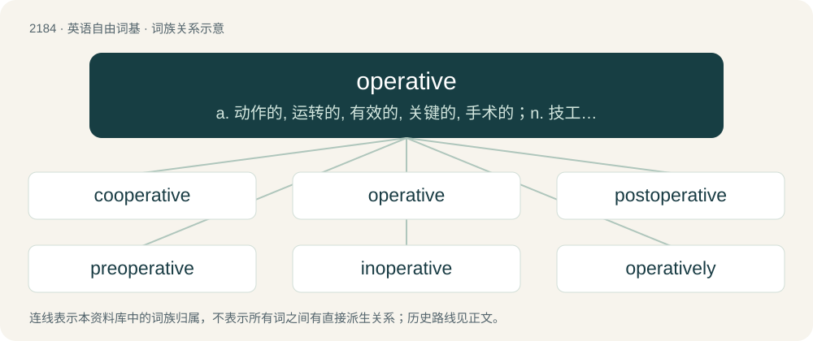

# 2287 · operative — a. 动作的, 运转的, 有效的, 关键的, 手术的；n. 技工, 侦探

[总目录](../00_总目录_按常用程度.md)

**类型**：英语自由词基　｜　**来源语言**：见词源记录

## 核心含义与来源

- 核心含义：a. 动作的, 运转的, 有效的, 关键的, 手术的；n. 技工, 侦探
- 英文含义：Effectual or important.
- 词形：operative

**来源记录 1**（形容词；Effectual or important.）

From Middle English operative, operatyfe, from Middle French operatif (modern French opératif) or its etymon Latin operātīvus. By surface analysis, operate + -ive.

## 词族图

## 单词速览（常用到不常用）

| 单词 | 音标 | 释义 |
|---|---|---|
| [cooperative](#w-1) | 美 /kuˈɑp.ɹətɪv/ | a. 合作的；合作社的 |
| [operative](#w-2) | 英 /ˈɒpəɹətɪv/；美 /ˈɑpəɹətɪv/ | a. 动作的, 运转的, 有效的, 关键的, 手术的；n. 技工, 侦探 |
| [postoperative](#w-3) | 英 /pəʊstˈɒpəɹətɪv/；美 /poʊstˈɑpəɹətɪv/ | a. 手术后的；\[医\] 手术后的 |
| [preoperative](#w-4) | /priːˈɒpərətiv/ | a. 手术前的；\[医\] 手术前的 |
| [inoperative](#w-5) | 英 /ɪnˈɒp(ə)ɹətɪv/；美 /ɪnˈɑp(ə)ɹətɪv/ | a. 不起作用的, 无效力的 |
| [operatively](#w-6) |  | adv. operative的变形 |
| [perioperative](#w-7) | /pɪəˈraɪɒpərətɪv/ | a. \[医\]手术期间的 |
| [intraoperative](#w-8) | /,intrəˈɔpərətiv,-reitiv/ | 外科手术进行时发生(或遇到,采取)的 |

## 逐词详解

### 1. cooperative

**词性**：形容词　｜　**音标**：美 /kuˈɑp.ɹətɪv/

**中文释义**：a. 合作的；合作社的

**英文义项**：Ready to work with another person or in a team; ready to cooperate. / Involving cooperation between individuals or parties.

**构词拆分**：co- + operative

**词源与演化**：

From co- + operative.

**例句**：

> The patient was rarely cooperative, and tended to refuse treatment.

该用例对应义项：Ready to work with another person or in a team; ready to cooperate.

### 2. operative

**词性**：形容词　｜　**音标**：英 /ˈɒpəɹətɪv/；美 /ˈɑpəɹətɪv/

**中文释义**：a. 动作的, 运转的, 有效的, 关键的, 手术的；n. 技工, 侦探

**英文义项**：Effectual or important. / Functional, in working order.

**词源与演化**：

From Middle English operative, operatyfe, from Middle French operatif (modern French opératif) or its etymon Latin operātīvus. By surface analysis, operate + -ive.

**例句**：

> He's usually in a good mood — the operative word there being "usually". Today was a disaster.

该用例对应义项：Effectual or important.

### 3. postoperative

**词性**：形容词　｜　**音标**：英 /pəʊstˈɒpəɹətɪv/；美 /poʊstˈɑpəɹətɪv/

**中文释义**：a. 手术后的；\[医\] 手术后的

**英文义项**：Of, relating to, or occurring in the period after a surgical operation.

**构词拆分**：post- + operative

**词源与演化**：

From post- + operative.

**例句**：

> The postoperative procedure is as follows.

该用例对应义项：Of, relating to, or occurring in the period after a surgical operation.

### 4. preoperative

**词性**：形容词　｜　**音标**：/priːˈɒpərətiv/

**中文释义**：a. 手术前的；\[医\] 手术前的

**英文义项**：Prior to surgery.

**构词拆分**：pre- + operative

**词源与演化**：

From pre- + operative.

### 5. inoperative

**词性**：形容词　｜　**音标**：英 /ɪnˈɒp(ə)ɹətɪv/；美 /ɪnˈɑp(ə)ɹətɪv/

**中文释义**：a. 不起作用的, 无效力的

**英文义项**：Not working or functioning; either idle or broken. / No longer legally binding.

**构词拆分**：in- + operative

**词源与演化**：

From in- + operative.

### 6. operatively

**词性**：副词

**中文释义**：adv. operative的变形

**英文义项**：In an operative manner.

**构词拆分**：operative + -ly

**词源与演化**：

From operative + -ly.

### 7. perioperative

**词性**：形容词　｜　**音标**：/pɪəˈraɪɒpərətɪv/

**中文释义**：a. \[医\]手术期间的

**英文义项**：Relating to the period around an operation, including immediate preoperative preparation and postoperative recovery.

**构词拆分**：peri- + operative

**词源与演化**：

From peri- + operative.

### 8. intraoperative

**词性**：形容词　｜　**音标**：/,intrəˈɔpərətiv,-reitiv/

**中文释义**：外科手术进行时发生(或遇到,采取)的

**英文义项**：Happening during a surgical operation.

**构词拆分**：intra- + operative

**词源与演化**：

From intra- + operative.
