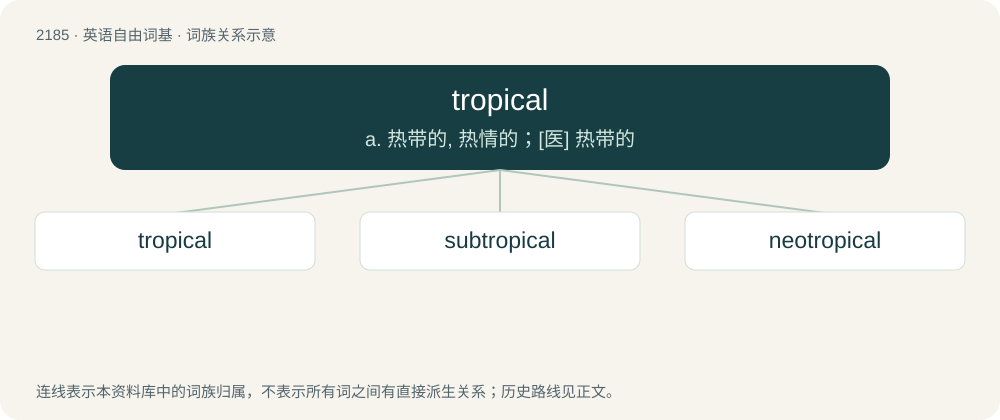

# 2288 · tropical — a. 热带的, 热情的；\[医\] 热带的

[总目录](../00_总目录_按常用程度.md)

**类型**：英语自由词基　｜　**来源语言**：见词源记录

## 核心含义与来源

- 核心含义：a. 热带的, 热情的；\[医\] 热带的
- 英文含义：Of or pertaining to the tropics, the equatorial region between 23 degrees north and 23 degrees south.
- 词形：tropical

**来源记录 1**（形容词；Of or pertaining to the tropics, the equatorial region between 23 degrees north and 23 degrees south.）

From tropic + -al.

## 词族图

## 单词速览（常用到不常用）

| 单词 | 音标 | 释义 |
|---|---|---|
| [tropical](#w-1) | 英 /ˈtɹɒp.ɪ.kəl/；美 /ˈtɹɑ.pɪ.kəl/ | a. 热带的, 热情的；\[医\] 热带的 |
| [subtropical](#w-2) | /sʌbˈtrɒpikl/ | a. 亚热带的；\[医\] 亚热带的 |
| [neotropical](#w-3) | /,niːəjˈtrɔpikəl/ | a. \[地\]新热带区的 |

## 逐词详解

### 1. tropical

**词性**：形容词　｜　**音标**：英 /ˈtɹɒp.ɪ.kəl/；美 /ˈtɹɑ.pɪ.kəl/

**中文释义**：a. 热带的, 热情的；\[医\] 热带的

**英文义项**：Of or pertaining to the tropics, the equatorial region between 23 degrees north and 23 degrees south. / From, or similar to, a hot, humid climate.

**构词拆分**：tropic + -al

**词源与演化**：

From tropic + -al.

**例句**：

> My favorite tropical fruits are pineapples and coconuts.

该用例对应义项：From, or similar to, a hot, humid climate.

### 2. subtropical

**词性**：形容词　｜　**音标**：/sʌbˈtrɒpikl/

**中文释义**：a. 亚热带的；\[医\] 亚热带的

**英文义项**：Pertaining to the regions of the Earth further from the equator than the tropical regions. / Having some characteristics of a tropical cyclone but also some characteristics of an extratropical cyclone.

**构词拆分**：sub- + tropical

**词源与演化**：

From sub- + tropical.

**例句**：

> Sochi has a subtropical climate and temperatures rarely fall below freezing.

### 3. neotropical

**词性**：形容词　｜　**音标**：/,niːəjˈtrɔpikəl/

**中文释义**：a. \[地\]新热带区的

**英文义项**：Occurring in tropical America, i.e. the tropics of the New World.

**构词拆分**：neo- + tropical

**词源与演化**：

From neo- + tropical.
