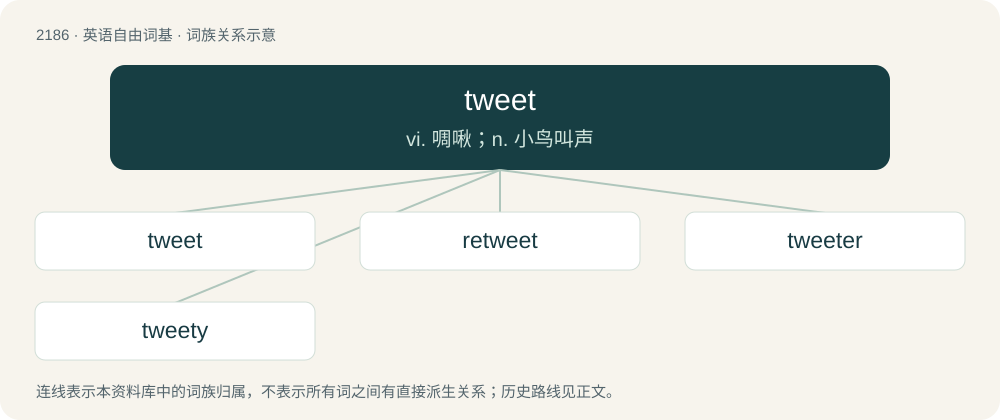

# 2289 · tweet — vi. 啁啾；n. 小鸟叫声

[总目录](../00_总目录_按常用程度.md)

**类型**：英语自由词基　｜　**来源语言**：见词源记录

## 核心含义与来源

- 核心含义：vi. 啁啾；n. 小鸟叫声
- 英文含义：The sound of a bird; any short high-pitched sound or whistle.
- 词形：tweet

**来源记录 1**（名词；The sound of a bird; any short high-pitched sound or whistle.）

Onomatopoeic of the sound made by a bird. Compare twitter. The social media senses evolved from earlier Twitter update, twit (noun), twitter (verb).

## 词族图

## 单词速览（常用到不常用）

| 单词 | 音标 | 释义 |
|---|---|---|
| [tweet](#w-1) | /ˈtwiːt/ | vi. 啁啾；n. 小鸟叫声 |
| [retweet](#w-2) |  | 【英文】To repost or forward another user's message on the microblogging social networking website Twitter. |
| [tweeter](#w-3) | 英 /ˈtwiːtə/；美 /ˈtwitɚ/ | n. 高频扬声器；\[电\] 高频扬声器 |
| [tweety](#w-4) |  | n. 翠迪（卡通形象） |

## 逐词详解

### 1. tweet

**词性**：名词　｜　**音标**：/ˈtwiːt/

**中文释义**：vi. 啁啾；n. 小鸟叫声

**英文义项**：The sound of a bird; any short high-pitched sound or whistle. / An entry posted on the microblogging service Twitter.

**词源与演化**：

Onomatopoeic of the sound made by a bird. Compare twitter. The social media senses evolved from earlier Twitter update, twit (noun), twitter (verb).

**例句**：

> Every grandiose tweet provokes a chorus of gibes, jeers, and sneers.

### 2. retweet

**词性**：动词

**英文义项**：To repost or forward another user's message on the microblogging social networking website Twitter.

**构词拆分**：re- + tweet

**词源与演化**：

From re- + tweet.

### 3. tweeter

**词性**：名词　｜　**音标**：英 /ˈtwiːtə/；美 /ˈtwitɚ/

**中文释义**：n. 高频扬声器；\[电\] 高频扬声器

**英文义项**：An electronic speaker designed to produce high-frequency sound. / One who or that which makes a tweeting noise.

**构词拆分**：tweet + -er

**词源与演化**：

From to tweet + -er.

### 4. tweety

**词性**：形容词

**中文释义**：n. 翠迪（卡通形象）

**英文义项**：Characterised by tweets (in various senses).

**构词拆分**：tweet + -y

**词源与演化**：

From tweet + -y.
