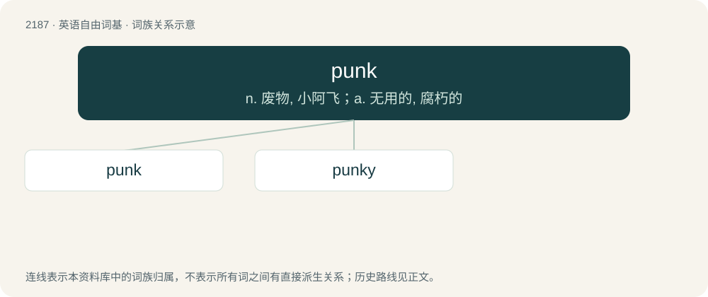

# 2290 · punk — n. 废物, 小阿飞；a. 无用的, 腐朽的

[总目录](../00_总目录_按常用程度.md)

**类型**：英语自由词基　｜　**来源语言**：见词源记录

## 核心含义与来源

- 核心含义：n. 废物, 小阿飞；a. 无用的, 腐朽的
- 英文含义：A passive or effeminate homosexual man.
- 词形：punk

**多个词源／构词路径**：同一拼写可能有不同来源；以下按词性和含义分别列出。

**来源记录 1**（名词；A passive or effeminate homosexual man.）

Uncertain. Possibly from punk (“rotten wood dust used as tinder”), attested since 1678, to anything worthless (attested since 1869) and then to any undesirable person (since 1908). The relatively tame 21st century usage of punk (“prank”, verb) was popularized by the American television show Punk'd (2003).

**来源记录 2**（名词；Any material used as tinder for lighting fires, such as agaric, dried wood, or touchwood, but especially wood altered by certain fungi.）

Unclear; first attested circa 1680 in writings about Native American practices, probably from Unami punkw (“dust”), though it has also been suggested it could be an alteration of spunk (“tinder”) (compare funk (“rotten wood”)).

## 词族图

## 单词速览（常用到不常用）

| 单词 | 音标 | 释义 |
|---|---|---|
| [punk](#w-1) | /ˈpʌŋk/ | n. 废物, 小阿飞；a. 无用的, 腐朽的 |
| [punky](#w-2) | 英 /ˈpʌŋki/；美 /ˈpʌŋki/ | a. 含火绒（或朽木）的; 松软的; 有弹性的; 闷烧的 |

## 逐词详解

### 1. punk

**词性**：名词　｜　**音标**：/ˈpʌŋk/

**中文释义**：n. 废物, 小阿飞；a. 无用的, 腐朽的

**英文义项**：A passive or effeminate homosexual man. / A boy who accompanies a hobo, especially as used for sex.

**词源与演化**：

Uncertain. Possibly from punk (“rotten wood dust used as tinder”), attested since 1678, to anything worthless (attested since 1869) and then to any undesirable person (since 1908). The relatively tame 21st century usage of punk (“prank”, verb) was popularized by the American television show Punk'd (2003).

**例句**：

> Because he was so weak, Vinny soon became Tony's punk.

该用例对应义项：A man forced or coerced into a homosexual relationship, especially in prison.

### 2. punky

**词性**：形容词　｜　**音标**：英 /ˈpʌŋki/；美 /ˈpʌŋki/

**中文释义**：a. 含火绒（或朽木）的; 松软的; 有弹性的; 闷烧的

**英文义项**：Of or pertaining to punk (touchwood); rotted or soft. / Of or pertaining to the punk subculture.

**构词拆分**：punk + -y

**词源与演化**：

From punk + -y.

**用法示例／搭配（非完整句）**：

> a punky hairstyle

该用例对应义项：Of or pertaining to the punk subculture.
