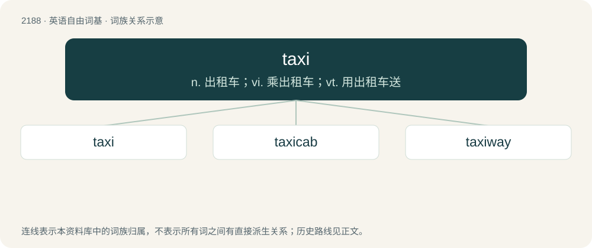

# 2291 · taxi — n. 出租车；vi. 乘出租车；vt. 用出租车送

[总目录](../00_总目录_按常用程度.md)

**类型**：英语自由词基　｜　**来源语言**：见词源记录

## 核心含义与来源

- 核心含义：n. 出租车；vi. 乘出租车；vt. 用出租车送
- 英文含义：A vehicle that may be hired for single journeys by members of the public, particularly one with an automated meter to calculate the fare.
- 词形：taxi

**来源记录 1**（名词；A vehicle that may be hired for single journeys by members of the public, particularly one with an automated meter to calculate the fare.）

Shortened from taximeter cab, taximeter (“automatic meter that records distance and fare”) from French taximètre, from German Taxameter (whence also English taxameter), coined from Medieval Latin taxa (“tax, charge”). More at tax, task. The aviation sense originally derived from a slang term for training aircraft used for practicing ground operations, which were said to drive around the airfield like a taxicab, and subsequently applied to all aircraft ground movements.

## 词族图

## 单词速览（常用到不常用）

| 单词 | 音标 | 释义 |
|---|---|---|
| [taxi](#w-1) | 英 /ˈtæksi/ | n. 出租车；vi. 乘出租车；vt. 用出租车送 |
| [taxicab](#w-2) | 英 /ˈtæksikæb/；美 /ˈtæksiˌkæb/ | n. 出租车 |
| [taxiway](#w-3) | /ˈtæksiwei/ | n. 滑行道 |

## 逐词详解

### 1. taxi

**词性**：名词　｜　**音标**：英 /ˈtæksi/

**中文释义**：n. 出租车；vi. 乘出租车；vt. 用出租车送

**英文义项**：A vehicle that may be hired for single journeys by members of the public, particularly one with an automated meter to calculate the fare. / The movement of an aircraft across an airport's surface under its own power; a phase of aircraft operation involving this movement.

**词源与演化**：

Shortened from taximeter cab, taximeter (“automatic meter that records distance and fare”) from French taximètre, from German Taxameter (whence also English taxameter), coined from Medieval Latin taxa (“tax, charge”). More at tax, task. The aviation sense originally derived from a slang term for training aircraft used for practicing ground operations, which were said to drive around the airfield like a taxicab, and subsequently applied to all aircraft ground movements.

**例句**：

> Seat belts must be kept fastened during taxi, takeoff, turbulence, and landing.

该用例对应义项：The movement of an aircraft across an airport's surface under its own power; a phase of aircraft operation involving this movement.

### 2. taxicab

**词性**：名词　｜　**音标**：英 /ˈtæksikæb/；美 /ˈtæksiˌkæb/

**中文释义**：n. 出租车

**英文义项**：Synonym of taxi, a vehicle available for public hire for single journeys, particularly one using a taximeter to automate fare calculation.

**构词拆分**：taxi + cab

**词源与演化**：

Shortened from taximeter cab, equivalent to taxi + cab.

**例句**：

> Excuse me, where is the taxicab stand?

### 3. taxiway

**词性**：名词　｜　**音标**：/ˈtæksiwei/

**中文释义**：n. 滑行道

**英文义项**：A road or path within an airport designated for the taxiing of aircraft connecting the runways with ramps, hangars, terminals and other facilities.

**构词拆分**：taxi + way

**词源与演化**：

From taxi + way.
