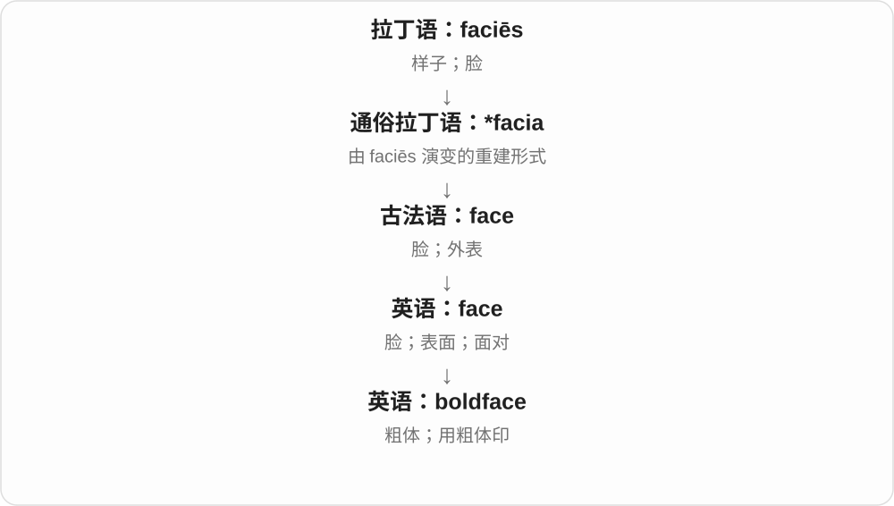

# 2294 · bold — 有胆量、冒失，以及视觉醒目与字体粗重

[逐词精讲目录](../00_逐词精讲目录.md) · [总目录](../00_总目录_按常用程度.md)

## 核心词根与来源

人格、行动与设计共享强烈、显著的感觉。评价是否正面，要随对象和语气判断。

**BOLD：敢于行动，或强烈地引起注意**

bold → boldly、boldness；embolden 使变大胆；boldface 看粗体字。

- **性质、方式与状态**：bold · boldly · boldness
- **使变大胆与字体**：embolden · boldface

## 词形与演化规律

古英语 bald／beald → bold；-ly、-ness；em- + bold + -en 使变大胆。

## 单词速览（按词族由简到繁）

同一基础词的相关扩展放在一起，先读基础形式，再读扩展；各组之间优先读常用的。具体词源关系见各词讲解。

| 单词 | 音标 | 核心意思 |
|---|---|---|
| [bold](#w-1) | 英 /bəʊld/；美 /boʊld/ | 大胆的、勇敢的；醒目的；粗体的；冒失放肆的 |
| [boldly](#w-2) | 英 /ˈbəʊldli/；美 /ˈboʊldli/ | 大胆地；醒目、鲜明地 |
| [boldness](#w-3) | 英 /ˈbəʊldnəs/；美 /ˈboʊldnəs/ | 大胆、勇气；冒失；醒目、粗重程度 |
| [embolden](#w-5) | 英 /ɪmˈbəʊldən/；美 /ɪmˈboʊldən/，也读 /em-/ | 使更大胆、鼓起勇气；使文字加粗 |
| [boldface](#w-6) | /ˈbəʊldfeɪs/ | 粗体；用粗体印 |

## 逐词讲解

### 1. bold — 大胆的、勇敢的；醒目的；粗体的；冒失放肆的

**音标**：英 /bəʊld/；美 /boʊld/

**先抓住这个画面**

人敢迈出去，是 bold；颜色、字形一下跳进眼睛，也能用 bold。是夸勇气还是嫌冒失，要看说话人的态度。

**怎么拆**

承接古英语 bald、beald 等大胆、强壮相关形式。视觉上强烈、显眼的扩展再进入粗体字用法；不是 bald 秃头的现代拼写变化。

**怎么变成今天的意思**

**古英语 bald／beald → 中古英语 bold → bold**  
勇敢、有胆量；也可冒失、放肆

↓

**视觉性质的扩展**  
醒目、强烈；字体笔画粗重

↓

**相关词尾与动词形成**  
boldly、boldness；embolden 使更大胆、鼓起勇气

a bold decision 大胆决定，bold colours 醒目颜色，bold type 粗体字，in bold 用粗体。动词 bold 也可直接说把文字加粗。

**常见搭配与例句**

a bold decision；bold colours；in bold。

> It was a bold decision to open the shop there.

在那里开店是个大胆决定。

> Please put the title in bold.

请把标题设为粗体。

**别混淆**

bold 不固定褒义，也不保证判断正确。字体 bold 表笔画粗重，和把字号变大、用大写都不是同一个操作。

### 2. boldly — 大胆地；醒目、鲜明地

**音标**：英 /ˈbəʊldli/；美 /ˈboʊldli/

**先抓住这个画面**

人行动时不畏缩，是 boldly；文字、图形设计得显眼，也能这样说。它把 bold 的不同性质放到动作、呈现方式上。

**怎么拆**

bold + -ly，古英语 bealdlīċe、中古英语 boldely 等已有对应副词，现代形态规则清楚。

**怎么变成今天的意思**

**古英语 bald／beald → 中古英语 bold → bold**  
勇敢、有胆量；也可冒失、放肆

↓

**视觉性质的扩展**  
醒目、强烈；字体笔画粗重

↓

**bold + -ly → boldly**  
以大胆、鲜明或醒目的方式

speak boldly 大胆发言，boldly designed 设计鲜明，boldly printed 醒目印刷。

**常见搭配与例句**

speak boldly；boldly designed；boldly printed。

> She spoke boldly about the need for change.

她大胆谈了改革的必要性。

> The warning was boldly printed on the cover.

警告醒目地印在封面上。

**别混淆**

boldly 不等于 loudly 大声地。声音可以小却表达大胆，字样醒目也不一定全用大写。

### 3. boldness — 大胆、勇气；冒失；醒目、粗重程度

**音标**：英 /ˈbəʊldnəs/；美 /ˈboʊldnəs/

**先抓住这个画面**

把敢做、显眼这类性质当成一个对象来评价，就是 boldness。设计师可谈颜色的 boldness，评论者也可谈决定的胆量。

**怎么拆**

bold + -ness，中古英语已有 boldnesse。继承人的胆量和视觉显著程度等多种意义。

**怎么变成今天的意思**

**古英语 bald／beald → 中古英语 bold → bold**  
勇敢、有胆量；也可冒失、放肆

↓

**视觉性质的扩展**  
醒目、强烈；字体笔画粗重

↓

**bold + -ness → boldness**  
胆量、冒失或视觉粗重醒目这一性质

the boldness of the plan 计划的大胆，admire her boldness 欣赏她的勇气，the boldness of the lettering 字体的粗重醒目程度。

**常见搭配与例句**

the boldness of；admire someone’s boldness。

> The boldness of the proposal surprised the committee.

提案的大胆让委员会感到意外。

> The designer adjusted the boldness of the lettering.

设计师调整了字样的粗重程度。

**别混淆**

boldness 不自动等于 wisdom 明智；勇敢尝试与结果是否正确，是两种评价。

### 4. embolden — 使更大胆、鼓起勇气；使文字加粗

**音标**：英 /ɪmˈbəʊldən/；美 /ɪmˈboʊldən/，也读 /em-/

**先抓住这个画面**

一次成功让人下一步敢做更多，就是 embolden。它不保证行为值得鼓励，敌手也可能因没人制止而更放肆。

**怎么拆**

em- 是 en- 在 b 前的同化形式，与 bold、-en 合作形成使变大胆的动词；历史上也有 enbold、embold 等较短形式。

**怎么变成今天的意思**

**古英语 bald／beald → 中古英语 bold → bold**  
勇敢、有胆量；也可冒失、放肆

↓

**视觉性质的扩展**  
醒目、强烈；字体笔画粗重

↓

**em- + bold + -en → embolden**  
使更大胆；视觉上也可使文字加粗

embolden someone to act 使某人更敢行动，emboldened by success 因成功而壮胆，embolden the heading 把标题加粗。

**常见搭配与例句**

embolden someone to；emboldened by；embolden the heading。

> The early success emboldened the team to try a harder design.

最初的成功让团队更敢尝试困难设计。

> The lack of a response only emboldened the bullies.

没有人回应反而让欺凌者更加放肆。

**别混淆**

encourage 常有鼓励、促成意味；embolden 更突出变得敢做。坏行为被 embolden 也很常见，不自动是正面赞美。

### 5. boldface — 粗体；用粗体印

**音标**：/ˈbəʊldfeɪs/

**先抓住这个画面**

一行字中有几个词笔画特别粗，像声音突然加重，那就是 boldface。

**怎么拆**

bold（粗、醒目）+ face（字的面貌），印刷领域的英语合成。

**怎么变成今天的意思**

face 可指字模和字形的外观，bold 描述笔画重量。作动词就是将内容设为粗体。

**常见搭配与例句**

in boldface；boldface type；boldface a heading。

> The key terms appear in boldface.

关键词以粗体显示。

> Please boldface the section headings.

请把各节标题设为粗体。

**别混淆**

bold 通常可直接说粗体；boldface 更明确指出印刷字样，不是“脸皮厚”。

## 这一组要分清什么

bold 不等于 bald；粗体不等于大写；embolden 可使坏行为更放肆。

## 串起来练习

The success emboldened her to propose a bold design with boldface headings.

成功让她更敢提出大胆设计，标题还用了粗体。
